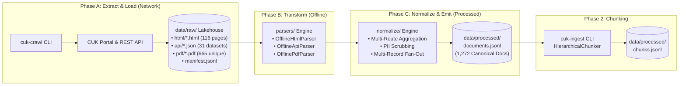

# CUK RAG Assistant

> High-performance Retrieval-Augmented Generation (RAG) assistant for the Central University of Kashmir (`https://www.cukashmir.ac.in`).

---

## 1. Project Status & Roadmap

| Phase | Milestone | Subsystem | Status |
| :---: | :--- | :--- | :---: |
| **Phase 0** | Baseline Specs & API Reverse Engineering | 81-endpoint mapping, route discovery, schemas | ✅ **Completed** |
| **Phase 1** | Ingestion & Document Lake Normalization (ELT) | `cuk-crawl` + `cuk-parse` (HTML, API, PDF lakehouse) | ✅ **Completed** |
| **Phase 2** | Document Parsing & Hierarchical Chunking | `HierarchicalChunker`, parent-child linking, `cuk-ingest` | 🔄 **In Progress** |
| **Phase 3** | Hybrid Storage, Vector Indexing & Reranking | FastEmbed (384d), LanceDB (Tantivy BM25 + RRF), FlashRank | 🔄 **In Progress** |
| **Phase 4** | LLM Pool, Guardrails & Citation Grounding | Gemini Flash + Groq Llama 3.3, Llama Guard 3, Citation Verifier | ✅ **Completed** |
| **Phase 5** | Multi-Turn Memory & Serving Interfaces | SQLite WAL session store, slot router, FastAPI / Chainlit UI | 🔄 **In Progress** |
| **Phase 6** | Observability, Telemetry & Golden Evaluation | OpenTelemetry / Logfire, 12 failure tags, golden eval suite | 🔄 **In Progress** |

---

## 2. Ingestion Architecture (Extract-Load-Transform)

The ingestion pipeline follows an **ELT (Extract-Load-Transform)** architecture:



---

## 3. Project Layout

```
cuk-rag-chatbot/
├── cuk_assistant/              # Core application package
│   ├── core/                   # Config, CachedClient, logging, Protocol interfaces
│   ├── schemas/                # Pure Pydantic v2 schemas (Document, Chunks, Metadata)
│   ├── ingestion/              # [Phases 1 & 2] Ingestion & Parsing Subsystem
│   │   ├── collector/          # [Phase A] Route walker, async client, raw manifest writer
│   │   ├── parsers/            # [Phase B] Offline HTML, PDF, and API parsers
│   │   ├── normalize/          # [Phase C] PII scrubber, multi-route aggregator, pipeline
│   │   ├── chunking/           # Hierarchical parent-child chunking engine
│   │   └── cli/                # CLI entrypoints (cuk-crawl, cuk-parse, cuk-ingest)
│   ├── retrieval/              # [Phase 3] FastEmbed, LanceDB hybrid store, FlashRank
│   ├── guardrails/             # [Phase 4] Input guard, output guard, citation verifier
│   ├── llm/                    # [Phase 4] Gemini + Groq provider pool & circuit breaker
│   ├── agent/                  # [Phase 5] SQLite WAL session memory, slot router
│   ├── pipeline/               # [Phase 5] High-level RAG workflow orchestrator
│   └── observability/          # [Phase 6] Telemetry protocols, Logfire/Langfuse exporters
│
├── data/                       # Data lakehouse (git-ignored)
│   ├── raw/                    # Immutable raw lake (html/, api/, pdf/, manifest.jsonl)
│   └── processed/              # Normalized canonical lake (nodes.jsonl, documents.jsonl, chunks.jsonl)
│
├── docs/                       # Technical specifications & documentation
│   ├── ingestion_pipeline/     # Ingestion subsystem deep-dives (collector, parsers, normalization)
│   ├── architecture.md         # Full C4 architecture & subsystem specifications
│   ├── requirements.md         # System requirements & failure taxonomy
│   ├── api_contracts.md        # Reverse-engineered API endpoint signatures
│   └── project_status.md       # Live tracking checklist
│
├── evals/                      # Golden evaluation datasets & regression suites
└── tests/                      # Pytest unit & integration test suites
```

---

## 4. Operational CLI Commands

### 1. Raw Crawl (`cuk-crawl`)
```bash
# Full crawl (HTML, APIs, and PDFs)
uv run cuk-crawl crawl

# Fast crawl (HTML and APIs, skipping PDF binary downloads)
uv run cuk-crawl crawl --skip-pdf

# Re-crawl with forced cache bypass
uv run cuk-crawl crawl --force

# Sitemap discovery only (data/raw/nodes.jsonl)
uv run cuk-crawl build-nodes
```

### 2. Offline Parser Pipeline (`cuk-parse`)
```bash
# Normalize raw lake assets into data/processed/documents.jsonl
uv run cuk-parse

# Parse with custom concurrency
uv run cuk-parse --workers 16
```

### 3. Chunking & Ingestion (`cuk-ingest`)
```bash
# Stream documents.jsonl through HierarchicalChunker into chunks.jsonl
uv run cuk-ingest
```

---

## 5. Verification & Testing

```bash
# Code style and formatting checks
uv run ruff check cuk_assistant/ tests/
uv run ruff format --check cuk_assistant/ tests/

# Targeted ingestion unit tests
uv run pytest tests/unit/test_offline_parser.py tests/unit/test_metadata_normalizer.py tests/unit/test_reconciliation.py -v

# Acceptance test suite
uv run pytest tests/unit/test_acceptance.py -v

# Full project test suite (500+ tests)
uv run pytest tests/unit/ -q
```

---

## 6. Documentation References

- [Ingestion Pipeline Overview](file:///home/mihawk/ubuntu_data/projects/cuk-rag-chatbot/docs/ingestion_pipeline/README.md)
  - [Phase A: Collector Deep-Dive](file:///home/mihawk/ubuntu_data/projects/cuk-rag-chatbot/docs/ingestion_pipeline/collector.md)
  - [Phase B: Offline Parsers Deep-Dive](file:///home/mihawk/ubuntu_data/projects/cuk-rag-chatbot/docs/ingestion_pipeline/parsers.md)
  - [Phase C: Normalization & Aggregation](file:///home/mihawk/ubuntu_data/projects/cuk-rag-chatbot/docs/ingestion_pipeline/normalization.md)
- [System Architecture Specification](file:///home/mihawk/ubuntu_data/projects/cuk-rag-chatbot/docs/architecture.md)
- [System Requirements & Failure Attribution](file:///home/mihawk/ubuntu_data/projects/cuk-rag-chatbot/docs/requirements.md)
- [API Reverse Engineering Findings](file:///home/mihawk/ubuntu_data/projects/cuk-rag-chatbot/docs/api_contracts.md)
