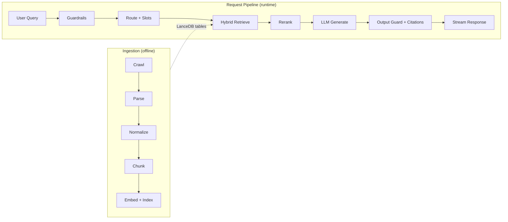

# CUK RAG Assistant

**A production-grade retrieval-augmented generation chatbot for the Central University of Kashmir.**

Scrapes the university website, ingests academic documents into a hybrid vector store, and answers student queries with **citation-grounded, PII-scrubbed, hallucination-checked** responses — all behind a streaming chat interface.

---

## Highlights

- **Hybrid retrieval** — LanceDB dense vectors + Tantivy BM25 fused via Reciprocal Rank Fusion, reranked by a cross-encoder
- **Citation verification** — every quoted snippet is checked verbatim against retrieved chunks; ungrounded claims are redacted before reaching the user
- **Circuit-breaker LLM failover** — Google Gemini primary, Groq fallback, with per-provider automatic recovery
- **Faceted slot filling** — interactive disambiguation chips when mandatory parameters (program, batch, semester) are missing
- **PII scrubbing** — Indian phone numbers, Aadhaar IDs, and student marks are redacted from all outputs
- **Dependency injection** — every component is a Protocol; new adapters register via decorators with zero pipeline changes
- **12-diagnostic failure attribution** — every degraded response is tagged with a canonical code and remediation hint
- **Docker multi-stage build** — ONNX models pre-warmed in the builder stage for zero cold-start latency

---

## Architecture



```
cuk_assistant/
├── core/           protocols · factory · registry · config
├── ingestion/      crawl · parse · normalize · chunk · embed · index
├── pipeline/       orchestrator (the request-flow hub)
├── agent/          router · slot filler · session store
├── guardrails/     input guard · output guard · citation verifier
├── retrieval/      LanceDB store · hybrid coordinator · FlashRank reranker
├── llm/            Gemini client · Groq client · circuit-breaker pool
├── api/            FastAPI REST + SSE endpoints
├── ui/             Chainlit web app
├── schemas/        Pydantic v2 data models
├── observability/  telemetry sinks · 12-code failure attribution
└── evals/          golden dataset evaluation harness
```

---

## Walkthrough: One Query, Every Pipeline Step

Here's what happens when a student asks **"What is the syllabus of DBMS?"** — a query that exercises the full pipeline end to end.

### Turn 1: Initial query

```
User: What is the syllabus of DBMS?
```

**Step 1 — Input Guardrails**

The `InputGuard` runs two local checks in under 1ms:

| Check | Method | Result |
|-------|--------|--------|
| Domain classification | Regex: `syllabus` keyword matches in-domain pattern | ✅ In domain |
| Prompt-injection scan | Regex: no injection patterns detected | ✅ Safe |

**Step 2 — Session Memory**

`SQLiteSessionStore` (WAL mode) creates a session, retrieves the last 4 turns (empty — first message), and persists the user message.

**Step 3 — Intent Routing + Slot Filling**

The `AdaptiveRouter` classifies the query:

1. `detect_academic_intent()` — `syllabus` keyword matches → intent = `SYLLABUS`
2. `extract_slots()` — `dbms` found in `KNOWN_COURSE_PROGRAM_MAP` → infers `program = "B.Tech CSE"` and `course_title = "Database Management Systems"`
3. `get_mandatory_slots(SYLLABUS)` → required: `["program", "batch_year", "semester"]`
4. Missing slots: `["batch_year", "semester"]` (program was inferred from course title)

The orchestrator emits a `slot_prompt` event with interactive chips:

```
┌─────────────────────────────────────────┐
│  Which admission batch or regulation    │
│  cohort year?                            │
│                                         │
│  [ 2024 (NEP) ]  [ 2023 ]  [ 2022 ]     │
│  [ 2021 ]       [ 2020 ]                │
└─────────────────────────────────────────┘
```

> The assistant doesn't ask for `program` — it was inferred from the course name "DBMS" → B.Tech CSE.

### Turn 2: User selects batch year

```
User clicks: 2024 (NEP)
```

The `on_slot_selected` callback merges `batch_year = "2024"` into session slots and re-dispatches the query. The slot filler re-evaluates — `semester` is still missing — and emits another chip prompt:

```
┌─────────────────────────────────────────┐
│  Which semester syllabus do you need?    │
│                                         │
│  [ Sem 1 ]  [ Sem 2 ]  [ Sem 3 ]       │
│  [ Sem 4 ]  [ Sem 5 ]  [ Sem 6 ]       │
│  [ Sem 7 ]  [ Sem 8 ]                   │
└─────────────────────────────────────────┘
```

### Turn 3: User selects semester — all slots complete

```
User clicks: Semester 4
```

Now `session_slots = {program: "B.Tech CSE", batch_year: "2024", semester: "Semester 4"}`. The slot filler detects all mandatory slots are filled and builds a metadata filter:

```sql
doc_type == 'syllabus' AND program == 'B.Tech CSE' AND batch_year == '2024' AND semester == 'Semester 4'
```

**Step 4 — Hybrid Retrieval**

`HybridRetrievalCoordinator.retrieve()` executes:

1. `FastEmbedAdapter.embed_query("What is the syllabus of DBMS?")` → 384-dim vector
2. `LanceDBStore.hybrid_search()` — dense cosine (IVF-PQ) + BM25 (Tantivy) fused via RRF(K=60) → 30 candidates
3. If scoped search returns 0 results, auto-relaxes to global search (scope fallback)
4. `FlashRankReranker.rerank()` — ms-marco-TinyBERT cross-encoder rescores all 30 → top 5
5. Parent context expansion — each candidate's parent section text is attached for richer LLM context

**Step 5 — LLM Generation**

`LLMProviderPool.generate_answer()` tries Gemini first:

| Provider | Circuit state | Result |
|----------|--------------|--------|
| Google Gemini (`gemini-flash-latest`) | CLOSED (healthy) | ✅ Returns `AnswerWithCitations` |

If Gemini had returned a 429, the circuit breaker would trip OPEN, and Groq would be tried automatically:

```
Gemini 429 → CircuitBreaker trips OPEN (60s cooloff) → Groq fallback → ✅ Success
```

The LLM returns:

```python
AnswerWithCitations(
    direct_answer="The B.Tech CSE Semester 4 syllabus includes Database Management Systems covering ER modeling, SQL, normalization, transaction management, and indexing. The course carries 4 credits with 3 lecture hours and 1 tutorial per week...",
    quoted_snippets=["The course carries 4 credits with 3 lecture hours", "ER modeling, SQL, normalization, transaction management"],
    citation_chunk_ids=["doc_abc::c5", "doc_abc::c8"],
    confidence_score=0.92,
)
```

**Step 6 — Citation Verification**

`VerbatimCitationVerifier` normalizes each quoted snippet (collapse whitespace, lowercase) and checks if it appears as a substring of any retrieved chunk's text:

```
Snippet: "the course carries 4 credits with 3 lecture hours"
Context: "...the course carries 4 credits with 3 lecture hours and 1 tutorial..."
→ ✅ Grounded (found verbatim in chunk doc_abc::c5)

Snippet: "ER modeling, SQL, normalization, transaction management"
Context: "...topics include ER modeling, SQL, normalization, transaction management, and indexing..."
→ ✅ Grounded (found verbatim in chunk doc_abc::c8)
```

If a snippet were NOT found, it would be replaced with `[UNVERIFIED CLAIM REDACTED]` in the output.

**Step 7 — Output Guardrails**

| Check | What it does | Result |
|-------|-------------|--------|
| PII scrub | Redact phones (`[REDACTED_PHONE]`), Aadhaar (`[REDACTED_ID]`), marks (`[REDACTED_MARKS]`) | ✅ No PII found |
| Safety scan | Regex: toxicity / hate speech / defamation patterns | ✅ Safe |

**Step 8 — Citation Cards**

The orchestrator builds `CitationCard` objects from retrieved chunks, each with document title, source URL, page number, section heading, and the verbatim quoted snippet.

**Step 9 — Stream + Persist**

Tokens are streamed to the client one by one via SSE. Citation cards are emitted as side-panel elements. The full response is persisted to SQLite. The turn is wrapped in telemetry spans:

```
[span] input_guard        0.3ms
[span] adaptive_router    1.2ms
[span] hybrid_retrieve   18.5ms
[span] generate_answer 1240.0ms
[span] citation_verify    0.8ms
[span] output_guard       0.5ms
Total latency:          1261.3ms
```

The user sees:

```
The B.Tech CSE Semester 4 syllabus includes Database Management
Systems covering ER modeling, SQL, normalization, transaction
management, and indexing. The course carries 4 credits with 3
lecture hours and 1 tutorial per week...

📚 [1] B.Tech CSE Syllabus 2022 (p. 5)     ← side-panel citation
📚 [2] Course Outlines (p. 12)             ← side-panel citation

👍 Helpful  👎 Inaccurate                   ← feedback buttons
```

---

## Tech Stack

| Layer | Technology | Why |
|-------|-----------|-----|
| API | FastAPI + SSE | Async REST + real-time streaming |
| UI | Chainlit | Chat-native web framework |
| Vector store | LanceDB | Embedded hybrid (dense + sparse) with Arrow columnar format |
| Full-text | Tantivy (BM25) | Embedded lexical search fused with dense via RRF |
| Embeddings | FastEmbed (BGE-small-en-v1.5) | Local ONNX CPU, 384-dim, sub-10ms |
| Reranker | FlashRank (ms-marco-TinyBERT) | Cross-encoder, ~3ms per query |
| LLM | Google Gemini → Groq fallback | Circuit-breaker failover, zero-downtime |
| Session | SQLite (WAL) | High-concurrency conversation memory |
| Telemetry | Logfire / Langfuse / Phoenix | Auto-selected by env vars, fail-open |
| Data models | Pydantic v2 | Strict, frozen, discriminated unions |
| Packaging | uv | Fast dependency management + build |
| Deploy | Docker multi-stage | Pre-warmed models, unprivileged runtime |

---

## Quickstart

### Prerequisites

- Python 3.12+
- [uv](https://docs.astral.sh/uv/) package manager

### Install

```bash
uv sync
cp .env.example .env  # fill in GEMINI_API_KEY and GROQ_API_KEY
```

### Ingest documents (run once)

```bash
make ingest    # crawl → parse → chunk → embed → index into LanceDB
```

### Run

```bash
make ui         # Chainlit on http://localhost:8001
make run-api    # FastAPI on http://localhost:8000
```

### Docker

```bash
make docker-up    # API:8000 + UI:8001
make docker-down
```

### Tests & Linting

```bash
make test-unit    # pytest tests/unit/
make test         # pytest tests/unit/ + tests/integration/
make lint         # ruff check + format check
make fmt          # ruff format
```

---

## Design Principles

| Principle | How it's enforced |
|-----------|-------------------|
| **Separation of Concerns** | Ingestion never calls LLMs. Retrieval never formulates responses. The orchestrator never instantiates concrete classes. |
| **Dependency Injection** | All components receive dependencies via constructors as `Protocol` types. Only `core/factory.py` imports concrete classes. |
| **Open/Closed** | New adapters self-register via `@register_vector_store("qdrant")` decorators. Zero changes to pipeline code needed. |

---

## Documentation

Full documentation with 93 Mermaid flow charts lives in [`docs/`](docs/):

- **[Architecture](docs/architecture.md)** — system design, module map, deployment, caching
- **[Documentation Index](docs/INDEX.md)** — table of contents for all 19 docs
- **[Request Pipeline](docs/pipeline/overview.md)** — the 9-step orchestrator lifecycle
- **[Routing + Slots](docs/pipeline/routing-slots.md)** — intent detection + chip generation + known issues
- **[Retrieval](docs/pipeline/retrieval-rerank.md)** — hybrid search + RRF + reranking + fallback
- **[LLM Failover](docs/pipeline/llm-failover.md)** — circuit breaker state machine
- **[Guardrails](docs/pipeline/guardrails.md)** — PII scrubbing + citation verification
- **[Deployment](docs/deployment/deployment.md)** — Docker + caching + security

---

## Configuration

Key environment variables (see `.env.example` for the full list):

| Variable | Purpose |
|----------|---------|
| `GEMINI_API_KEY` | Primary LLM provider |
| `GROQ_API_KEY` | Fallback LLM provider |
| `LANCEDB_DIR` | Vector store path (default: `data/lancedb`) |
| `SQLITE_DB_PATH` | Session store path (default: `data/sessions.db`) |
| `FASTEMBED_CACHE_PATH` | Embedding model cache (Docker pre-warms this) |
| `FLASHRANK_CACHE_PATH` | Reranker model cache (Docker pre-warms this) |

---

## Project Structure

```
.
├── cuk_assistant/          Main package (12 subpackages)
├── tests/                   Unit + integration test suite
├── evals/                   Golden dataset + evaluation harness
├── configs/                 Crawl sources + menu hierarchy
├── data/                    LanceDB, SQLite, raw assets (gitignored)
├── docs/                    19 documentation files with flow charts
├── scripts/                 Bootstrap + consolidation utilities
├── Dockerfile               Multi-stage build (builder + runtime)
├── docker-compose.yml       Dual-service: API + UI
├── Makefile                 All dev + deploy commands
├── pyproject.toml           Dependencies + ruff + pytest config
└── .env.example             Environment variable template
```
