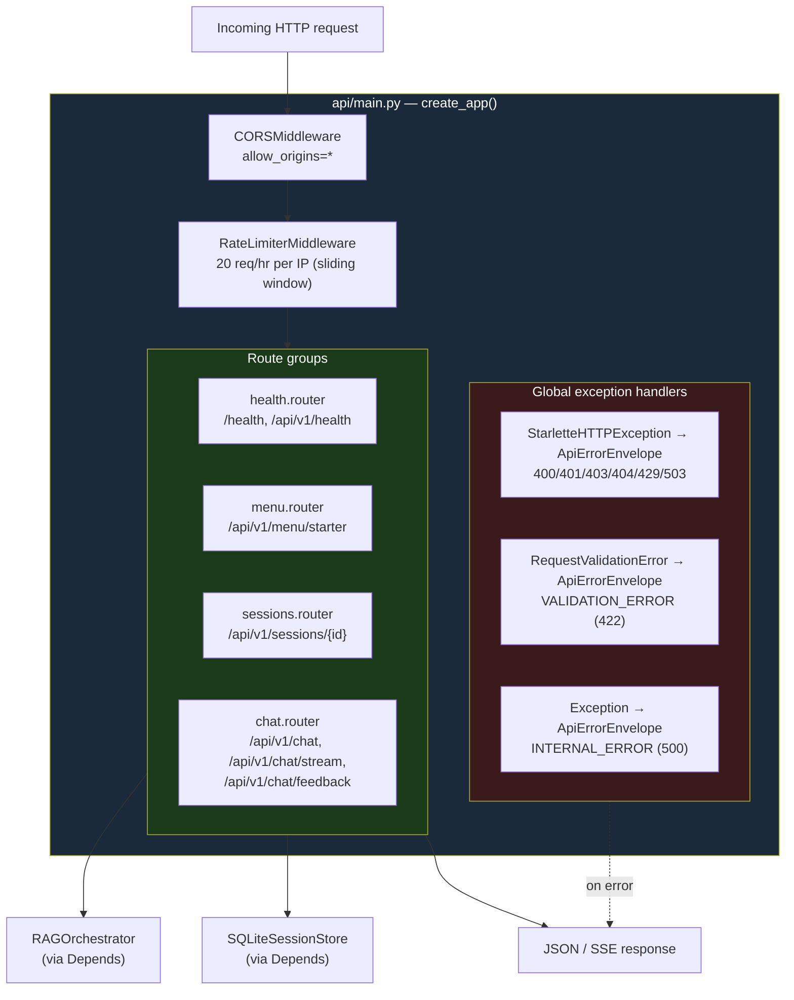
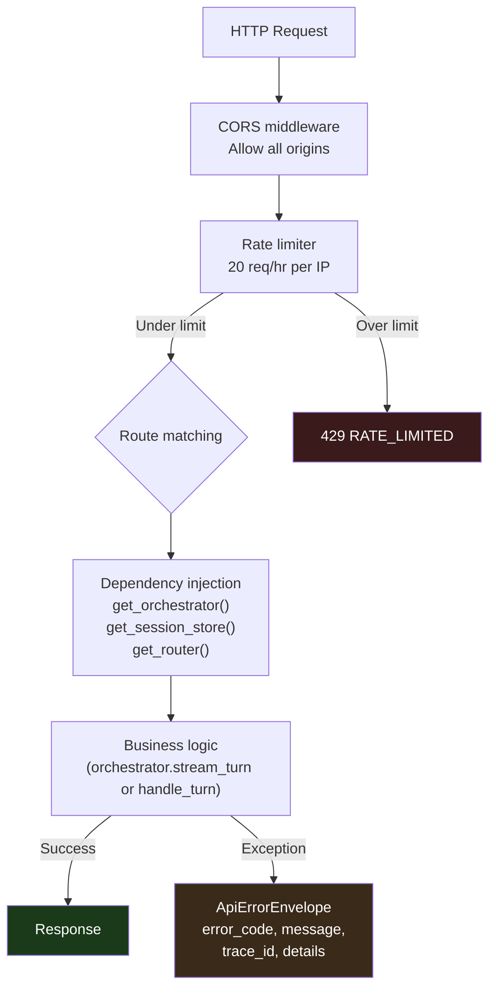
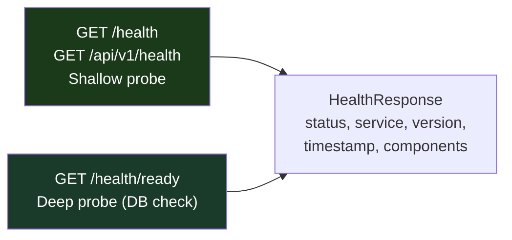
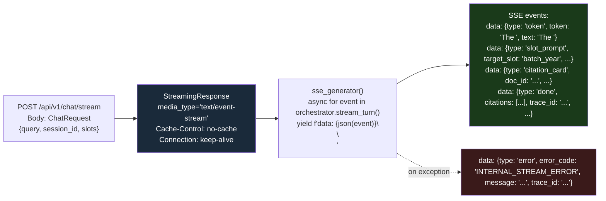
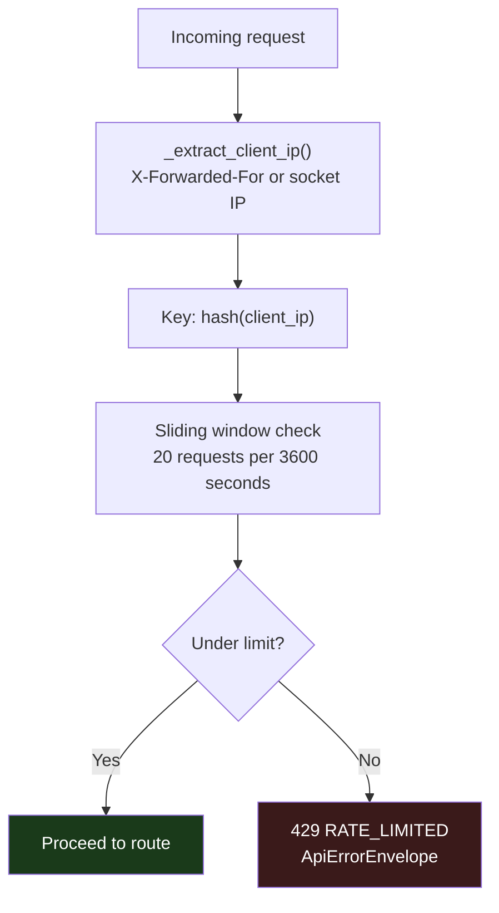

# FastAPI REST + SSE

> **The REST and Server-Sent Events API surface.** FastAPI serves health probes, starter menu, session history, and streaming chat.
>
> Related: [UI Interaction](./ui.md) · [Pipeline Overview](../pipeline/overview.md)

---

## 1. Purpose

The FastAPI server (`api/main.py`) exposes REST endpoints for programmatic access and SSE streaming for real-time chat. It sits in front of the `RAGOrchestrator` — it contains no business logic, only transport and error handling.

---

## 2. Application Architecture



---

## 3. Request Flow



---

## 4. Endpoints

### Health



| Method | Path | Response | Notes |
|--------|------|----------|-------|
| GET | `/health` | `HealthResponse` | Shallow probe, no DB check. `Cache-Control: no-store` |
| GET | `/api/v1/health` | `HealthResponse` | Same as `/health` (OpenAPI documented) |
| GET | `/health/ready` | `HealthResponse` | Deep probe: executes `SELECT 1` on SQLite, reports latency. Returns 503 if DB unavailable. |

### Menu

| Method | Path | Response | Notes |
|--------|------|----------|-------|
| GET | `/api/v1/menu/starter` | `StarterMenuResponse` | Returns 5 categories of guided starter prompts. 1-hour public cache. Loads from `configs/menu_hierarchy.json` if available, otherwise uses built-in defaults. |

### Sessions

| Method | Path | Response | Notes |
|--------|------|----------|-------|
| GET | `/api/v1/sessions/{session_id}` | `SessionHistoryResponse` | Full chronological message history + rolling summary. 404 if not found. |
| DELETE | `/api/v1/sessions/{session_id}` | `{status: "deleted"}` | Cascade deletes session + messages + summaries. 404 if not found. |

### Chat

| Method | Path | Response | Notes |
|--------|------|----------|-------|
| POST | `/api/v1/chat` | `ChatResponse` | Synchronous turn via `handle_turn()`. For programmatic evaluation. |
| POST | `/api/v1/chat/stream` | `text/event-stream` (SSE) | Streaming turn via `stream_turn()`. Real-time tokens, slot prompts, citation cards. |
| POST | `/api/v1/chat/feedback` | `{status: "success"}` | Records thumbs up/down feedback to telemetry sink. |

---

## 5. SSE Streaming Protocol

The `/api/v1/chat/stream` endpoint returns Server-Sent Events:



### SSE event format

Each event is a JSON object prefixed with `data: `:

```
data: {"type": "token", "token": "The ", "text": "The "}

data: {"type": "token", "token": "syllabus ", "text": "syllabus "}

data: {"type": "citation_card", "citation_id": "cite_1", "doc_id": "...", "title": "B.Tech CSE Syllabus", "source_url": "...", "page_number": 5, "quoted_snippet": "..."}

data: {"type": "done", "citations": [...], "trace_id": "abc123", "session_id": "sess_xyz"}
```

---

## 6. Rate Limiting



The `RateLimiterMiddleware` uses a sliding window of 20 requests per hour per client IP. The IP is extracted from `X-Forwarded-For` header (for reverse proxies) or the socket address.

---

## 7. Error Envelope

All errors conform to `ApiErrorEnvelope`:

```json
{
  "error_code": "RATE_LIMITED",
  "message": "Rate limit exceeded. Maximum 20 requests per hour.",
  "trace_id": "abc123def456",
  "details": {
    "retry_after_seconds": 3600,
    "limit": 20,
    "window_seconds": 3600
  }
}
```

| HTTP Status | `error_code` | When |
|------------|-------------|------|
| 400 | `BAD_REQUEST` | Malformed request |
| 404 | `NOT_FOUND` | Session not found / empty query |
| 422 | `VALIDATION_ERROR` | Pydantic validation failed |
| 429 | `RATE_LIMITED` | Rate limit exceeded |
| 500 | `INTERNAL_ERROR` | Unhandled exception |
| 503 | `SERVICE_UNAVAILABLE` | Health check deep probe failure |

---

## 8. Dependency Injection in API Routes

Each route uses FastAPI's `Depends()` to get its dependencies. They use lazy singleton pattern:

```python
_global_orchestrator: RAGOrchestrator | None = None

def get_orchestrator() -> RAGOrchestrator:
    global _global_orchestrator
    if _global_orchestrator is None:
        _global_orchestrator = create_rag_orchestrator()
    return _global_orchestrator
```

| Dependency | Provider | Singleton |
|-----------|---------|-----------|
| Orchestrator | `get_orchestrator()` | Yes (module-level) |
| Session store | `get_session_store()` | Yes (module-level) |
| Router | `get_router()` | Yes (module-level) |
| Telemetry sink | `get_telemetry_sink()` | Yes (module-level, InMemory default) |

---

## 9. Key Files

| File | Responsibility |
|------|---------------|
| `api/main.py` | `create_app()` — FastAPI application factory |
| `api/middleware/rate_limiter.py` | `RateLimiterMiddleware` — sliding window IP limiter |
| `api/routes/health.py` | Health and readiness probes |
| `api/routes/menu.py` | Starter menu endpoint |
| `api/routes/sessions.py` | Session history and delete endpoints |
| `api/routes/chat.py` | Chat (sync + SSE) and feedback endpoints |
| `schemas/chat.py` | `ChatRequest`, `ChatResponse`, `FeedbackRequest` |
