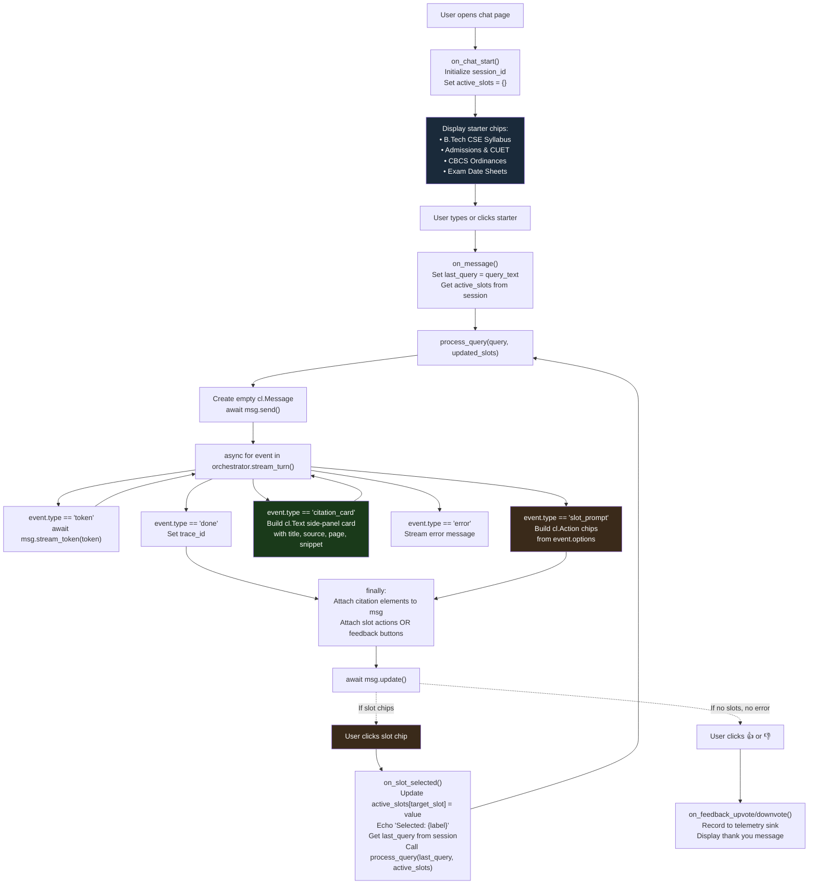
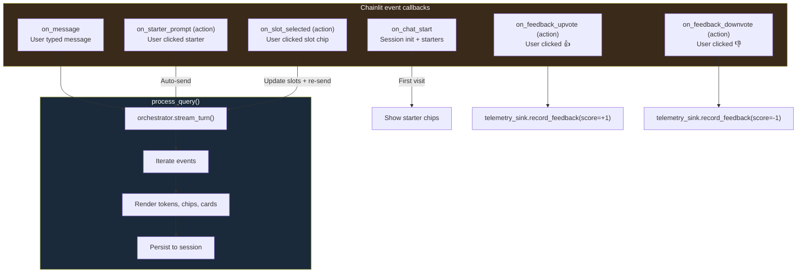
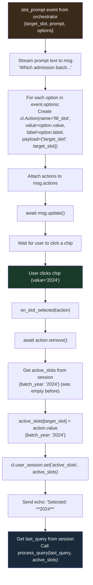
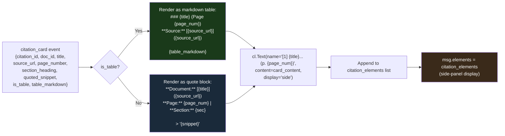

# Chainlit UI

> **The web chat interface.** Chainlit handles the chat lifecycle: starter prompts, slot-filling chips, streaming responses, citation cards, and feedback buttons.
>
> Related: [API](./api.md) · [Pipeline Overview](../pipeline/overview.md) · [Routing + Slots](../pipeline/routing-slots.md)

---

## 1. Purpose

The Chainlit UI (`ui/app.py`) is the primary user-facing interface. It builds a `RAGOrchestrator` singleton, handles chat lifecycle events, renders slot-filling chips, streams tokens, displays side-panel citation cards, and records user feedback.

---

## 2. Interaction Flow



---

## 3. Event Handling Lifecycle



---

## 4. Slot-Filling Chip Flow



### Known issue: Slot selection bug

When a user clicks a chip, `on_slot_selected` calls `process_query(query, updated_slots=active_slots)`. The `query` is retrieved from `cl.user_session.get("last_query", "")`. This should work correctly — the orchestrator receives the accumulated slots and re-evaluates the route.

However, the bug occurs when:
1. The user's first message is an academic query requiring slots
2. The orchestrator emits a `slot_prompt` event
3. The user clicks a chip
4. `process_query` is called with the original query + updated slots
5. The orchestrator's `route()` method calls `fill_slots(query, session_slots=slots)` which should merge the session slots with query-extracted slots
6. If the next slot is still missing, a new `slot_prompt` should be emitted

The flow appears correct in the code. The likely issue is either:
- `last_query` not being set in `on_slot_selected` (falls back to `action.value`)
- The orchestrator receiving `slots=None` instead of the accumulated dict
- The `FacetedSlotFiller.extract_slots()` not properly merging session slots

---

## 5. Citation Card Rendering



Citation cards appear in the Chainlit side panel for verification. Each card shows the document title, source URL, page number, section heading, and a verbatim quoted snippet (or markdown table if the chunk is a table).

---

## 6. Feedback Buttons

After a completed turn (no slot chips, no error), the UI attaches feedback buttons:

```python
feedback_actions = [
    cl.Action(
        name="feedback_upvote",
        value=turn_trace_id,
        label="👍 Helpful",
        description="Answer is accurate and verified",
        payload={},
    ),
    cl.Action(
        name="feedback_downvote",
        value=turn_trace_id,
        label="👎 Inaccurate",
        description="Information is missing or outdated",
        payload={},
    ),
]
msg.actions = feedback_actions
```

When clicked, the callback records to the telemetry sink:

```python
sink.record_feedback(
    trace_id=action.value,  # The turn's trace_id
    score=1,  # or -1 for downvote
    feedback_category="helpful",  # or "unhelpful"
)
```

---

## 7. Singleton Orchestrator

The UI uses a module-level singleton orchestrator, initialized lazily on first use:

```python
_orchestrator: RAGOrchestrator | None = None

def get_ui_orchestrator() -> RAGOrchestrator:
    global _orchestrator
    if _orchestrator is None:
        _orchestrator = create_rag_orchestrator()
    return _orchestrator
```

This means all users share the same orchestrator instance (and its LanceDB connection, LLM pool, session store, etc.). This is fine for single-process deployment.

---

## 8. Key Files

| File | Responsibility |
|------|---------------|
| `ui/app.py` | Chainlit app — event handlers, process_query, run() |
| `.chainlit/config.toml` | Chainlit configuration |
| `core/factory.py` | `create_rag_orchestrator()` — builds the singleton |
