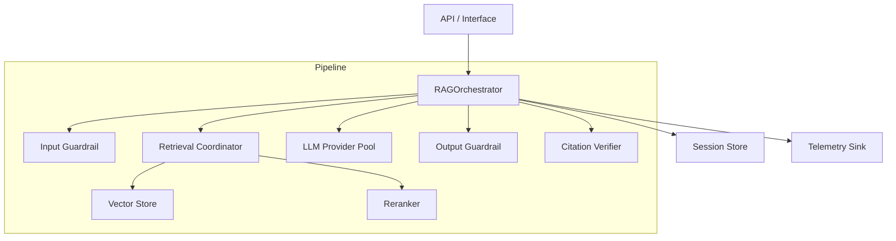
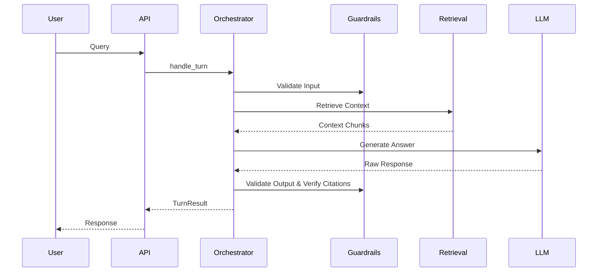

# CUK RAG Assistant Architecture

## 1. Overview
The CUK RAG Assistant is a high-reliability, modular Retrieval-Augmented Generation (RAG) system. It strictly enforces **Separation of Concerns (SoC)**, **Dependency Injection (DI)**, and the **Open/Closed Principle (OCP)** to ensure maintainability, scalability, and testability.

## 2. High-Level Architecture
The system is built around a centralized `RAGOrchestrator` that orchestrates the request lifecycle by coordinating retrieval, inference, and security guardrails.

## 3. Core Components

### 3.1. RAGOrchestrator (`cuk_assistant/pipeline/orchestrator.py`)
The heart of the application. It receives queries, manages the interaction loop, and delegates tasks to injected protocols. It handles failure attribution and observability logging.

### 3.2. Retrieval Subsystem (`cuk_assistant/retrieval/`)
- **VectorStoreProtocol**: Manages hybrid search (Vector + BM25).
- **RerankerProtocol**: Refines retrieval precision using models like FlashRank.

### 3.3. LLM Provider Pool (`cuk_assistant/llm/`)
Abstraction layer for LLM inference. Supports multiple providers (Gemini, Groq) with circuit-breaking capabilities to ensure high availability.

### 3.4. Guardrails (`cuk_assistant/guardrails/`)
- **Input Guard**: Sanitizes user input for safety.
- **Output Guard**: Ensures generated responses meet quality and safety standards.
- **Citation Verifier**: Ensures factual grounding by verifying references against context chunks.

## 4. Request Data Flow
The following sequence diagram outlines the turn-based request processing.

## 5. Design Principles
- **Dependency Injection (DI)**: Components are instantiated via `cuk_assistant/core/factory.py` and provided to services as abstract protocols.
- **Observability**: Every operation is logged as structured OpenTelemetry spans via Logfire, with mandatory diagnostic tagging for failures.
- **Registry Pattern**: New adapters (vector stores, telemetry sinks) are added via decorators in `cuk_assistant/core/registry.py` without modifying pipeline logic (OCP).
