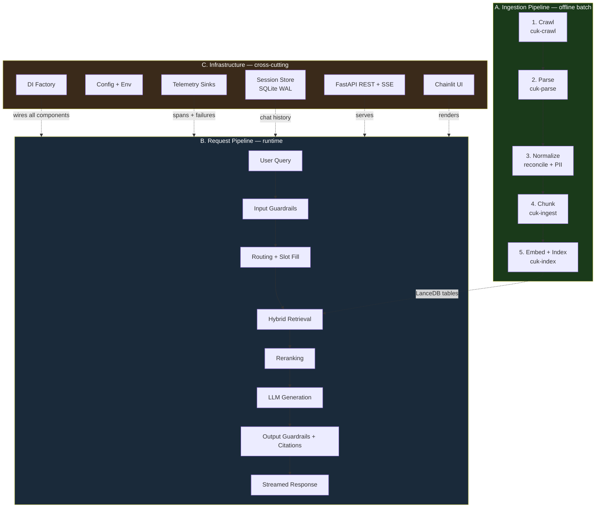
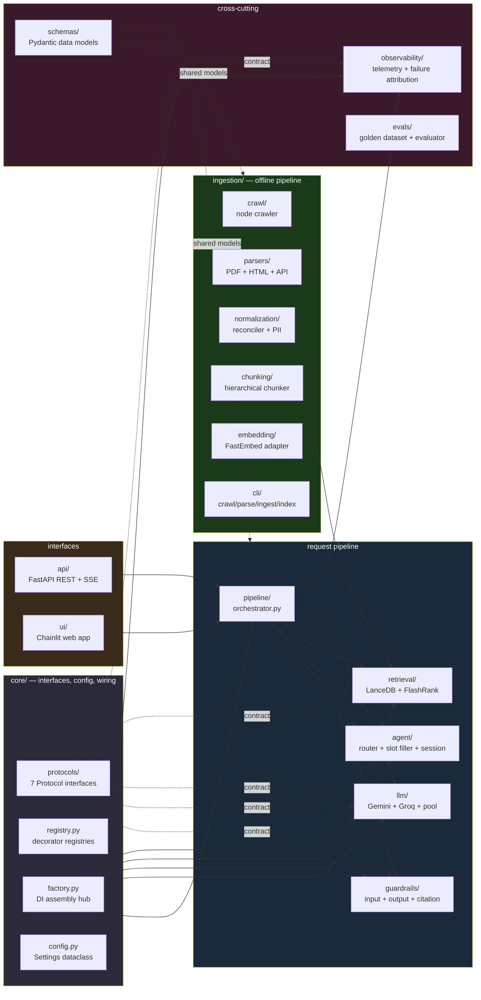
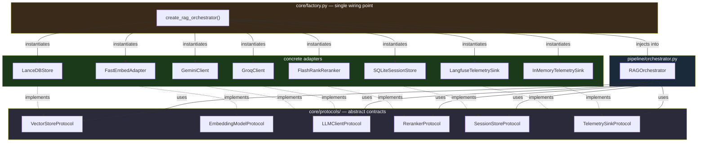
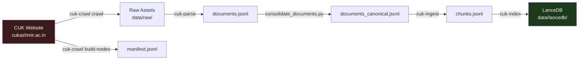
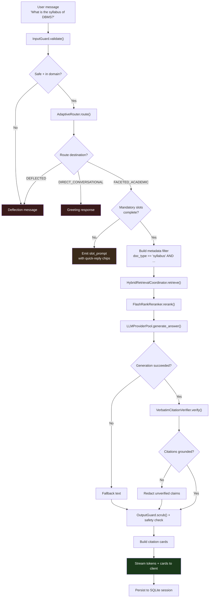
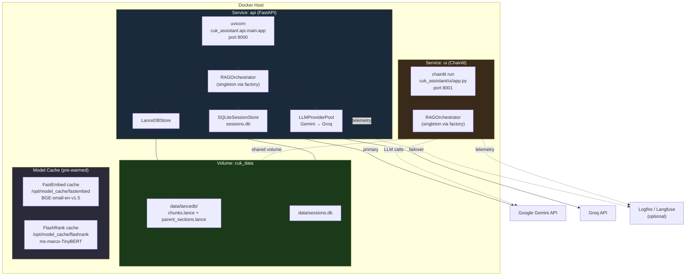
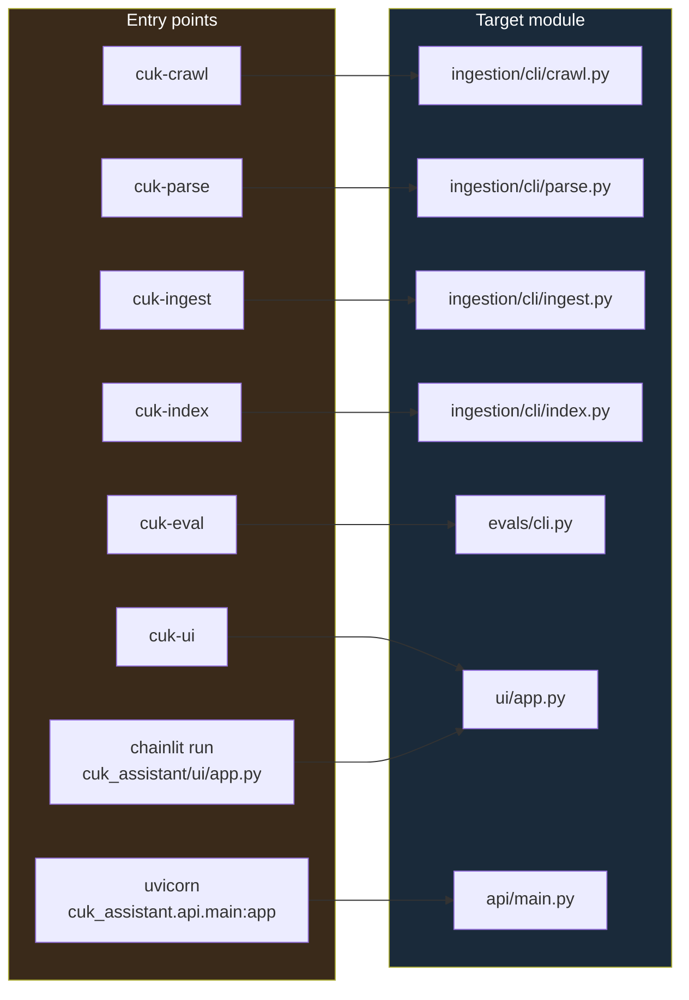

# Architecture

> **Full system design document.** Covers module map, data flow, design principles, deployment topology, and caching strategy.
>
> See [`INDEX.md`](./INDEX.md) for the complete documentation table of contents.

---

## 1. System Overview

The CUK RAG Assistant is a retrieval-augmented generation chatbot for the Central University of Kashmir. It scrapes the university website, ingests documents into a hybrid vector store, and answers student queries with citation-grounded responses.

The system has **three subsystems** that run at different times and serve different purposes:



**When each runs:**

| Subsystem | When | Trigger | Output |
|-----------|------|---------|--------|
| Ingestion | Offline, batch | `make ingest` / `cuk-crawl` / `cuk-index` | LanceDB tables + Tantivy FTS index |
| Request | Runtime, per user message | Chainlit UI or FastAPI endpoint | Streamed tokens + citation cards |
| Infrastructure | Always | Process startup | Configured orchestrator, API server |

---

## 2. Module Map

The `cuk_assistant/` package has 12 subpackages. Each follows the **Separation of Concerns (SoC)** principle — a module never reaches across boundaries into another module's domain.



### Module responsibilities

| Module | Responsibility | Key files | Never does |
|--------|--------------|-----------|------------|
| `core/protocols/` | Protocol interface definitions (7 contracts) | `storage.py`, `llm.py`, `session.py`, `telemetry.py`, `reranker.py`, `ingestion.py`, `document_parser.py` | Contains implementations |
| `core/registry.py` | Decorator-based component registration | `register_vector_store`, `register_embedding_model`, etc. | Instantiates components |
| `core/factory.py` | Dependency injection — wires all components | `create_rag_orchestrator()` | Contains business logic |
| `core/config.py` | Environment-driven configuration | `Settings` dataclass, `load_settings()` | Reads secrets at module level |
| `ingestion/crawl/` | Scrape CUK website (Angular SPA) | `node_crawler.py`, `direct_client.py`, `pdf_extractor.py` | Calls vector DBs or LLMs |
| `ingestion/parsers/` | Parse PDF/HTML/API into structured records | `pdf_parser.py`, `html_parser.py`, `docling_adapter.py` | Calls vector DBs or LLMs |
| `ingestion/normalization/` | Reconcile metadata, scrub PII, detect deltas | `reconciler.py`, `sanitizer.py`, `delta_detector.py` | Performs retrieval |
| `ingestion/chunking/` | Hierarchical AST markdown chunking | `hierarchical_chunker.py` | Generates embeddings |
| `ingestion/embedding/` | Dense vector embeddings | `fastembed_adapter.py` | Performs retrieval |
| `agent/` | Intent routing, slot filling, session memory | `router.py`, `slot_filler.py`, `session_store.py` | Performs retrieval or LLM generation |
| `guardrails/` | Input/output safety, PII scrub, citation verify | `input_guard.py`, `output_guard.py`, `citation_verifier.py` | Generates responses |
| `retrieval/` | Hybrid vector + BM25 storage and reranking | `lancedb_store.py`, `coordinator.py`, `flashrank_reranker.py` | Formulates conversational responses |
| `llm/` | LLM inference + provider failover | `gemini_client.py`, `groq_client.py`, `pool.py` | Performs retrieval |
| `pipeline/orchestrator.py` | Workflow orchestration via injected protocols | `RAGOrchestrator` | Instantiates concrete classes |
| `api/` | FastAPI REST + SSE transport | `main.py`, `routes/chat.py`, `routes/sessions.py` | Contains business logic |
| `ui/` | Chainlit web presentation | `app.py` | Contains business logic |
| `schemas/` | Pure Pydantic data models | `metadata.py`, `chunks.py`, `chat.py`, `retrieval.py`, `llm.py` | Imports database or vendor libs |
| `observability/` | Telemetry sinks + failure attribution | `in_memory_sink.py`, `langfuse_sink.py`, `failure_attribution.py` | Mutates pipeline behavior |
| `evals/` | Offline evaluation harness | `evaluator.py`, `query_miner.py`, `cli.py` | Runs during request flow |

---

## 3. Design Principles

Three invariants govern every file in the codebase (enforced via `GEMINI.md`):

### 3.1 Separation of Concerns (SoC)

Each module has one job. The ingestion pipeline never calls the LLM. The retrieval layer never formulates responses. The orchestrator never instantiates concrete classes. This means you can test, replace, or rewrite any module without touching the others.

### 3.2 Dependency Injection (DI)

Components receive their dependencies through constructors as abstract `Protocol` types. No module imports a concrete adapter class — except `core/factory.py`, which is the single place where concrete classes are instantiated and wired together.



### 3.3 Open/Closed Principle (OCP)

New adapters are added by creating a class and decorating it with the appropriate registry. Zero modifications to existing pipeline code are needed.

```python
# To add a new vector store:
@register_vector_store("qdrant")
class QdrantStore(VectorStoreProtocol):
    def hybrid_search(self, ...): ...

# To add a new LLM provider:
class OpenAIClient(LLMClientProtocol):
    async def generate_answer(self, ...): ...

# Factory picks them up automatically — no orchestrator changes needed.
```

---

## 4. Data Flow

### 4.1 Ingestion data flow (offline)



**Data formats at each stage:**

| Stage | File | Format | Key fields |
|-------|------|--------|------------|
| Crawl | `data/raw/pdf/`, `data/raw/html/` | Binary PDFs, HTML files | Scraped assets |
| Crawl | `data/raw/manifest.jsonl` | JSONL | `asset_id`, `asset_type`, `source_url`, `provenance` |
| Parse | `data/processed/documents.jsonl` | JSONL | `text`, `metadata` (universal schema) |
| Normalize | `data/processed/documents_canonical.jsonl` | JSONL | Deduped, reconciled, PII-scrubbed |
| Chunk | `data/processed/chunks.jsonl` | JSONL | `chunk_id`, `doc_id`, `text`, `chunk_type`, `parent_chunk_id`, `metadata` |
| Index | `data/lancedb/chunks.lance` | LanceDB (Arrow) | `chunk_id`, `vector`, `text`, `metadata_json`, top-level columns |
| Index | `data/lancedb/parent_sections.lance` | LanceDB (Arrow) | `parent_chunk_id`, `full_section_text`, `child_chunk_ids` |

### 4.2 Request data flow (runtime)



---

## 5. Technology Stack

| Layer | Technology | Version | Purpose |
|-------|-----------|---------|---------|
| Language | Python | 3.12+ | Application code |
| Package manager | uv | 0.13+ | Dependency management, build |
| Web framework (API) | FastAPI | 0.163+ | REST + SSE endpoints |
| Web framework (UI) | Chainlit | 2.12+ | Chat interface |
| Vector store | LanceDB | 0.41+ | Hybrid dense + sparse search |
| Full-text search | Tantivy | 0.27+ | BM25 lexical index |
| Embeddings | FastEmbed | 0.9+ | BGE-small-en-v1.5 (384-dim) |
| Reranker | FlashRank | 0.2+ | ms-marco-TinyBERT-L-2-v2 |
| LLM (primary) | Google Gemini | — | gemini-flash-latest |
| LLM (fallback) | Groq | — | qwen3.8-27b / llama-3.3-70b |
| Data models | Pydantic | 2.14+ | Schemas, validation, coercion |
| Session store | SQLite | — | WAL mode conversation memory |
| Observability | Logfire + Langfuse + Phoenix | — | Telemetry, tracing, failure attribution |
| PDF parsing | PyMuPDF + Docling | — | PDF text + table extraction |
| HTML parsing | BeautifulSoup + lxml | — | HTML scraping |
| Containerization | Docker + docker-compose | — | Multi-stage build, dual-service deploy |
| Linting | Ruff | 0.17+ | Code quality + formatting |
| Testing | pytest + pytest-asyncio | — | Unit + integration tests |

---

## 6. Deployment Topology

### 6.1 Docker Compose (production)



### 6.2 Local development

```bash
# Ingestion (offline)
make ingest          # chunk + embed + index

# API server
make run-api         # uvicorn on :8000

# UI server
make ui              # chainlit on :8001

# Tests
make test-unit       # pytest tests/unit/
```

### 6.3 Environment variables

| Variable | Default | Used by | Purpose |
|----------|---------|---------|---------|
| `GEMINI_API_KEY` | — | `llm/gemini_client.py` | Primary LLM provider |
| `GROQ_API_KEY` | — | `llm/groq_client.py` | Fallback LLM provider |
| `GEMINI_MODEL` | `gemini-flash-latest` | Factory | Gemini model name |
| `GROQ_MODEL` | `qwen/qwen3.8-27b` | Factory | Groq model name |
| `LANCEDB_DIR` | `data/lancedb` | `LanceDBStore` | Vector store path |
| `SQLITE_DB_PATH` | `data/sessions.db` | `SQLiteSessionStore` | Session DB path |
| `FASTEMBED_CACHE_PATH` | — | `FastEmbedAdapter` | Embedding model cache |
| `FLASHRANK_CACHE_PATH` | — | `FlashRankReranker` | Reranker model cache |
| `LOGFIRE_TOKEN` | — | Telemetry | Logfire integration |
| `LANGFUSE_PUBLIC_KEY` | — | Telemetry | Langfuse integration |
| `LANGFUSE_SECRET_KEY` | — | Telemetry | Langfuse integration |
| `PHOENIX_COLLECTOR_ENDPOINT` | — | Telemetry | Phoenix/Arize integration |
| `BASE_URL` | `https://www.cukashmir.ac.in` | Crawler | Target website |
| `CONTACT_EMAIL` | — | API | Rate limit contact |

---

## 7. Caching Strategy

The system has four caching layers, each serving a different purpose:

```mermaid
flowchart TB
    subgraph LAYER1["Layer 1: HTTP Response Cache"]
        HTTP["core/http_cache.py<br/>in-memory LRU<br/>caches crawler HTTP responses"]
    end

    subgraph LAYER2["Layer 2: Model Cache (disk)"]
        FE["FastEmbed ONNX models<br/>/opt/model_cache/fastembed/<br/>BAAI/bge-small-en-v1.5"]
        FR["FlashRank ONNX models<br/>/opt/model_cache/flashrank/<br/>ms-marco-TinyBERT-L-2-v2"]
    end

    subgraph LAYER3["Layer 3: LanceDB (disk)"]
        LAN["data/lancedb/chunks.lance<br/>vectors + text + metadata_json<br/>columnar Arrow format"]
        FTS["Tantivy BM25 index<br/>full-text lexical index<br/>embedded in LanceDB"]
        PAR["data/lancedb/parent_sections.lance<br/>parent chunk context expansion"]
    end

    subgraph LAYER4["Layer 4: SQLite Session (disk)"]
        SES["data/sessions.db<br/>WAL mode<br/>conversation history + summaries"]
    end

    CRAWLER["Crawler"] -->|"GET requests"| HTTP
    EMBED["Embedding pipeline"] -->|"loads ONNX once"| FE
    RERANK["Reranking"] -->|"loads ONNX once"| FR
    RETRIEVAL["Hybrid retrieval"] -->|"vector + FTS queries"| LAN
    RETRIEVAL -->|"BM25 queries"| FTS
    RETRIEVAL -->|"context expansion"| PAR
    ORCHESTRATOR["RAGOrchestrator"] -->|"chat history"| SES

    style LAYER1 fill:#3a1a2a,color:#fff
    style LAYER2 fill:#2a2a3a,color:#fff
    style LAYER3 fill:#1a3a1a,color:#fff
    style LAYER4 fill:#3a2a1a,color:#fff
```



| Layer | Type | Location | Lifetime | Invalidated by |
|-------|------|----------|----------|---------------|
| HTTP cache | In-memory LRU | Process memory | Process lifetime | TTL expiry |
| Model cache | Disk (ONNX) | `/opt/model_cache/` | Until image rebuild | Docker rebuild |
| LanceDB | Disk (Arrow) | `data/lancedb/` | Until re-indexing | `cuk-index` command |
| SQLite session | Disk (WAL) | `data/sessions.db` | Manual deletion | Session delete API |

### 7.1 Model pre-warming in Docker

The Dockerfile pre-warms both ONNX models during the builder stage so the runtime image starts without cold-start latency:

```dockerfile
# Builder stage pre-warms models into /opt/model_cache/
RUN python -c "from fastembed import TextEmbedding; TextEmbedding('BAAI/bge-small-en-v1.5', ...)"
RUN python -c "from flashrank import Ranker; Ranker(model_name='ms-marco-TinyBERT-L-2-v2', ...)"
```

---

## 8. Entry Points



| Command | Entry point | Subsystem | Purpose |
|---------|------------|-----------|---------|
| `cuk-crawl crawl` | `ingestion/cli/crawl.py` | Ingestion | Scrape CUK website |
| `cuk-crawl build-nodes` | `ingestion/cli/crawl.py` | Ingestion | Build navigation hierarchy |
| `cuk-crawl save-pdfs` | `ingestion/cli/crawl.py` | Ingestion | Download PDFs |
| `cuk-parse` | `ingestion/cli/parse.py` | Ingestion | Parse raw assets to documents |
| `cuk-ingest` | `ingestion/cli/ingest.py` | Ingestion | Chunk documents |
| `cuk-index` | `ingestion/cli/index.py` | Ingestion | Embed + index into LanceDB |
| `cuk-eval run` | `evals/cli.py` | Evaluation | Run golden dataset benchmark |
| `cuk-ui` | `ui/app.py` | UI | Launch Chainlit web UI |
| `uvicorn cuk_assistant.api.main:app` | `api/main.py` | API | Launch FastAPI server |

---

## 9. Known Issues and Gaps

These are documented in detail in their respective module docs:

| Issue | Where documented | Status |
|-------|-----------------|--------|
| Metadata filter column mismatch — slot-filler builds filters against `program`, `batch_year`, `semester` etc., but these fields live inside `metadata_json`, not as top-level LanceDB columns. Filters silently stripped by sanitizer. | [`pipeline/routing-slots.md`](./pipeline/routing-slots.md) | **Broken** |
| Slot selection chip → nothing happens — UI dispatches `on_slot_selected` but the orchestrator re-evaluates from scratch instead of continuing slot filling. | [`api-ui/ui.md`](./api-ui/ui.md) | **Broken** |
| Obvious slots (department inferred from course) still asked — no inference logic to skip department when course implies it. | [`pipeline/routing-slots.md`](./pipeline/routing-slots.md) | **Missing feature** |
| `README.md` referenced in `pyproject.toml` but doesn't exist — `uv` build fails. | — | **Broken reference** |
| `chainlit.md` referenced in Dockerfile but doesn't exist — Docker build fails. | — | **Broken reference** |

---

## 10. Further Reading

| Topic | Document |
|-------|----------|
| Ingestion pipeline overview | [`ingestion/overview.md`](./ingestion/overview.md) |
| Crawler internals | [`ingestion/crawl.md`](./ingestion/crawl.md) |
| Parse + normalize | [`ingestion/parse-normalize.md`](./ingestion/parse-normalize.md) |
| Chunk + embed + index | [`ingestion/chunk-index.md`](./ingestion/chunk-index.md) |
| Request pipeline overview | [`pipeline/overview.md`](./pipeline/overview.md) |
| Guardrails | [`pipeline/guardrails.md`](./pipeline/guardrails.md) |
| Routing + slot filling | [`pipeline/routing-slots.md`](./pipeline/routing-slots.md) |
| Retrieval + reranking | [`pipeline/retrieval-rerank.md`](./pipeline/retrieval-rerank.md) |
| LLM failover | [`pipeline/llm-failover.md`](./pipeline/llm-failover.md) |
| Session memory | [`pipeline/session.md`](./pipeline/session.md) |
| DI + factory | [`core/di-factory.md`](./core/di-factory.md) |
| Schemas | [`core/schemas.md`](./core/schemas.md) |
| API | [`api-ui/api.md`](./api-ui/api.md) |
| Chainlit UI | [`api-ui/ui.md`](./api-ui/ui.md) |
| Telemetry | [`observability/telemetry.md`](./observability/telemetry.md) |
| Deployment | [`deployment/deployment.md`](./deployment/deployment.md) |
| Evaluation | [`evals/evaluation.md`](./evals/evaluation.md) |
