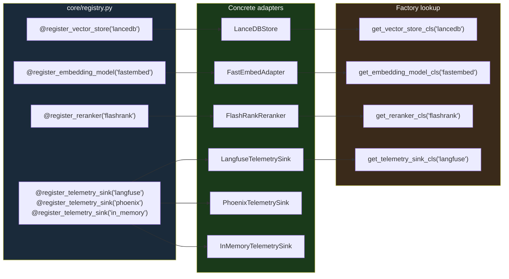
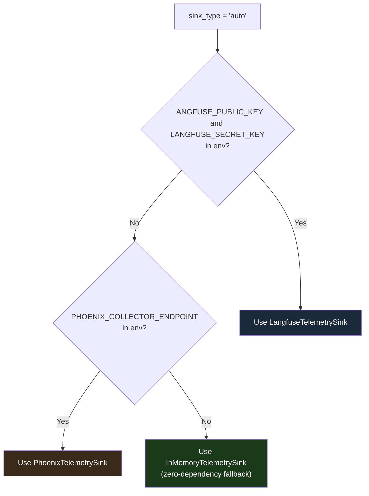
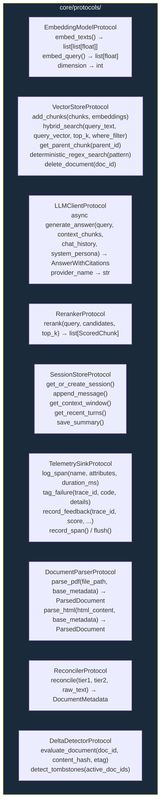

# Dependency Injection + Factory

> **How all components are wired together via the factory pattern and protocol interfaces.**
>
> Related: [Architecture](../architecture.md) · [Schemas](./schemas.md)

---

## 1. Purpose

`core/factory.py` is the single place where concrete adapter classes are instantiated and injected into the `RAGOrchestrator`. No other module imports concrete classes. This enforces the Dependency Injection (DI) and Open/Closed Principle (OCP) invariants.

---

## 2. Factory Wiring Diagram

```mermaid
flowchart TB
    subgraph FACTORY["core/factory.py — create_rag_orchestrator()"]
        FE["create_embedding_model('fastembed')"]
        VS["create_vector_store('lancedb')"]
        RR["create_reranker('flashrank')"]
        RC["create_retrieval_coordinator()"]
        LP["create_llm_pool()"]
        IG["create_input_guard()"]
        OG["create_output_guard()"]
        CV["create_citation_verifier()"]
        SS["create_session_store()"]
        RT["create_router()"]
        TS["create_telemetry_sink('auto')"]
        ORC["RAGOrchestrator()"]
    end

    subgraph CONCRETE["Concrete adapters (instantiated by factory)"]
        FEA["FastEmbedAdapter<br/>BGE-small-en-v1.5 (384-dim)"]
        LDB["LanceDBStore<br/>Arrow columnar + Tantivy BM25"]
        FRR["FlashRankReranker<br/>ms-marco-TinyBERT"]
        HRC["HybridRetrievalCoordinator"]
        GEM["GeminiClient<br/>Google Gemini API"]
        GRQ["GroqClient<br/>Groq API"]
        POOL["LLMProviderPool<br/>Gemini + Groq + circuit breaker"]
        ING["InputGuard<br/>LocalDomainClassifier + LlamaGuard"]
        OUTG["OutputGuard<br/>PIIScrubber + safety rail"]
        VCV["VerbatimCitationVerifier"]
        SQL["SQLiteSessionStore<br/>WAL mode"]
        AR["AdaptiveRouter<br/>FacetedSlotFiller"]
        SINK["TelemetrySink<br/>(auto-selected)"]
    end

    subgraph PROTOCOLS["core/protocols/ — 7 interfaces"]
        ESP["EmbeddingModelProtocol"]
        VSP["VectorStoreProtocol"]
        RRP["RerankerProtocol"]
        LLP["LLMClientProtocol"]
        SSP["SessionStoreProtocol"]
        TSP["TelemetrySinkProtocol"]
        DPP["DocumentParserProtocol"]
        RIP["ReconcilerProtocol"]
        DDP["DeltaDetectorProtocol"]
    end

    FE --> FEA
    VS --> LDB
    RR --> FRR
    RC --> HRC
    LP --> GEM
    LP --> GRQ
    LP --> POOL
    IG --> ING
    OG --> OUTG
    CV --> VCV
    SS --> SQL
    RT --> AR
    TS --> SINK

    FEA -.->|"implements"| ESP
    LDB -.->|"implements"| VSP
    FRR -.->|"implements"| RRP
    POOL -.->|"implements"| LLP
    SQL -.->|"implements"| SSP
    SINK -.->|"implements"| TSP

    FE --> RC
    VS --> RC
    RR --> RC
    RC --> ORC
    POOL --> ORC
    ING --> ORC
    OUTG --> ORC
    VCV --> ORC
    SQL --> ORC
    AR --> ORC
    SINK --> ORC

    style FACTORY fill:#3a2a1a,color:#fff
    style CONCRETE fill:#1a3a1a,color:#fff
    style PROTOCOLS fill:#1a2a3a,color:#fff
```



---

## 3. Registry Pattern

Components self-register via decorators. The factory looks them up by name:



### Adding a new adapter (OCP)

To add a new vector store (e.g. Qdrant), you only create the adapter class and decorate it:

```python
@register_vector_store("qdrant")
class QdrantStore(VectorStoreProtocol):
    def hybrid_search(self, query_text, query_vector, top_k, where_filter): ...
    def add_chunks(self, chunks, embeddings): ...
    # ... implement all protocol methods
```

Then pass `name="qdrant"` to `create_vector_store()`. Zero changes to orchestrator, retrieval coordinator, or factory.

---

## 4. Telemetry Sink Auto-Selection

The factory auto-selects the telemetry sink based on environment variables:



---

## 5. Protocol Interfaces

All 7 protocol interfaces defined in `core/protocols/`:



---

## 6. Factory Function Reference

| Factory function | Returns | Default | Env-driven config |
|-----------------|--------|---------|-------------------|
| `create_embedding_model("fastembed")` | `FastEmbedAdapter` | fastembed | `FASTEMBED_CACHE_PATH` |
| `create_vector_store("lancedb")` | `LanceDBStore` | lancedb | `LANCEDB_DIR` |
| `create_reranker("flashrank")` | `FlashRankReranker` | flashrank | `FLASHRANK_CACHE_PATH` |
| `create_retrieval_coordinator()` | `HybridRetrievalCoordinator` | (assembles store + embedder + reranker) | — |
| `create_llm_pool()` | `LLMProviderPool` | Gemini + Groq | `GEMINI_API_KEY`, `GROQ_API_KEY`, `GEMINI_MODEL`, `GROQ_MODEL` |
| `create_input_guard()` | `InputGuard` | (default classifiers) | — |
| `create_output_guard()` | `OutputGuard` | (default scrubber + rail) | — |
| `create_citation_verifier()` | `VerbatimCitationVerifier` | (min_snippet_chars=15) | — |
| `create_session_store()` | `SQLiteSessionStore` | WAL mode | `SQLITE_DB_PATH` |
| `create_router()` | `AdaptiveRouter` | (with FacetedSlotFiller) | — |
| `create_telemetry_sink("auto")` | `TelemetrySinkProtocol` | InMemory fallback | `LANGFUSE_*`, `PHOENIX_*` |
| `create_rag_orchestrator()` | `RAGOrchestrator` | (assembles everything) | — |

---

## 7. Key Files

| File | Responsibility |
|------|---------------|
| `core/factory.py` | DI assembly hub — instantiates and wires all components |
| `core/registry.py` | Decorator-based component registries (4 registries) |
| `core/protocols/storage.py` | `EmbeddingModelProtocol`, `VectorStoreProtocol` |
| `core/protocols/llm.py` | `LLMClientProtocol` |
| `core/protocols/reranker.py` | `RerankerProtocol` |
| `core/protocols/session.py` | `SessionStoreProtocol` |
| `core/protocols/telemetry.py` | `TelemetrySinkProtocol`, `FailureDiagnosticCode` |
| `core/protocols/document_parser.py` | `DocumentParserProtocol`, `ParsedDocument` |
| `core/protocols/ingestion.py` | `ReconcilerProtocol`, `DeltaDetectorProtocol` |
| `core/config.py` | `Settings` dataclass — environment-driven config |
