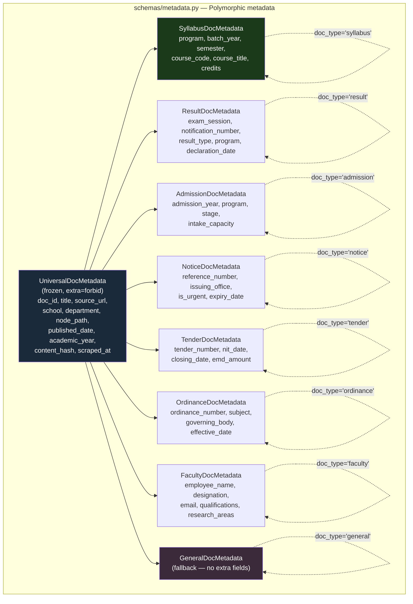
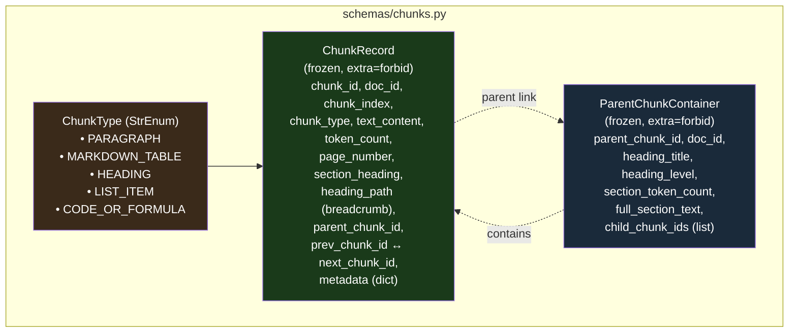
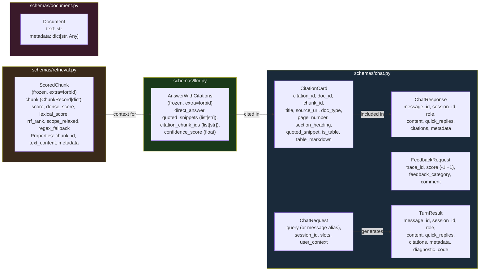

# Schemas

> **Pydantic v2 data models shared across ingestion and request pipelines.**
>
> Related: [DI + Factory](./di-factory.md) · [Architecture](../architecture.md)

---

## 1. Schema Inheritance Tree



### Discriminator

All metadata models use `doc_type` as the polymorphic discriminator. The `parse_document_metadata()` function routes to the correct model:

```python
DocumentMetadataUnion = Annotated[
    SyllabusDocMetadata | ResultDocMetadata | AdmissionDocMetadata
    | NoticeDocMetadata | TenderDocMetadata | OrdinanceDocMetadata
    | FacultyDocMetadata | GeneralDocMetadata,
    Field(discriminator="doc_type"),
]
```

### Invariants

- `extra="forbid"` — no unknown fields allowed
- `frozen=True` — immutable after creation
- `extra="forbid"` on all models prevents field leakage

---

## 2. Chunk Schemas



### ChunkRecord auto-fill

The `_fill_text_and_hash` validator ensures `text_content` and `text` are always synchronized, and `content_hash` is auto-computed:

```python
@model_validator(mode="before")
def _fill_text_and_hash(cls, data):
    # If text_content is None but text exists, copy text → text_content
    # If text is None but text_content exists, copy text_content → text
    # If content_hash is missing, compute SHA-256 of text_content
```

---

## 3. Request/Response Schemas



### ChatRequest field harmonization

The `ChatRequest` model accepts either `query` or `message` as the input field. A `model_validator` harmonizes them:

```python
@model_validator(mode="before")
def harmonize_fields(cls, values):
    if not values.get("query") and values.get("message"):
        values["query"] = values["message"]
    elif not values.get("message") and values.get("query"):
        values["message"] = values["query"]
    return values
```

### FeedbackRequest validation

Score must be exactly `-1` (downvote) or `+1` (upvote):

```python
@field_validator("score")
def validate_score(cls, v):
    if v not in (-1, 1):
        raise ValueError("Score must be strictly -1 or 1.")
    return v
```

---

## 4. ScoredChunk Properties

The `ScoredChunk` provides convenience properties for accessing chunk fields regardless of whether the chunk is a `ChunkRecord` object or a dict:

```python
@property
def chunk_id(self) -> str:
    if isinstance(self.chunk, dict):
        return str(self.chunk.get("chunk_id", ""))
    return str(getattr(self.chunk, "chunk_id", ""))

@property
def text_content(self) -> str:
    if isinstance(self.chunk, dict):
        return str(self.chunk.get("text_content", ""))
    return str(getattr(self.chunk, "text_content", ""))

@property
def metadata(self) -> dict[str, Any]:
    if isinstance(self.chunk, dict):
        return self.chunk.get("metadata", {})
    return getattr(self.chunk, "metadata", {})
```

---

## 5. Key Files

| File | Schemas |
|------|--------|
| `schemas/metadata.py` | `UniversalDocMetadata`, 7 domain schemas, `parse_document_metadata()` |
| `schemas/chunks.py` | `ChunkType`, `ChunkRecord`, `ParentChunkContainer` |
| `schemas/chat.py` | `ChatRequest`, `ChatResponse`, `FeedbackRequest`, `CitationCard`, `TurnResult` |
| `schemas/llm.py` | `AnswerWithCitations` |
| `schemas/retrieval.py` | `ScoredChunk` |
| `schemas/document.py` | `Document` |
