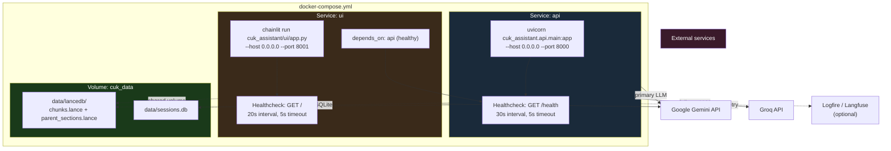
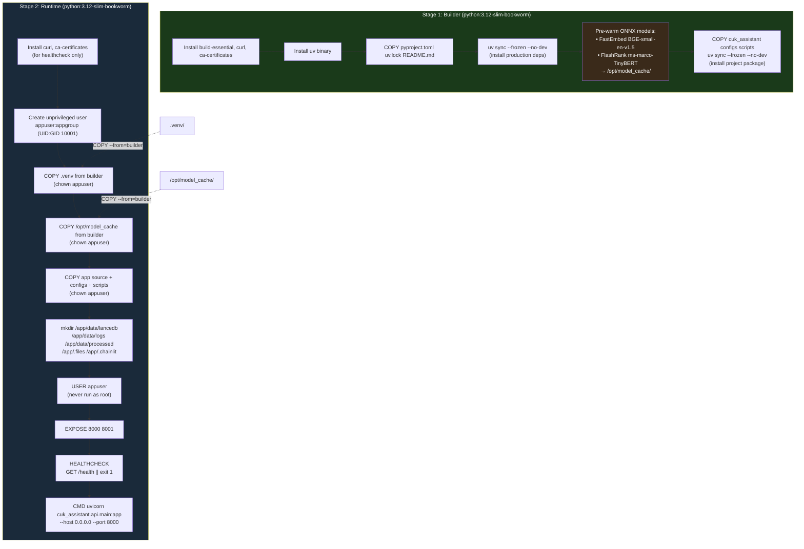
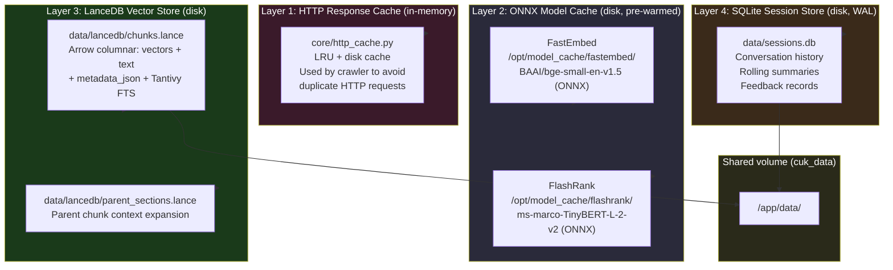

# Deployment

> **Docker multi-stage build, model pre-warming, and caching strategy.**
>
> Related: [Architecture](../architecture.md)

---

## 1. Purpose

The system runs as two Docker services: FastAPI (port 8000) and Chainlit UI (port 8001). A multi-stage Dockerfile builds dependencies and pre-warms ONNX models in the builder stage, then copies them to a minimal runtime image.

---

## 2. Deployment Topology



---

## 3. Docker Multi-Stage Build



### Model pre-warming

The builder stage downloads and caches ONNX models so the runtime image starts without cold-start latency:

```dockerfile
ENV FASTEMBED_CACHE_PATH=/opt/model_cache/fastembed
ENV FLASHRANK_CACHE_PATH=/opt/model_cache/flashrank

RUN python -c "from fastembed import TextEmbedding; TextEmbedding('BAAI/bge-small-en-v1.5', cache_dir='/opt/model_cache/fastembed')"
RUN python -c "from flashrank import Ranker; Ranker(model_name='ms-marco-TinyBERT-L-2-v2', cache_dir='/opt/model_cache/flashrank')"
```

---

## 4. Caching Layers



| Layer | Type | Location | Lifetime | Invalidated by |
|-------|------|----------|----------|---------------|
| HTTP cache | In-memory LRU + disk | Process memory + `.cache/` | Process lifetime | TTL expiry |
| Model cache | Disk (ONNX) | `/opt/model_cache/` | Until image rebuild | Docker rebuild |
| LanceDB | Disk (Arrow) | `data/lancedb/` | Until re-indexing | `cuk-index` command |
| SQLite | Disk (WAL) | `data/sessions.db` | Manual deletion | Session delete API |

---

## 5. Environment Variables

| Variable | Default | Required | Purpose |
|----------|---------|----------|---------|
| `GEMINI_API_KEY` | — | Yes (for LLM) | Google Gemini API key |
| `GROQ_API_KEY` | — | Yes (for failover) | Groq API key |
| `GEMINI_MODEL` | `gemini-flash-latest` | No | Gemini model name |
| `GROQ_MODEL` | `qwen/qwen3.8-27b` | No | Groq model name |
| `LANCEDB_DIR` | `data/lancedb` | No | Vector store path |
| `SQLITE_DB_PATH` | `data/sessions.db` | No | Session DB path |
| `FASTEMBED_CACHE_PATH` | — | No | Embedding model cache |
| `FLASHRANK_CACHE_PATH` | — | No | Reranker model cache |
| `LOGFIRE_TOKEN` | — | No | Logfire telemetry |
| `LANGFUSE_PUBLIC_KEY` | — | No | Langfuse telemetry |
| `LANGFUSE_SECRET_KEY` | — | No | Langfuse telemetry |
| `PHOENIX_COLLECTOR_ENDPOINT` | — | No | Phoenix telemetry |
| `BASE_URL` | `https://www.cukashmir.ac.in` | No | Crawler target URL |
| `CONTACT_EMAIL` | — | No | Rate limit contact |
| `CHAINLIT_PORT` | `8001` | No | Chainlit port |
| `CHAINLIT_HOST` | `0.0.0.0` | No | Chainlit bind address |

---

## 6. Docker Compose Commands

```bash
# Build images
make docker-build    # docker compose build

# Start stack (API:8000 + UI:8001)
make docker-up       # docker compose up -d

# View logs
make docker-logs    # docker compose logs -f

# Stop stack
make docker-down    # docker compose down
```

---

## 7. Local Development

```bash
# Install dependencies
make install         # uv sync

# Ingest documents (offline)
make ingest          # cuk-ingest + cuk-index

# Run API server
make run-api         # uvicorn on :8000

# Run UI server
make ui              # chainlit on :8001

# Run tests
make test-unit       # pytest tests/unit/
make test            # pytest tests/unit/ + tests/integration/

# Lint and format
make lint            # ruff check + format check
make fmt             # ruff format
```

---

## 8. Security

| Measure | Implementation |
|---------|---------------|
| Non-root user | Runtime runs as `appuser` (UID 10001) |
| Minimal image | `python:3.12-slim-bookworm` — no dev tools in runtime |
| Secrets in env | API keys via environment variables, not baked into image |
| `.dockerignore` | Excludes `.env`, `.git`, tests, data, caches |
| Rate limiting | 20 req/hr per IP (sliding window) |
| CORS | Configurable origins (currently `*` — tighten for production) |

---

## 9. Key Files

| File | Responsibility |
|------|---------------|
| `Dockerfile` | Multi-stage build (builder + runtime) |
| `docker-compose.yml` | Dual-service compose (API + UI) |
| `.dockerignore` | Excludes secrets, caches, tests from image |
| `Makefile` | All development and deployment commands |
| `.env.example` | Template for environment variables |
