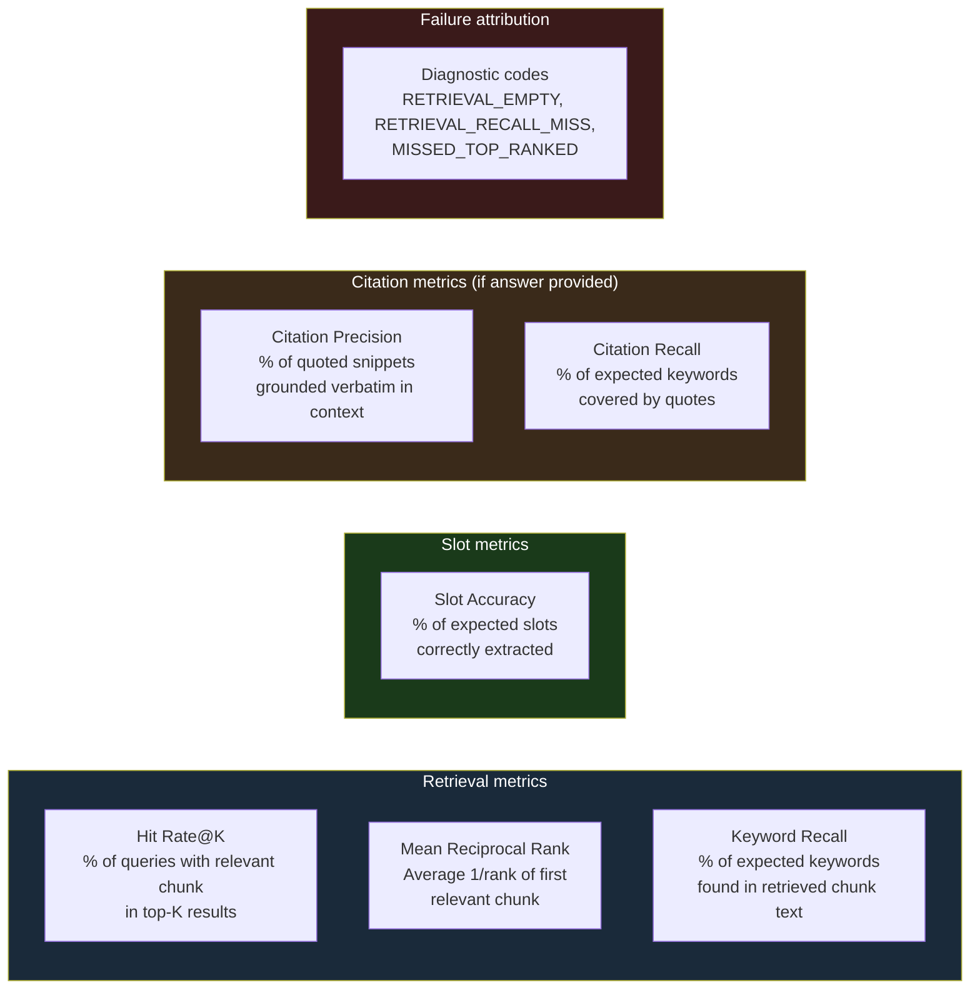
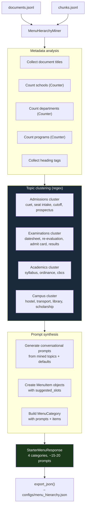

# Evaluation Harness

> **Golden dataset regression benchmarking and menu hierarchy mining.**
>
> Related: [Architecture](../architecture.md)

---

## 1. Purpose

The evaluation harness runs offline regression benchmarks against a golden dataset of test cases. It measures retrieval hit rate, MRR, keyword recall, slot extraction accuracy, and citation grounding. It also mines document metadata to dynamically generate starter menu hierarchies for the UI.

---

## 2. Evaluation Flow

```mermaid
flowchart TD
    CLI["cuk-eval run --dataset evals/golden_dataset.jsonl --top-k 5"]
    INIT["Initialize RAGEvaluator<br/>with retrieval coordinator"]
    LOAD["Load golden dataset<br/>JSONL → list of GoldenTestCase"]

    LOOP["For each test case:"]
    SLOTS["1. Evaluate slot extraction<br/>slot_filler.extract_slots(query)<br/>Compare against expected_slots<br/>→ slot_accuracy"]
    RETRIEVE["2. Execute hybrid retrieval<br/>coordinator.retrieve(query, top_k=30)<br/>→ list of ScoredChunk candidates"]
    RELEVANCE["3. Check relevance<br/>is_chunk_relevant(chunk,<br/>acceptable_patterns, expected_keywords)<br/>→ first_relevant_rank, hit_at_k"]
    MRR["4. Compute MRR<br/>reciprocal_rank = 1 / first_relevant_rank"]
    KEYWORD["5. Keyword recall<br/>Count expected_keywords in<br/>retrieved chunk text"]
    CITATION["6. Citation metrics (if answer provided)<br/>Verbatim citation precision<br/>+ keyword coverage recall"]
    DIAG["7. Failure attribution<br/>If miss: check wider pool<br/>→ MISSED_TOP_RANKED or RETRIEVAL_RECALL_MISS<br/>or RETRIEVAL_EMPTY"]
    RESULT["TestCaseEvalResult"]

    AGG["Aggregate all results"]
    SUMMARY["EvaluationSummary<br/>hit_rate_at_k, mrr,<br/>mean_keyword_recall,<br/>mean_slot_accuracy,<br/>failure_attribution_counts"]

    CLI --> INIT --> LOAD
    LOAD --> LOOP
    LOOP --> SLOTS --> RETRIEVE --> RELEVANCE --> MRR --> KEYWORD
    KEYWORD --> CITATION --> DIAG --> RESULT
    RESULT --> AGG --> SUMMARY

    style SUMMARY fill:#1a3a1a,color:#fff
    style DIAG fill:#3a1a1a,color:#fff
```



---

## 3. Metrics



### Failure attribution in evaluation

When a test case misses (no relevant chunk in top-K), the evaluator checks:

1. **Were there zero candidates?** → `RETRIEVAL_EMPTY`
2. **Was a relevant chunk found in the wider pool (top_k*2)?** → `MISSED_TOP_RANKED` (reranking issue)
3. **No relevant chunk in wider pool either?** → `RETRIEVAL_RECALL_MISS` (content not in corpus)

---

## 4. Golden Test Case Schema

```json
{
  "eval_id": "eval_001",
  "query": "What is the syllabus for B.Tech CSE Semester 4?",
  "expected_slots": {
    "intent": "syllabus",
    "program": "B.Tech CSE",
    "semester": "Semester 4"
  },
  "expected_keywords": ["database", "management", "systems", "dbms"],
  "ground_truth_answer": "The syllabus includes Database Management Systems, Operating Systems, Computer Networks, and Software Engineering.",
  "acceptable_source_patterns": ["*syllabus*", "*btech*cse*", "*curriculum*"]
}
```

| Field | Type | Purpose |
|-------|------|---------|
| `eval_id` | str | Unique test case identifier |
| `query` | str | Natural language user query |
| `expected_slots` | dict | Ground-truth slot constraints (intent, program, semester, etc.) |
| `expected_keywords` | list[str] | Keywords expected in relevant retrieved chunks |
| `ground_truth_answer` | str | Factual answer for citation recall comparison |
| `acceptable_source_patterns` | list[str] | fnmatch/glob patterns for relevant source URLs, titles, doc_types |

---

## 5. Menu Hierarchy Mining



The miner analyzes document and chunk metadata to discover what topics exist in the corpus. It clusters them into 4 categories (admissions, examinations, academics, campus) and generates conversational starter prompts with pre-filled suggested slots. The output replaces the static default menu in `api/routes/menu.py`.

---

## 6. CLI Commands

```bash
# Run evaluation benchmark
cuk-eval run --dataset evals/golden_dataset.jsonl --top-k 5

# Run with JSON output
cuk-eval run --dataset evals/golden_dataset.jsonl --output reports/eval_results.json

# Run with strict threshold (fail if hit rate < 50%)
cuk-eval run --strict --min-hit-rate 0.5

# Mine menu hierarchy from ingested documents
cuk-eval mine-queries --output configs/menu_hierarchy.json

# Or via Makefile
make eval    # cuk-eval run --top-k 5
```

---

## 7. Key Files

| File | Responsibility |
|------|---------------|
| `evals/evaluator.py` | `RAGEvaluator` — benchmark evaluation engine |
| `evals/cli.py` | CLI entry point (`cuk-eval`) |
| `evals/query_miner.py` | `MenuHierarchyMiner` — menu generation from metadata |
| `evals/schemas.py` | `GoldenTestCase`, `TestCaseEvalResult`, `EvaluationSummary` |
