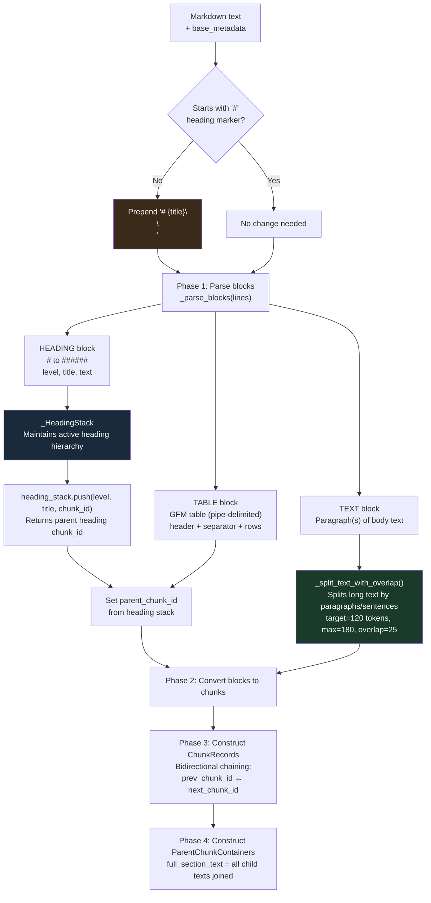
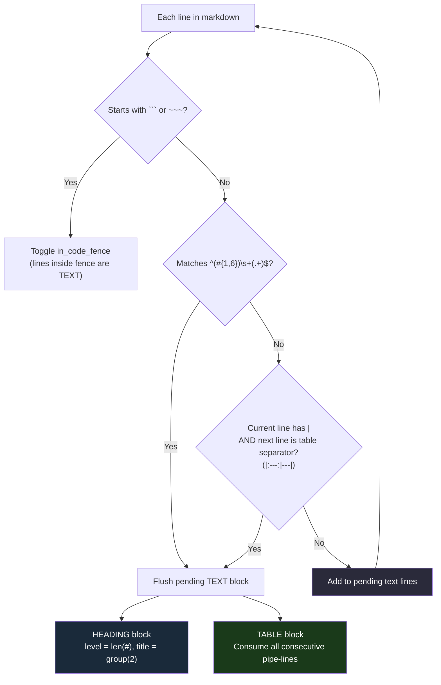
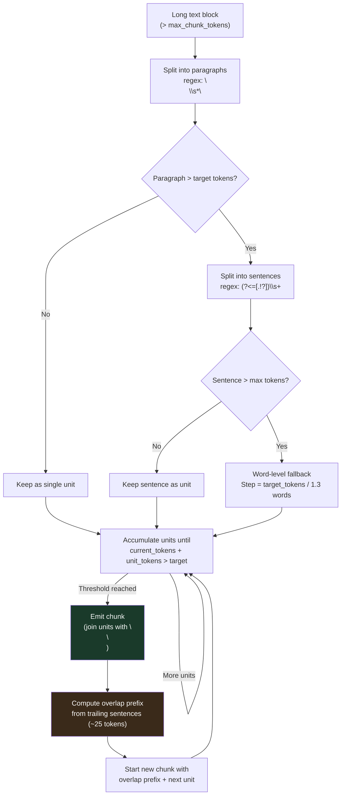
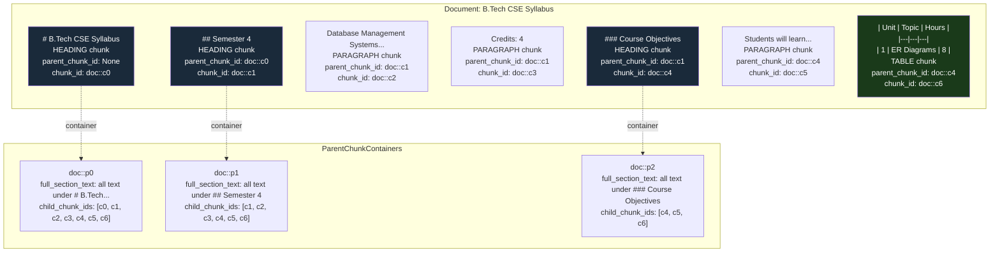
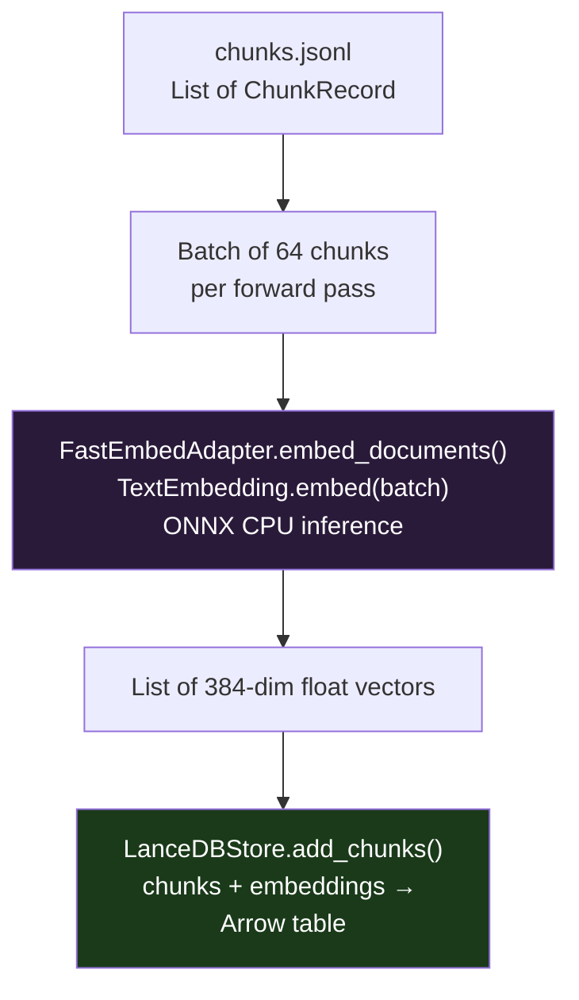
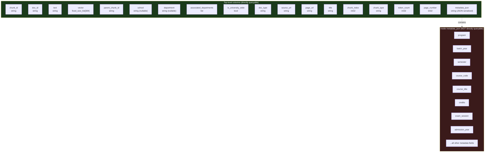
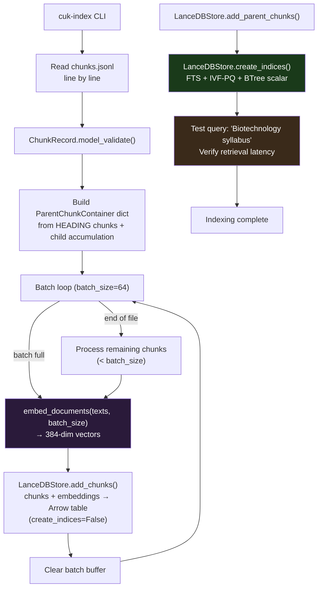

# Chunk + Embed + Index

> **Stages 4–5 of the ingestion pipeline.** Splits documents into hierarchical chunks, generates dense vectors, and indexes into LanceDB.
>
> Related: [Ingestion Overview](./overview.md) · [Parse + Normalize](./parse-normalize.md)

---

## 1. Purpose

Two CLI commands transform canonical documents into a searchable vector store:

- **`cuk-ingest`** — Reads `documents.jsonl`, enriches metadata with `PdfFactExtractor`, splits text into hierarchical chunks via `HierarchicalChunker`, writes `chunks.jsonl`.
- **`cuk-index`** — Reads `chunks.jsonl`, generates 384-dim dense vectors with FastEmbed, writes to LanceDB (Arrow columnar) with a Tantivy BM25 full-text index.

---

## 2. End-to-End Flow

```mermaid
flowchart LR
    subgraph STAGE4["Stage 4: Chunk (cuk-ingest)"]
        DOCS["documents.jsonl<br/>One line per document"]
        RUNNER["IngestionPipelineRunner.run()"]
        FACTS["PdfFactExtractor<br/>enrich_document_metadata()"]
        PREP["Prepend '# {title}' if<br/>no heading markers"]
        CHUNKER["HierarchicalChunker<br/>chunk_markdown()"]
        ADJUST["Ensure parent_chunk_id<br/>links on orphaned chunks"]
        CHUNKS_OUT["chunks.jsonl<br/>Atomic write (.tmp → rename)"]
    end

    subgraph STAGE5["Stage 5: Embed + Index (cuk-index)"]
        CHUNKS["chunks.jsonl"]
        EMBED["FastEmbedAdapter<br/>BGE-small-en-v1.5 (384-dim ONNX)"]
        BATCH["Batch embedding<br/>batch_size=64"]
        LANCE["LanceDBStore<br/>add_chunks()"]
        PARENT["Build parent_sections.lance<br/>from HEADING chunks"]
        INDICES["create_indices()<br/>IVF-PQ vector + Tantivy FTS<br/>+ BTree scalar"]
        VERIFY["Test query verification"]
        LAN_OUT["data/lancedb/<br/>chunks.lance<br/>parent_sections.lance"]
    end

    DOCS --> RUNNER
    RUNNER --> FACTS --> PREP --> CHUNKER --> ADJUST --> CHUNKS_OUT
    CHUNKS_OUT --> CHUNKS
    CHUNKS --> EMBED --> BATCH --> LANCE
    CHUNKS --> PARENT
    LANCE --> INDICES --> VERIFY --> LAN_OUT

    style STAGE4 fill:#1a3a2a,color:#fff
    style STAGE5 fill:#2a1a3a,color:#fff
```



---

## 3. Hierarchical Chunking

The `HierarchicalChunker` parses markdown text into structural blocks (headings, tables, paragraphs) and creates parent-child relationships between heading sections and their content.

### Chunking pipeline



### Block detection rules



### Text splitting with overlap

When a TEXT block exceeds `max_chunk_tokens` (180), it's split respecting paragraph and sentence boundaries:



### Chunk types

| `ChunkType` | Description | Generated from |
|-------------|-------------|----------------|
| `HEADING` | Section heading (`#` to `######`) | Markdown heading lines |
| `PARAGRAPH` | Body text chunk | Split from TEXT blocks |
| `MARKDOWN_TABLE` | Complete GFM table | Consecutive pipe-delimited lines |

> Tables are **atomic** — never split across chunks.

### Parent-child linking



Each `HEADING` chunk creates a `ParentChunkContainer` that accumulates all child chunk texts. At retrieval time, the coordinator can expand a child chunk to its full parent section for richer context.

---

## 4. PdfFactExtractor

Before chunking, each document's metadata is enriched with intrinsic facts extracted from text:

```mermaid
flowchart LR
    META["Raw metadata dict"]
    TEXT["Document text"]
    TITLE["Document title"]

    EXTRACT["PdfFactExtractor.extract_facts()"]

    subgraph PATTERNS["Regex extraction"]
        REF["Reference/circular number<br/>CUK/Acad/2023/123<br/>NIT No 04 of 2026"]
        DATE["Notification date<br/>Dated: 15-11-2024 → 2024-11-15"]
        SUBJ["Subject line<br/>Subject: Examination Schedule"]
        YEAR["Academic year<br/>2023-24 → 2023-2024"]
        AUTH["Issuing authority<br/>Registrar, Dean, VC, COE, HOD"]
        SIGN["Signatories<br/>Sd/- Name (Designation)"]
    end

    FACTS["PdfIntrinsicFacts<br/>(reference_number, notification_date,<br/>issuing_authority, signatories,<br/>subject, academic_year)"]
    ENRICH["enrich_document_metadata()<br/>Backfill missing fields<br/>(don't overwrite existing)"]
    OUT["Enriched metadata<br/>reference_number, circular_number,<br/>published_date, issuing_authority,<br/>academic_year, subject"]

    META --> EXTRACT
    TEXT --> EXTRACT
    TITLE --> EXTRACT
    EXTRACT --> PATTERNS
    PATTERNS --> FACTS
    FACTS --> ENRICH
    META --> ENRICH
    ENRICH --> OUT

    style PATTERNS fill:#1a2a3a,color:#fff
    style ENRICH fill:#1a3a2a,color:#fff
```



Extraction uses the first 3000 characters (header) and last 3000 characters (tail) of document text. Signatories and authority designations are searched in both header and tail.

---

## 5. Embedding (FastEmbed)

The `FastEmbedAdapter` generates 384-dimensional dense vectors using the BAAI/bge-small-en-v1.5 ONNX model:



### Model details

| Property | Value |
|----------|-------|
| Model | BAAI/bge-small-en-v1.5 |
| Dimension | 384 |
| Runtime | ONNX CPU (via FastEmbed) |
| Query embedding | `query_embed()` (query-optimized) with fallback to `embed()` |
| Caching | `/opt/model_cache/fastembed/` (Docker pre-warmed) |
| Threading | Configurable via `--threads` flag |

---

## 6. LanceDB Schema

The LanceDB store uses Apache Arrow columnar format. Two tables are created:

### chunks table (CHUNKS_ARROW_SCHEMA)



> **Known issue:** The slot-filler builds WHERE clauses like `program == 'B.Tech'` against `program` as if it were a top-level column, but `program` lives inside `metadata_json`. LanceDB's SQL filter engine cannot query inside a JSON string column. The filter sanitizer in `hybrid_search` strips these clauses, causing **silent filter failure**. See [routing-slots.md](../pipeline/routing-slots.md) for details.

### parent_sections table (PARENT_SECTIONS_ARROW_SCHEMA)

| Column | Type | Description |
|--------|------|-------------|
| `parent_chunk_id` | string | Parent section identifier |
| `doc_id` | string | Document ID |
| `heading_title` | string | Section heading text |
| `heading_level` | int32 | Heading depth (1–6) |
| `section_token_count` | int32 | Total tokens in section |
| `full_section_text` | string | Concatenated text of all child chunks |
| `child_chunk_ids` | list<string> | All child chunk IDs in this section |

---

## 7. Indexing Pipeline



### Indices created

| Index | Type | Columns | Purpose |
|-------|------|---------|---------|
| FTS | Tantivy full-text | `text` | BM25 lexical search |
| Vector | IVF-PQ | `vector` | Approximate nearest neighbor (dense) |
| Scalar | BTree | `doc_type`, `school`, `department` | Metadata filter acceleration |

---

## 8. Output Verification

After indexing, `cuk-index` runs a test query to verify the store is functional:

```python
test_query = "Biotechnology syllabus"
test_vec = embedder.embed_query(test_query)
test_results = vector_store.hybrid_search(
    query_text=test_query,
    query_vector=test_vec,
    top_k=3,
)
# Reports latency + candidate count
```

This catches indexing issues before the RAG pipeline tries to use the store.

---

## 9. CLI Commands

```bash
# Chunk documents
cuk-ingest --input data/processed/documents.jsonl --output data/processed/chunks.jsonl

# Index into LanceDB
cuk-index --chunks-file data/processed/chunks.jsonl --db-dir data/lancedb --batch-size 64

# Check index health (no re-indexing)
cuk-index --stats

# Or via Makefile
make ingest    # runs cuk-ingest + cuk-index in sequence
```

---

## 10. Key Files

| File | Responsibility |
|------|---------------|
| `ingestion/cli/ingest.py` | CLI entry point (`cuk-ingest`) |
| `ingestion/cli/index.py` | CLI entry point (`cuk-index`) |
| `ingestion/runner.py` | `IngestionPipelineRunner` — chunk orchestration |
| `ingestion/chunking/hierarchical_chunker.py` | `HierarchicalChunker` — AST markdown chunking |
| `ingestion/parsers/subsystems/pdf_fact_extractor.py` | `PdfFactExtractor` — intrinsic fact extraction |
| `ingestion/embedding/fastembed_adapter.py` | `FastEmbedAdapter` — ONNX embedding (BGE-small) |
| `retrieval/subsystems/lancedb_store.py` | `LanceDBStore` — Arrow columnar store + hybrid search |
| `schemas/chunks.py` | `ChunkRecord`, `ChunkType`, `ParentChunkContainer` |
