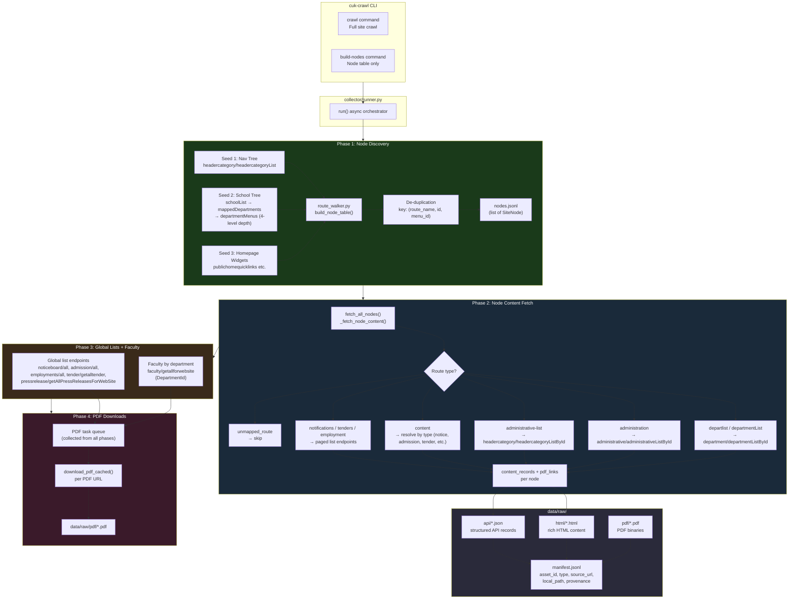
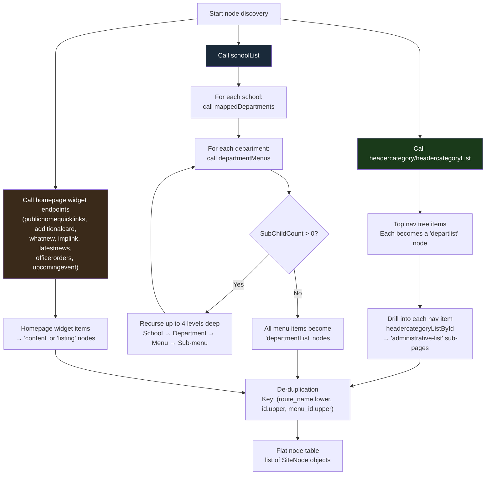
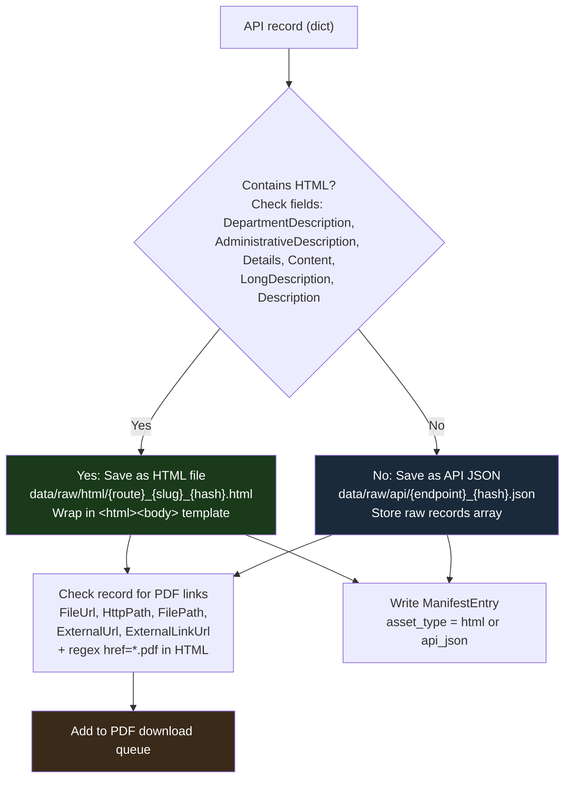
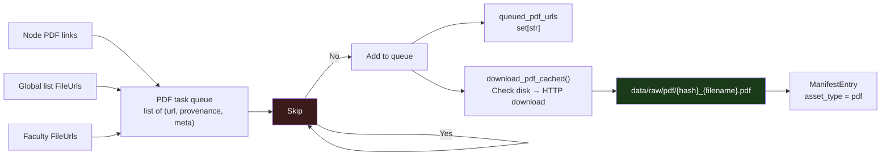

# Crawler

> **Stage 1 of the ingestion pipeline.** Scrapes the CUK website (Angular SPA) and downloads raw assets.
>
> Related: [Ingestion Overview](./overview.md) · [Parse + Normalize](./parse-normalize.md)

---

## 1. Purpose

The CUK website (`cukashmir.ac.in`) is an Angular single-page application. Content is served via a REST API at `cukapi.disgenweb.in`. The crawler discovers every page (node) on the site, fetches its content via the appropriate API endpoint, and downloads linked PDFs. Output is raw, unmodified assets — no parsing, no markdown conversion, no regex stripping.

---

## 2. Architecture



---

## 3. Node Discovery (Phase 1)

The CUK site is an Angular SPA. Every "page" is an Angular route (`/#/route;id=X;menuid=Y`). The crawler discovers pages using three complementary seed strategies:



### SiteNode structure

Each discovered page is a `SiteNode` with:

| Field | Description |
|-------|-------------|
| `node_id` | Stable 20-char hex hash of `(route_name, id, menu_id)` |
| `route_name` | Angular route segment (e.g. `departmentList`, `administration`) |
| `id` | Primary entity ID (DepartmentMasterId or HeaderCategoryMasterId) |
| `menu_id` | Secondary menu-item ID for sub-pages |
| `breadcrumb` | Ordered list of ancestor labels (for RAG context) |
| `school_name` / `department_name` | Provenance from school tree |
| `source` | Which seed discovered it: `nav-tree`, `school-tree`, `homepage` |
| `status` | `pending` → `fetched` / `empty` / `failed` / `unmapped_route` |
| `content_records` | Raw API response (populated after fetch) |
| `pdf_links` | PDF URLs discovered on this page |

---

## 4. Content Fetch (Phase 2)

After the node table is built, each node's content is fetched by dispatching to the correct REST API based on `route_name`:

```mermaid
flowchart TD
    NODE["SiteNode<br/>(route_name, id, menu_id)"]
    ROUTE{"route_name?"}

    DEPART["departlist / departmentList<br/>POST department/departmentListById<br/>payload: {Id: menu_id or id}"]
    ADMIN["administration<br/>POST administrative/administrativeListById<br/>payload: {Id: id}"]
    ADM_LIST["administrative-list<br/>POST headercategory/headercategoryListById<br/>payload: {Id: id}"]
    CONTENT["content<br/>Parse type+id from URL<br/>Resolve endpoint by type"]
    NOTIF["notifications<br/>POST noticeboard/all (paged)"]
    TENDERS["tenders<br/>POST tender/getalltender"]
    EMPLOYMENT["employment<br/>POST employments/all (paged)"]
    MESSAGE["message<br/>POST messages/allmessagesforwebsite"]
    IMPLINK["implink<br/>POST implink/selectimplinksforwebsite"]
    UNIDOC["universitydoc<br/>POST universitydoc/selectforwebsite"]
    UNIINI["universityini<br/>POST universityinitiatives/selectinitforwebsite"]
    EVENT["upcoming-event<br/>POST event/getallupcomingeventsforwebsite (paged)"]
    SCHOOL["school<br/>No API call needed<br/>(already fetched in seed)"]
    HOME["home<br/>No API call needed"]
    UNMAPPED["unmapped_route<br/>Skip (no known API pattern)"]

    CONTENT_RESOLVE{"content type?"}
    NOTICE_T["notice → noticeboard/selectbyid"]
    ADM_T["admission → admission/getadmissionbyid"]
    TENDER_T["tender → tender/getbyidforwebsite"]
    WHATNEW_T["whatnew → whatnew/selectbyid"]
    PROGRAM_T["program → mainprogramms/selectbyid"]
    PRESS_T["press → pressrelease/selectbyid"]
    DATESHEET_T["datesheet → examdatesheet/ExamDateSheetId/{id}"]
    RESULT_T["result → examinationresult/ExaminationResultbyId/{id}"]
    EMPLOYMENT_T["employment → employments/getEditDataById"]
    DEFAULT_T["default → noticeboard/selectbyid"]

    NODE --> ROUTE
    ROUTE -->|"departlist / departmentList"| DEPART
    ROUTE -->|"administration"| ADMIN
    ROUTE -->|"administrative-list"| ADM_LIST
    ROUTE -->|"content"| CONTENT --> CONTENT_RESOLVE
    ROUTE -->|"notifications"| NOTIF
    ROUTE -->|"tenders"| TENDERS
    ROUTE -->|"employment"| EMPLOYMENT
    ROUTE -->|"message"| MESSAGE
    ROUTE -->|"implink"| IMPLINK
    ROUTE -->|"universitydoc"| UNIDOC
    ROUTE -->|"universityini"| UNIINI
    ROUTE -->|"upcoming-event"| EVENT
    ROUTE -->|"school"| SCHOOL
    ROUTE -->|"home"| HOME
    ROUTE -->|"unknown / unmapped"| UNMAPPED

    CONTENT_RESOLVE -->|"notice"| NOTICE_T
    CONTENT_RESOLVE -->|"admission"| ADM_T
    CONTENT_RESOLVE -->|"tender"| TENDER_T
    CONTENT_RESOLVE -->|"whatnew"| WHATNEW_T
    CONTENT_RESOLVE -->|"program"| PROGRAM_T
    CONTENT_RESOLVE -->|"press"| PRESS_T
    CONTENT_RESOLVE -->|"datesheet"| DATESHEET_T
    CONTENT_RESOLVE -->|"result"| RESULT_T
    CONTENT_RESOLVE -->|"employment"| EMPLOYMENT_T
    CONTENT_RESOLVE -->|"default"| DEFAULT_T

    style DEPART fill:#1a3a1a,color:#fff
    style CONTENT fill:#1a2a3a,color:#fff
    style UNMAPPED fill:#3a1a1a,color:#fff
    style SCHOOL fill:#3a2a3a,color:#fff
    style HOME fill:#3a2a3a,color:#fff
```



### Content-to-HTML routing

After fetching API records, each record is inspected for HTML content. The crawler checks fields like `DepartmentDescription`, `AdministrativeDescription`, `Details`, `Content`, `LongDescription`, `Description` for HTML tags. If HTML is found, it's saved as an HTML file. If only structured data remains, it's saved as an API JSON file.



---

## 5. Global Lists and Faculty (Phase 3)

After per-node content is fetched, the crawler collects university-wide content:

| Endpoint | Payload | Purpose |
|----------|---------|---------|
| `noticeboard/all` | `{seen: 0, next: 0}` | All notices |
| `admission/all` | `{seen: 0, next: 0}` | All admissions |
| `employments/all` | `{seen: 0, next: 0}` | All employment postings |
| `tender/getalltender` | `{langType: 1}` | All tenders |
| `pressrelease/getAllPressReleasesForWebSite` | `{seen: 0, next: 0}` | All press releases |
| `faculty/getallforwebsite` | `{langType: 1, DepartmentId}` | Faculty per department |

Each global list result is saved as API JSON with a manifest entry marked `is_university_wide: true`.

---

## 6. PDF Downloads (Phase 4)

PDF URLs are collected throughout all phases:

1. **Node PDF links** — discovered in content records via `FileUrl` field or `href="*.pdf"` regex in HTML
2. **Global list PDFs** — `FileUrl` field in notice/admission/tender records
3. **Faculty records** — `FileUrl` for faculty profiles

All PDFs are queued, de-duplicated by URL, then downloaded via `download_pdf_cached()`. The function checks disk first (skip if file exists with non-zero size), then falls back to HTTP download through the cached client.

### PDF de-duplication



---

## 7. HTTP Caching and Retry

All HTTP requests go through `CachedClient` (in `core/http_cache.py`) and `DirectApiClient`:

| Feature | Implementation |
|---------|---------------|
| Response cache | In-memory LRU + disk cache keyed by URL hash |
| Retry | `tenacity` — 3 attempts with exponential backoff (1s–10s) |
| Rate limiting | HTTP cache prevents duplicate requests |
| Headers | Custom `langtype`, `Origin`, `Referer` for CUK API |
| Timeout | 30 seconds per request |
| Redirects | Disabled (CUK API returns 200 for content) |

---

## 8. Manifest Output

Every asset (HTML, API JSON, PDF) gets a `ManifestEntry` written to `data/raw/manifest.jsonl`:

```json
{
  "asset_id": "html_a1b2c3d4e5f6a1b2c3d4e5f6",
  "asset_type": "html",
  "source_url": "https://cukashmir.ac.in/#/departmentList;id=...;menuid=...",
  "local_path": "data/raw/html/departmentList_dept_cse_a1b2c3d4.html",
  "scraped_at": "2024-11-21T10:30:00+00:00",
  "provenance": {
    "school": "School of Engineering & Technology",
    "school_master_id": "SCH_ENG_001",
    "department": "Department of Computer Science & Engineering",
    "department_master_id": "DEPT_CSE_001",
    "node_path": ["Home", "Academics", "Engineering", "CSE"],
    "menu_id": "...",
    "route_name": "departmentList",
    "node_id": "...",
    "page_url": "https://cukashmir.ac.in/#/departmentList;id=..."
  },
  "raw_meta": {
    "title": "Department of Computer Science & Engineering",
    "route_name": "departmentList",
    "page_url": "https://cukashmir.ac.in/#/departmentList;id=...",
    "source_url": "https://cukashmir.ac.in/#/departmentList;id=...",
    "api_endpoint": "department/departmentListById",
    "html_key": "DepartmentDescription",
    "content_hash": "a1b2c3d4e5f6a1b2c3d4e5f6",
    "content_type": "department_page"
  }
}
```

### Asset types

| `asset_type` | Content | Source |
|-------------|---------|--------|
| `html` | HTML wrapped in `<html><body>` template | Rich HTML fields from API records |
| `api_json` | Raw JSON array of API records | Structured data (faculty, notices, tenders) |
| `pdf` | Binary PDF file | Direct download from `FileUrl` or embedded `href` |

---

## 9. CLI Commands

```bash
# Full crawl (all 4 phases)
cuk-crawl crawl

# Force re-crawl even if assets exist
cuk-crawl crawl --force

# Skip PDF downloads (HTML/API only)
cuk-crawl crawl --skip-pdf

# Build node table only (Phase 1, no content fetch or downloads)
cuk-crawl build-nodes
```

### Or via Makefile

```bash
make crawl         # cuk-crawl crawl
make crawl-force    # cuk-crawl crawl --force
make nodes          # cuk-crawl build-nodes
make save-pdfs      # cuk-crawl save-pdfs
```

---

## 10. Key Files

| File | Responsibility |
|------|---------------|
| `ingestion/cli/crawl.py` | CLI entry point (`cuk-crawl`) |
| `ingestion/collector/runner.py` | Async 4-phase orchestrator (`run()`) |
| `ingestion/collector/subsystems/route_walker.py` | Node discovery (`build_node_table`) + content fetch (`_fetch_node_content`) |
| `ingestion/collector/subsystems/client.py` | HTTP client with retry/cache (`DirectApiClient`) |
| `ingestion/collector/subsystems/manifest.py` | Thread-safe manifest writer (`ManifestWriter`) |
| `ingestion/crawl/html_parser.py` | HTML link extraction (PDF links, external links) |
| `core/http_cache.py` | Cached HTTP client (LRU + disk) |
