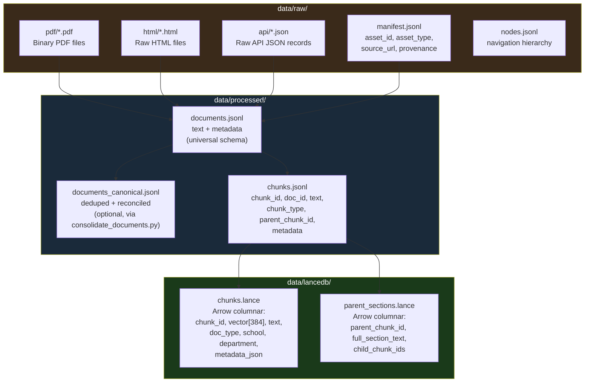
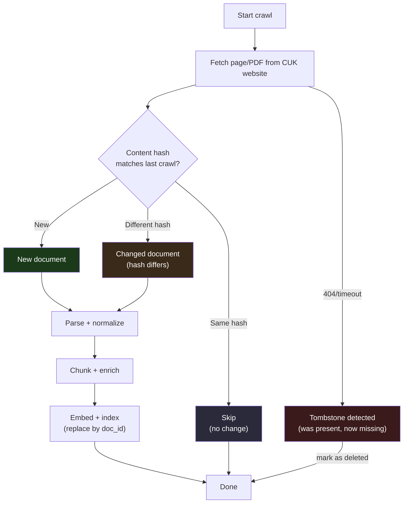

# Ingestion Pipeline Overview

> **The offline batch pipeline that scrapes, parses, normalizes, chunks, embeds, and indexes CUK documents into LanceDB.**
>
> Related: [Crawl](./crawl.md) · [Parse + Normalize](./parse-normalize.md) · [Chunk + Index](./chunk-index.md)

---

## 1. Purpose

The ingestion pipeline converts the live CUK website (`cukashmir.ac.in`) into a searchable hybrid vector store. It runs offline as a sequence of CLI commands, producing intermediate JSONL files at each stage. The entire pipeline is idempotent — re-running it replaces all outputs.

---

## 2. Five Stages

```mermaid
flowchart LR
    subgraph S1["Stage 1: Crawl"]
        C1["cuk-crawl crawl"]
        C2["cuk-crawl build-nodes"]
        C1_OUT["data/raw/<br/>pdf/, html/, api/<br/>manifest.jsonl<br/>nodes.jsonl"]
    end

    subgraph S2["Stage 2: Parse"]
        P1["cuk-parse"]
        P2["BS4 + PyMuPDF + JSON"]
        P_OUT["data/processed/<br/>documents.jsonl"]
    end

    subgraph S3["Stage 3: Normalize"]
        N1["TwoTierReconciler"]
        N2["PII Scrubber"]
        N3["Delta Detector"]
        N_OUT["documents.jsonl<br/>(reconciled + scrubbed)"]
    end

    subgraph S4["Stage 4: Chunk"]
        CH1["cuk-ingest"]
        CH2["HierarchicalChunker"]
        CH3["PdfFactExtractor"]
        CH_OUT["data/processed/<br/>chunks.jsonl"]
    end

    subgraph S5["Stage 5: Embed + Index"]
        I1["cuk-index"]
        I2["FastEmbedAdapter<br/>BGE-small-en-v1.5"]
        I3["LanceDBStore"]
        I_OUT["data/lancedb/<br/>chunks.lance<br/>parent_sections.lance"]
    end

    C1 --> C1_OUT
    C2 --> C1_OUT
    C1_OUT --> P1 --> P2 --> P_OUT
    P_OUT --> N1 --> N2 --> N3 --> N_OUT
    N_OUT --> CH1 --> CH2 --> CH3 --> CH_OUT
    CH_OUT --> I1 --> I2 --> I3 --> I_OUT

    style S1 fill:#1a3a1a,color:#fff
    style S2 fill:#1a2a3a,color:#fff
    style S3 fill:#3a2a1a,color:#fff
    style S4 fill:#1a3a2a,color:#fff
    style S5 fill:#2a1a3a,color:#fff
```



### CLI commands

| Command | Entry point | Input | Output |
|---------|------------|-------|--------|
| `cuk-crawl crawl` | `ingestion/cli/crawl.py` | CUK website | `data/raw/` assets + `manifest.jsonl` |
| `cuk-crawl build-nodes` | `ingestion/cli/crawl.py` | CUK website | `data/raw/nodes.jsonl` |
| `cuk-parse` | `ingestion/cli/parse.py` | `manifest.jsonl` | `data/processed/documents.jsonl` |
| `cuk-ingest` | `ingestion/cli/ingest.py` | `documents.jsonl` | `data/processed/chunks.jsonl` |
| `cuk-index` | `ingestion/cli/index.py` | `chunks.jsonl` | `data/lancedb/` (Arrow tables) |

**Or all at once:**

```bash
make ingest    # runs crawl → parse → ingest → index in sequence
```

---

## 3. Data Formats at Each Stage



### Field evolution across stages

| Field | manifest.jsonl | documents.jsonl | chunks.jsonl | LanceDB chunks table |
|-------|---------------|----------------|-------------|---------------------|
| `asset_id` / `doc_id` | `asset_id` | `metadata.doc_id` | `doc_id` | `doc_id` |
| `source_url` | `source_url` | `metadata.source_url` | `metadata.source_url` | `source_url` (top-level) |
| `text` | — | `text` (full document) | `text_content` (chunk) | `text` |
| `vector` | — | — | — | `vector` (384-dim float array) |
| `doc_type` | — | `metadata.doc_type` | `metadata.doc_type` | `doc_type` (top-level column) |
| `school` | `provenance.school` | `metadata.school` | `metadata.school` | `school` (top-level column) |
| `department` | `provenance.department` | `metadata.department` | `metadata.department` | `department` (top-level column) |
| `program` | — | `metadata.program` (if syllabus) | `metadata.program` | inside `metadata_json` (JSON string) |
| `batch_year` | — | `metadata.batch_year` (if syllabus) | `metadata.batch_year` | inside `metadata_json` (JSON string) |
| `semester` | — | `metadata.semester` (if syllabus) | `metadata.semester` | inside `metadata_json` (JSON string) |
| `parent_chunk_id` | — | — | `parent_chunk_id` | `parent_chunk_id` |
| `chunk_type` | — | — | `chunk_type` | `chunk_type` (top-level column) |
| `metadata_json` | — | — | — | `metadata_json` (full metadata as JSON string) |

> **Note:** Fields like `program`, `batch_year`, `semester` are stored inside `metadata_json` as a JSON string, **not** as top-level LanceDB columns. This is the root cause of the metadata filter mismatch documented in [routing-slots.md](../pipeline/routing-slots.md).

---

## 4. Stage Details

### Stage 1: Crawl (`cuk-crawl`)

The crawler scrapes the CUK website, which is an Angular SPA. It discovers navigation routes, downloads PDFs, fetches HTML pages, and collects API JSON records. Output goes to `data/raw/`.

- **Node discovery**: Parses the Angular SPA's menu hierarchy to build a navigation tree
- **PDF extraction**: Downloads PDF binaries with HEAD/GET requests
- **HTML/API**: Fetches page HTML and API JSON records
- **Manifest**: Writes `manifest.jsonl` with provenance metadata (school, department, route)

See [crawl.md](./crawl.md) for the full crawler decision tree.

### Stage 2: Parse (`cuk-parse`)

Reads `manifest.jsonl`, dispatches each asset to the appropriate parser (BS4 for HTML, PyMuPDF for PDF, JSON for API records), and produces `documents.jsonl` with full text and metadata.

- **HTML**: BeautifulSoup4 + lxml extraction
- **PDF**: PyMuPDF text + table extraction, Docling adapter for complex layouts
- **API**: Direct JSON parsing for faculty/notices/tenders

See [parse-normalize.md](./parse-normalize.md) for the parse + reconcile flow.

### Stage 3: Normalize (embedded in `cuk-parse`)

Normalization runs as part of the parse pipeline. The `TwoTierReconciler` harmonizes Tier 1 (web provenance from crawler) with Tier 2 (intrinsic facts extracted from document text). The `sanitizer` scrubs PII (phone numbers, emails, DOBs, roll numbers). The `DeltaDetector` tracks document changes between crawl runs.

- **TwoTierReconciler**: Merges crawler metadata with document-extracted facts, classifies into 7 domain types
- **PII Scrubber**: Regex-based removal of phone numbers, emails, DOBs, roll numbers
- **Delta Detection**: Content hash comparison for incremental updates

See [parse-normalize.md](./parse-normalize.md) for details.

### Stage 4: Chunk (`cuk-ingest`)

Reads `documents.jsonl`, enriches metadata with `PdfFactExtractor`, and performs hierarchical AST markdown chunking via `HierarchicalChunker`.

- **PdfFactExtractor**: Extracts course codes, batch years, semesters, circular references from text
- **HierarchicalChunker**: Parses markdown AST, builds heading stack, creates parent-child chunk relationships
- **Chunk types**: `HEADING` (parent sections), `PARAGRAPH` (child text), `MARKDOWN_TABLE` (structured tables)
- **Target size**: ~120 tokens per child chunk, max 180, with 25-token overlap
- **Atomic output**: Writes to `.tmp` file then renames for crash safety

See [chunk-index.md](./chunk-index.md) for the chunking flow.

### Stage 5: Embed + Index (`cuk-index`)

Reads `chunks.jsonl`, generates 384-dimensional dense vectors with FastEmbed (BGE-small-en-v1.5 ONNX model), and writes to LanceDB with a Tantivy BM25 full-text index.

- **FastEmbedAdapter**: Batch embedding generation, ONNX runtime
- **LanceDBStore**: Arrow columnar storage, hybrid search (dense + sparse)
- **Parent sections**: Builds `parent_sections.lance` table for context expansion
- **Indices**: IVF-PQ vector index, Tantivy FTS index, BTree scalar indices
- **Verification**: Runs a test query after indexing to measure retrieval latency

See [chunk-index.md](./chunk-index.md) for the embedding + indexing flow.

---

## 5. Module Structure

```mermaid
flowchart TB
    subgraph CLI["ingestion/cli/"]
        CLI_CRAWL["crawl.py<br/>cuk-crawl"]
        CLI_PARSE["parse.py<br/>cuk-parse"]
        CLI_INGEST["ingest.py<br/>cuk-ingest"]
        CLI_INDEX["index.py<br/>cuk-index"]
    end

    subgraph COLLECTOR["ingestion/collector/"]
        COLL_RUN["runner.py<br/>async crawl orchestrator"]
        COLL_CLIENT["subsystems/client.py<br/>DirectApiClient"]
        COLL_WALK["subsystems/route_walker.py<br/>Angular route discovery"]
        COLL_MAN["subsystems/manifest.py<br/>ManifestWriter"]
    end

    subgraph PARSERS["ingestion/parsers/"]
        PAR_BASE["base.py<br/>BaseParser"]
        PAR_HTML["html_parser.py<br/>BS4 HTML extraction"]
        PAR_PDF["pdf_parser.py<br/>PyMuPDF extraction"]
        PAR_API["api_parser.py<br/>JSON record parsing"]
        PAR_DOC["subsystems/docling_adapter.py<br/>DoclingPdfParser"]
        PAR_FACT["subsystems/pdf_fact_extractor.py<br/>PdfFactExtractor"]
    end

    subgraph NORM["ingestion/normalization/subsystems/"]
        NORM_PIPE["pipeline.py<br/>parse_manifest orchestrator"]
        NORM_REC["reconciler.py<br/>TwoTierReconciler"]
        NORM_SAN["sanitizer.py<br/>PII scrubbing"]
        NORM_DEL["delta_detector.py<br/>DeltaDetector"]
        NORM_AGG["aggregator.py<br/>cross-route merging"]
        NORM_META["metadata_normalizer.py<br/>regex extractors"]
    end

    subgraph CHUNK["ingestion/chunking/"]
        CHUNK_HC["hierarchical_chunker.py<br/>HierarchicalChunker"]
    end

    subgraph EMBED["ingestion/embedding/"]
        EMBED_FE["fastembed_adapter.py<br/>FastEmbedAdapter"]
    end

    subgraph RUNNER["ingestion/runner.py"]
        RUN_MAIN["IngestionPipelineRunner<br/>chunk orchestration"]
    end

    CLI_CRAWL --> COLL_RUN
    COLL_RUN --> COLL_CLIENT
    COLL_RUN --> COLL_WALK
    COLL_RUN --> COLL_MAN

    CLI_PARSE --> NORM_PIPE
    NORM_PIPE --> PARSERS
    NORM_PIPE --> NORM_REC
    NORM_PIPE --> NORM_SAN
    NORM_PIPE --> NORM_DEL

    CLI_INGEST --> RUN_MAIN
    RUN_MAIN --> PAR_FACT
    RUN_MAIN --> CHUNK_HC

    CLI_INDEX --> EMBED_FE
    CLI_INDEX --> RETR["retrieval/subsystems/lancedb_store.py"]

    style CLI fill:#3a2a1a,color:#fff
    style COLLECTOR fill:#1a3a1a,color:#fff
    style PARSERS fill:#1a2a3a,color:#fff
    style NORM fill:#3a1a2a,color:#fff
    style CHUNK fill:#1a3a2a,color:#fff
    style EMBED fill:#2a1a3a,color:#fff
    style RUNNER fill:#2a2a3a,color:#fff
```



---

## 6. Ingestion Stats Example

Running `make ingest` produces output like:

```
==> Running document chunking and hierarchical ingestion...
  Input:   data/processed/documents.jsonl
  Output:  data/processed/chunks.jsonl

Ingestion completed successfully!
  Total Documents:  450
  Total Chunks:      3,200
  Parent Sections:   380
  Table Chunks:      85
  Execution Time:    12.5s
  Errors:            2

==> Indexing chunks into hybrid LanceDB store (FastEmbed + Tantivy BM25)...
  Total Chunks:        3,200
  Parent Sections:     380
  Duration:            45.2s
  Throughput:          70.8 chunks/sec
  LanceDB Storage:     128.5 MB
  Indices Built:       fts_index (Tantivy), vector_idx (IVF-PQ), scalar_idx (BTree)
  Test Query Latency:  12.30 ms (3 candidates found)
```

---

## 7. Re-ingestion and Updates

The pipeline is designed for incremental updates via the `DeltaDetector`:



The `DeltaDetectorProtocol` (defined in `core/protocols/ingestion.py`) tracks `doc_id` → `content_hash` mappings. On re-crawl, documents with unchanged hashes are skipped. Documents that disappeared from the website are marked as tombstones. Only new or changed documents are re-parsed, re-chunked, and re-indexed.
