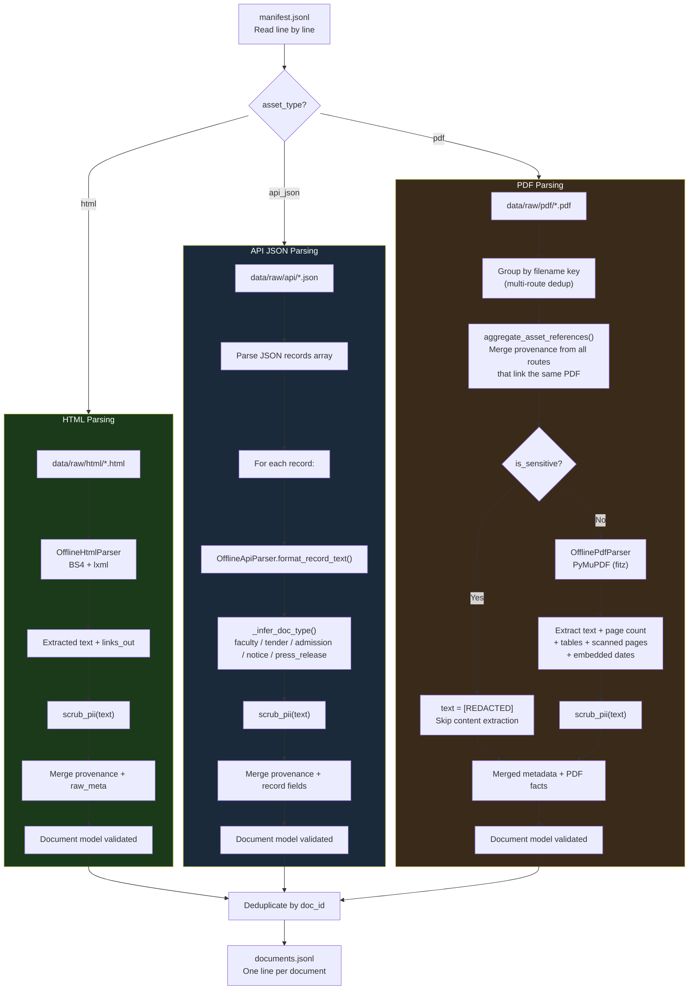
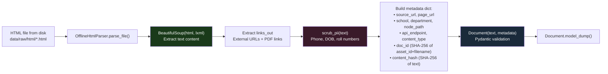
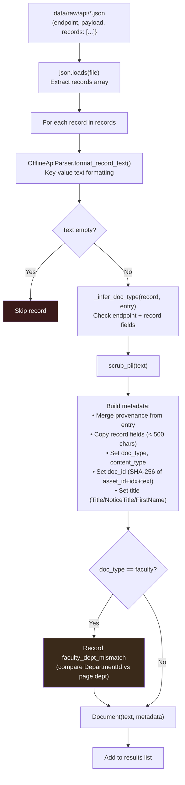
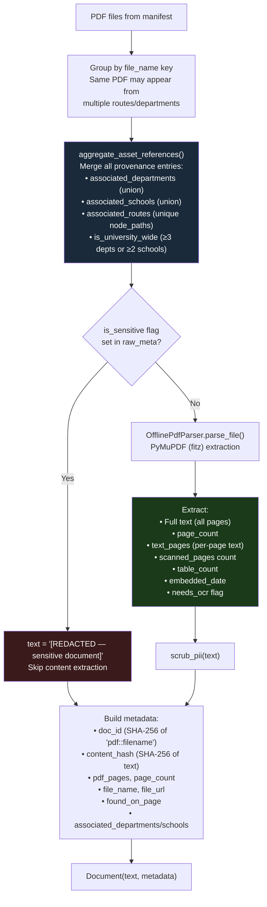
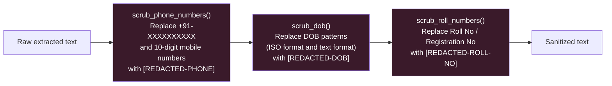
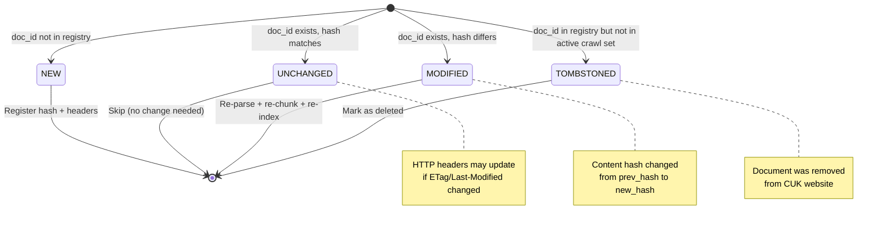
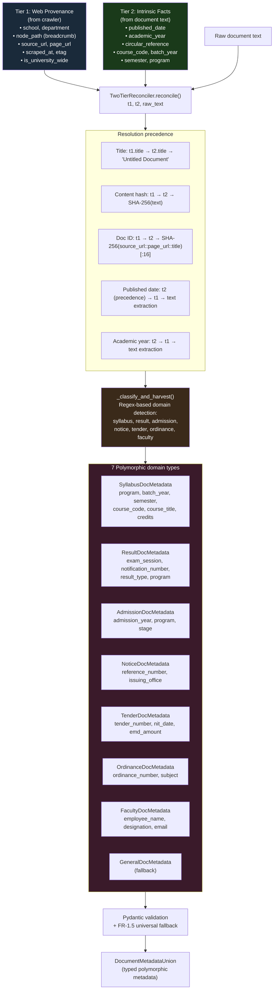

# Parse + Normalize

> **Stages 2–3 of the ingestion pipeline.** Converts raw assets into canonical documents with reconciled metadata and PII scrubbing.
>
> Related: [Ingestion Overview](./overview.md) · [Crawl](./crawl.md) · [Chunk + Index](./chunk-index.md)

---

## 1. Purpose

The parse pipeline reads `manifest.jsonl` (produced by the crawler), dispatches each raw asset to the appropriate parser (HTML, PDF, API JSON), extracts clean text, scrubs PII, reconciles metadata, and validates against the `Document` schema. Output is `documents.jsonl` — one JSONL record per canonical document.

---

## 2. Parse Pipeline Flow



---

## 3. HTML Parsing

HTML assets are pages from the CUK website that contain rich HTML content (department descriptions, administrative details, content pages). The parser uses BeautifulSoup4 with lxml.



### `content_type` classification for HTML

| Route name contains | `content_type` |
|---------------------|---------------|
| `department` or `depart` | `department_page` |
| Otherwise | `administrative_page` |

---

## 4. API JSON Parsing

API JSON assets contain structured records (notices, tenders, admissions, faculty, press releases). Each JSON file may contain multiple records. The parser formats each record into text and infers its document type.



### Document type inference

The `_infer_doc_type()` function checks endpoint names and record fields:

| Signal | Inferred `doc_type` |
|--------|-------------------|
| Endpoint contains `faculty` or record has `FirstName`/`Designation` | `faculty` |
| Endpoint contains `tender` or record has `TenderNo`/`TenderTitle` | `tender` |
| Endpoint contains `admission` | `admission` |
| Endpoint contains `employment` | `employment` |
| Endpoint contains `notice` or record has `NoticeTitle` | `notice` |
| Endpoint contains `pressrelease` | `press_release` |
| Otherwise | `api_record` |

---

## 5. PDF Parsing

PDFs are grouped by filename key to handle multi-route references (the same PDF linked from multiple department pages). The `aggregate_asset_references()` function merges provenance from all routes, building `associated_departments` and `associated_schools` lists.



### Multi-route aggregation example

A syllabus PDF for "B.Tech CSE Database Management Systems" might be linked from:
- School of Engineering → Department of CSE → Syllabus page
- School of Engineering → Department of IT → Course Outlines page

The aggregator merges both into one canonical document:

```json
{
  "associated_departments": ["Computer Science & Engineering", "Information Technology"],
  "associated_schools": ["School of Engineering & Technology"],
  "associated_routes": [["Home", "Academics", "CSE", "Syllabus"], ["Home", "Academics", "IT", "Course Outlines"]],
  "is_university_wide": false,
  "primary_department": "Computer Science & Engineering"
}
```

---

## 6. PII Sanitization

The `scrub_pii()` function applies regex-based redaction to all extracted text:



### Regex patterns

| Pattern | Regex | Replacement |
|---------|-------|-------------|
| Mobile/phone | `\b(?:\+91[- ]?)?[6-9]\d{9}\b` | `[REDACTED-PHONE]` |
| Date of birth (ISO) | `\b(19\|20)\d{2}-\d{2}-\d{2}T00:00:00\b` | `[REDACTED-DOB]` |
| Date of birth (text) | `\b(?:DOB\|Date\s*of\s*Birth)[\s:]*([0-9]{1,2}[-/][0-9]{1,2}[-/][0-9]{2,4})\b` | `DOB: [REDACTED-DOB]` |
| Roll/Registration | `\b(?:Roll\s*(?:No\|Number)\|Registration\s*(?:No\|Number))[\s:]*([A-Za-z0-9\-_/]{4,16})\b` | `Roll No: [REDACTED-ROLL-NO]` |

Additionally, `sanitize_record_dict()` strips known sensitive keys from record dictionaries: `dob`, `mobileno`, `phone`, `aadhar`, `pan`, `bankaccount`, `ifsc`, `salary`, etc.

---

## 7. Delta Detection

The `DeltaDetector` tracks document content hashes between crawl runs to support incremental updates:



### DeltaStatus values

| Status | Condition | Action |
|--------|-----------|--------|
| `NEW` | `doc_id` not in registry | Register, parse, chunk, index |
| `UNCHANGED` | `doc_id` exists, `content_hash` matches | Skip re-processing |
| `MODIFIED` | `doc_id` exists, `content_hash` differs | Re-parse, re-chunk, re-index |
| `TOMBSTONED` | `doc_id` in registry but absent from active crawl set | Mark as deleted in LanceDB |

---

## 8. Metadata Reconciliation (TwoTierReconciler)

The `TwoTierReconciler` harmonizes two tiers of metadata:



### Domain-specific field harvesting

The reconciler uses regex patterns to extract domain-specific fields from document text:

| Domain | Regex-extracted fields |
|--------|----------------------|
| Syllabus | `program` (B.Tech/M.Tech/MCA/MBA...), `batch_year`, `semester` (Roman/Arabic), `course_code` (BT-101, CS-C402), `credits` |
| Result | `exam_session`, `notification_number`, `result_type` (regular/re_evaluation/backlog) |
| Admission | `admission_year`, `stage` (cut_off/selection_list/counselling), `intake_capacity` |
| Notice | `reference_number` (CUK/Acad/2023/123), `issuing_office`, `is_urgent` |
| Tender | `tender_number` (NIT No), `nit_date`, `closing_date`, `emd_amount` |
| Ordinance | `ordinance_number`, `subject`, `governing_body`, `effective_date` |
| Faculty | `employee_name`, `designation`, `email` (masked), `qualifications`, `research_areas` |

---

## 9. Output Format

Each line in `documents.jsonl` is a serialized `Document` model:

```json
{
  "text": "The Central University of Kashmir offers a 4-semester B.Tech program...",
  "metadata": {
    "doc_id": "a1b2c3d4e5f6a1b2c3d4e5f6",
    "doc_type": "syllabus",
    "title": "B.Tech CSE Syllabus 2022",
    "normalized_title": "b.tech cse syllabus 2022",
    "source_url": "https://cukashmir.ac.in/docs/btech_cse_2022.pdf",
    "page_url": "https://cukashmir.ac.in/#/departmentList;id=...",
    "school": "School of Engineering & Technology",
    "department": "Department of Computer Science & Engineering",
    "node_path": ["Home", "Academics", "Engineering", "CSE"],
    "published_date": "2022-06-15",
    "academic_year": "2022-2023",
    "is_university_wide": false,
    "content_hash": "sha256...",
    "scraped_at": "2024-11-21T10:30:00+00:00",
    "program": "B.Tech Computer Science & Engineering",
    "batch_year": "2022",
    "semester": "Semester 4",
    "course_code": "BT-CSE-401",
    "course_title": "Database Management Systems",
    "credits": 4,
    "associated_departments": ["Computer Science & Engineering"],
    "associated_routes": [["Home", "Academics", "CSE", "Syllabus"]],
    "pdf_pages": 12,
    "page_count": 12
  }
}
```

---

## 10. Concurrency

The parse pipeline uses a `ThreadPoolExecutor` to parse assets in parallel:

| Asset type | Concurrency | Parser |
|-----------|-------------|--------|
| HTML | Up to `min(32, CPU+4)` threads | `OfflineHtmlParser` (BS4) |
| API JSON | Same pool | `OfflineApiParser` (JSON) |
| PDF | Same pool | `OfflinePdfParser` (PyMuPDF) |

PDFs are grouped first (by filename key), then each group is parsed as a unit.

---

## 11. Key Files

| File | Responsibility |
|------|---------------|
| `ingestion/cli/parse.py` | CLI entry point (`cuk-parse`) |
| `ingestion/normalization/subsystems/pipeline.py` | Parse orchestrator (`parse_manifest`) |
| `ingestion/parsers/html_parser.py` | HTML parsing (BS4 + lxml) |
| `ingestion/parsers/pdf_parser.py` | PDF parsing (PyMuPDF) |
| `ingestion/parsers/api_parser.py` | API JSON record formatting |
| `ingestion/normalization/subsystems/sanitizer.py` | PII scrubbing (phone, DOB, roll, email) |
| `ingestion/normalization/subsystems/aggregator.py` | Multi-route reference aggregation |
| `ingestion/normalization/subsystems/reconciler.py` | Two-tier metadata reconciliation |
| `ingestion/normalization/subsystems/delta_detector.py` | Incremental delta detection |
| `ingestion/normalization/subsystems/metadata_normalizer.py` | Regex extractors (batch year, semester, etc.) |
| `schemas/document.py` | `Document` Pydantic model |
| `schemas/metadata.py` | Polymorphic metadata schemas (7 domain types) |
