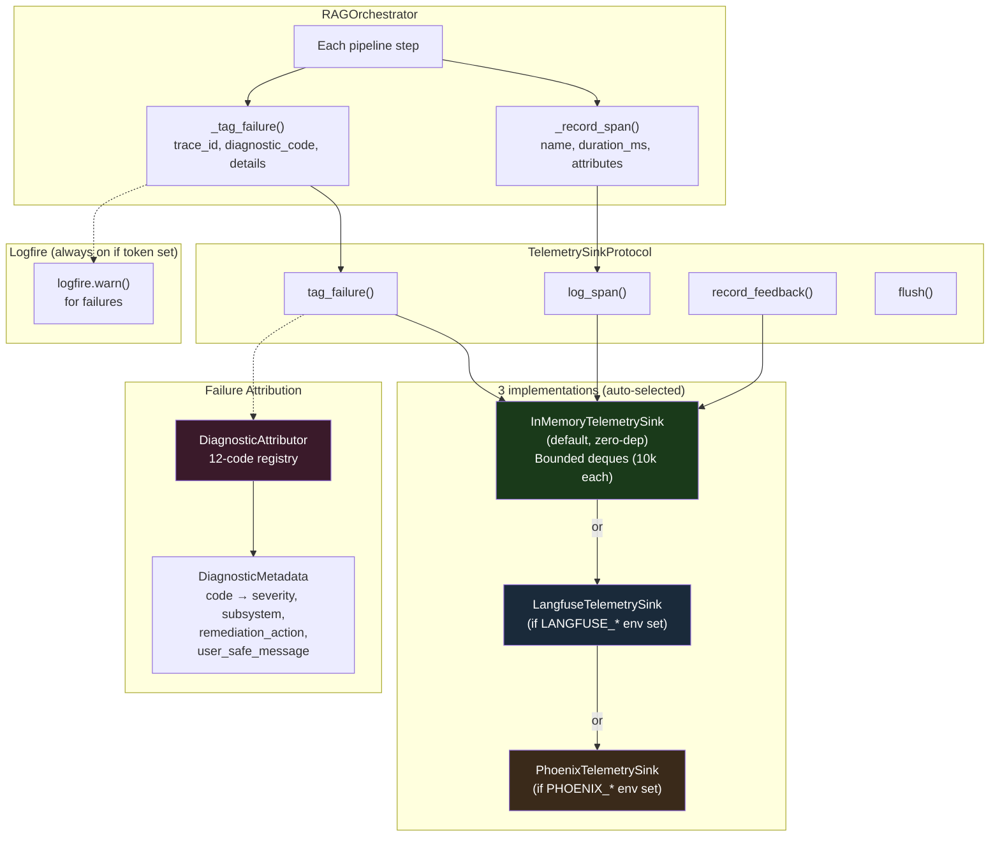
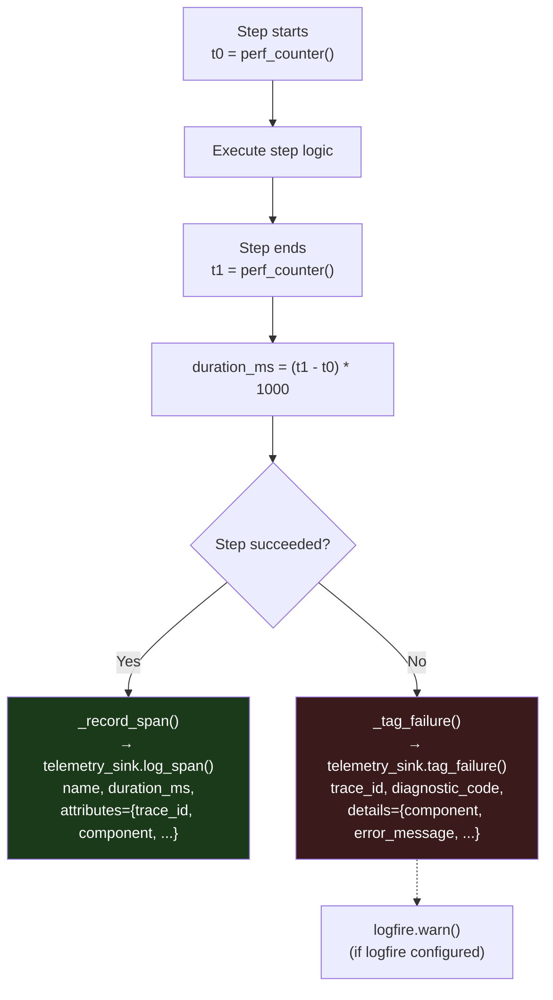
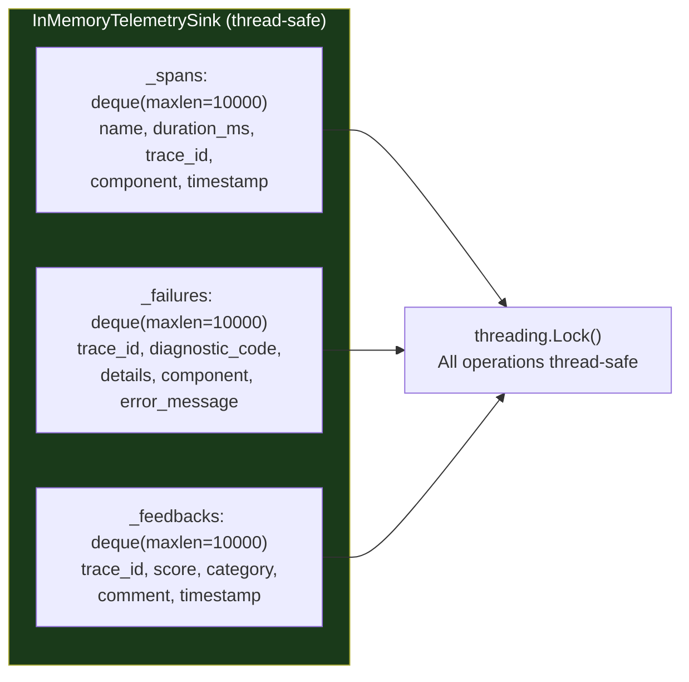

# Telemetry + Failure Attribution

> **Execution spans, diagnostic failure codes, and user feedback.** The telemetry system is fail-open — it never crashes the pipeline.
>
> Related: [Architecture](../architecture.md) · [Pipeline Overview](../pipeline/overview.md)

---

## 1. Purpose

Every pipeline step is wrapped in telemetry spans (timing) and failure attribution (diagnostic codes). Three telemetry sink implementations are available: InMemory (default), Langfuse, and Phoenix/Arize. The orchestrator also records user feedback (thumbs up/down).

---

## 2. Telemetry Architecture



---

## 3. 12-Diagnostic Failure Code Matrix

```mermaid
flowchart TB
    subgraph CODES["FailureDiagnosticCode (StrEnum)"]
        GB["GUARDRAIL_BLOCKED<br/>severity: LOW<br/>subsystem: guardrails<br/>Action: Reject with policy disclaimer"]
        PD["PARSING_DEFECT<br/>severity: HIGH<br/>subsystem: ingestion<br/>Action: Mark needs_ocr=True"]
        QPF["QUESTION_PARSING_FAILED<br/>severity: LOW<br/>subsystem: retrieval<br/>Action: Fallback to raw BM25"]
        RE["RETRIEVAL_EMPTY<br/>severity: MEDIUM<br/>subsystem: retrieval<br/>Action: Trigger scope fallback"]
        RRM["RETRIEVAL_RECALL_MISS<br/>severity: HIGH<br/>subsystem: retrieval<br/>Action: Regex fallback scan"]
        MTR["MISSED_TOP_RANKED<br/>severity: MEDIUM<br/>subsystem: retrieval<br/>Action: Log rank divergence"]
        CT["CONTEXT_TRUNCATION<br/>severity: MEDIUM<br/>subsystem: llm<br/>Action: Truncate lower-ranked chunks"]
        LEF["LLM_EXTRACTION_FAILURE<br/>severity: HIGH<br/>subsystem: llm<br/>Action: Switch to Groq fallback"]
        LH["LLM_HALLUCINATION<br/>severity: HIGH<br/>subsystem: guardrails<br/>Action: Redact unverified claims"]
        LFV["LLM_FORMAT_VIOLATION<br/>severity: HIGH<br/>subsystem: llm<br/>Action: Retry with JSON schema"]
        OSV["OUTPUT_SAFETY_VIOLATION<br/>severity: CRITICAL<br/>subsystem: guardrails<br/>Action: Censor output completely"]
        CMC["CORPUS_MISSING_CONTENT<br/>severity: LOW<br/>subsystem: guardrails<br/>Action: Return negative confirmation"]
    end

    style GB fill:#3a2a3a,color:#fff
    style PD fill:#3a1a1a,color:#fff
    style RRM fill:#3a1a1a,color:#fff
    style LEF fill:#3a1a1a,color:#fff
    style LH fill:#3a1a1a,color:#fff
    style LFV fill:#3a1a1a,color:#fff
    style OSV fill:#3a1a1a,color:#fff
    style RE fill:#3a2a1a,color:#fff
    style MTR fill:#3a2a1a,color:#fff
    style CT fill:#3a2a1a,color:#fff
    style QPF fill:#3a2a3a,color:#fff
    style CMC fill:#3a2a3a,color:#fff
```



### Codes used by the orchestrator

| Code | Step | Condition |
|------|------|-----------|
| `GUARDRAIL_BLOCKED` | Step 1, Step 3 | Query rejected by input guard or router |
| `RETRIEVAL_EMPTY` | Step 4 | Zero chunks returned |
| `RETRIEVAL_RECALL_MISS` | Step 4 | Low score + regex fallback triggered |
| `CORPUS_MISSING_CONTENT` | Step 4 | Regex fallback found nothing |
| `LLM_EXTRACTION_FAILURE` | Step 5 | All LLM providers failed |
| `LLM_HALLUCINATION` | Step 6 | Citation verifier found ungrounded snippets |
| `OUTPUT_SAFETY_VIOLATION` | Step 7 | Output safety rail triggered |

---

## 4. Span Recording Flow



### Fail-open invariant

All telemetry calls are wrapped in try/except. If the telemetry sink itself fails, the warning is logged but the pipeline continues:

```python
try:
    self.telemetry_sink.log_span(name=..., attributes=..., duration_ms=...)
except Exception as exc:
    logger.warning("Telemetry log_span failed: %s", exc)
```

---

## 5. InMemoryTelemetrySink

The default sink stores everything in bounded deques:



### Inspection methods

| Method | Returns | Filter |
|--------|---------|--------|
| `get_spans(trace_id)` | `list[TelemetryRecord]` | All or by trace_id |
| `get_failures(trace_id)` | `list[TelemetryRecord]` | All or by trace_id |
| `get_feedbacks(trace_id)` | `list[TelemetryRecord]` | All or by trace_id |
| `count_spans()` | `int` | Total span count |
| `count_failures()` | `int` | Total failure count |
| `count_feedbacks()` | `int` | Total feedback count |
| `clear()` | — | Clears all deques |

---

## 6. Feedback Flow


---

## 7. Key Files

| File | Responsibility |
|------|---------------|
| `core/protocols/telemetry.py` | `TelemetrySinkProtocol`, `FailureDiagnosticCode`, `SpanAttributes`, `FailureEvent` |
| `observability/in_memory_sink.py` | `InMemoryTelemetrySink` — default zero-dependency sink |
| `observability/langfuse_sink.py` | `LangfuseTelemetrySink` — Langfuse integration |
| `observability/phoenix_sink.py` | `PhoenixTelemetrySink` — Arize Phoenix OTLP integration |
| `observability/failure_attribution.py` | `DiagnosticAttributor`, `DiagnosticMetadata`, 12-code registry |
| `core/factory.py` | `create_telemetry_sink()` — auto-selects based on env vars |
