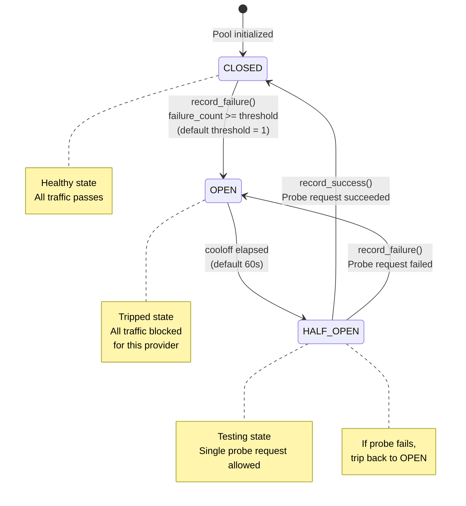
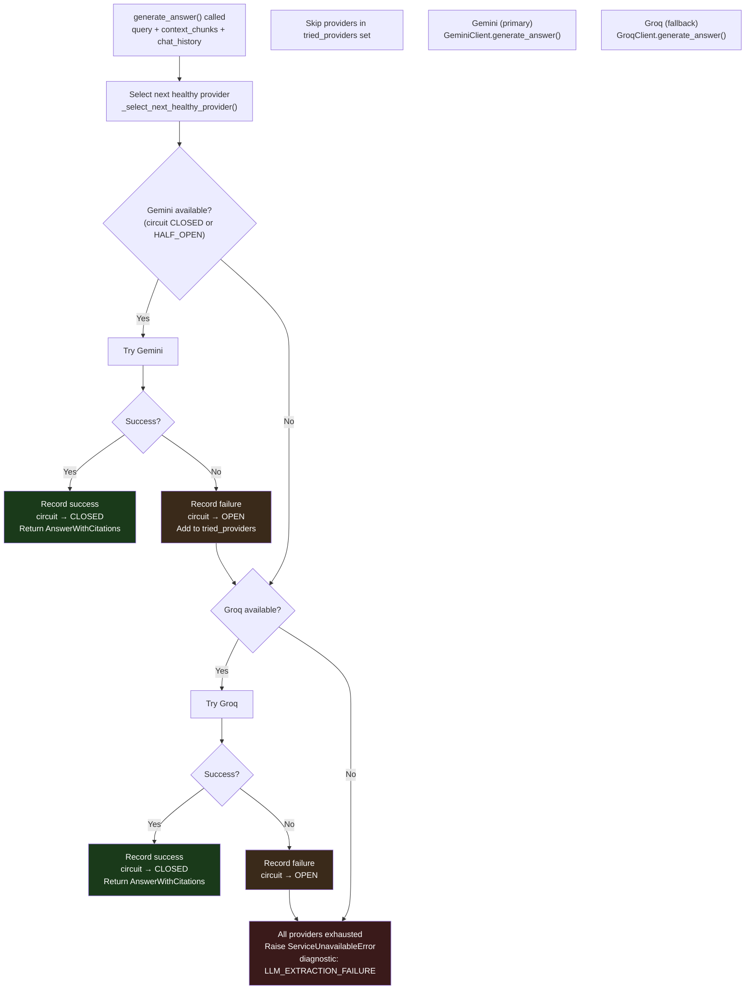
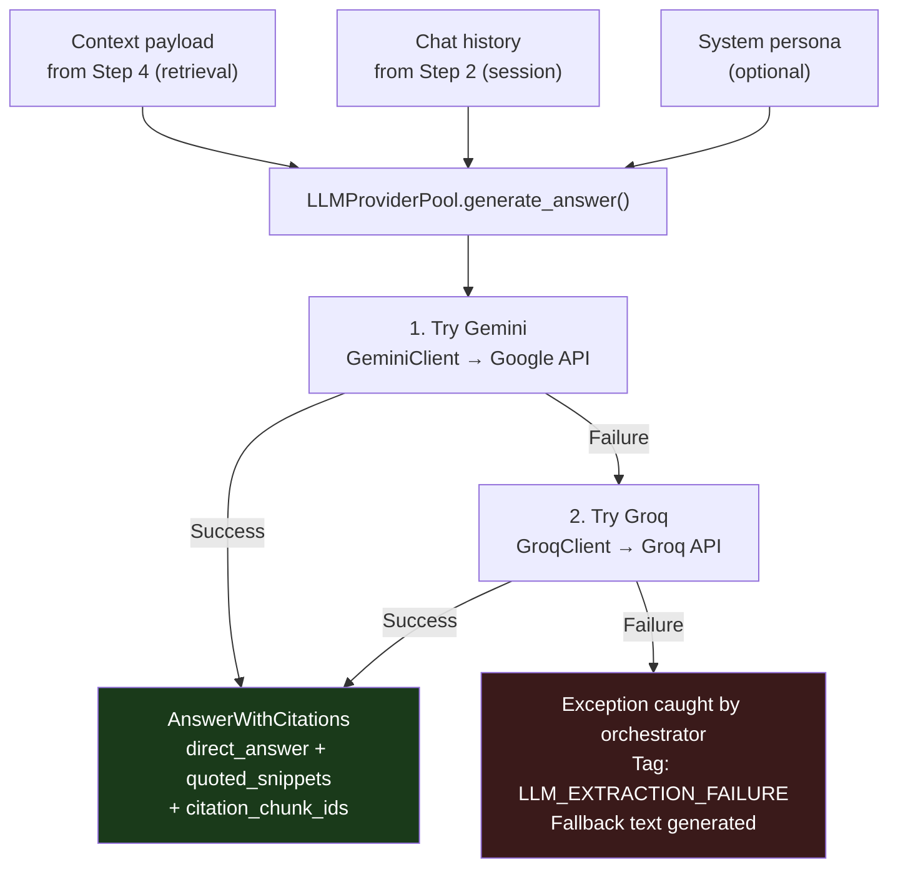
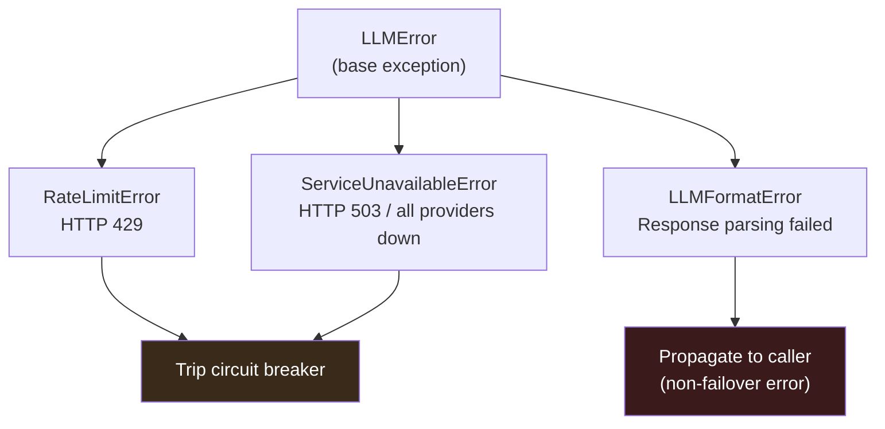

# LLM Generation + Circuit Breaker Failover

> **Gemini primary, Groq fallback.** The `LLMProviderPool` wraps both providers in per-provider circuit breakers for automatic failover.
>
> Related: [Pipeline Overview](./overview.md)

---

## 1. Purpose

Step 5 of the request pipeline generates a structured answer with citations. The `LLMProviderPool` provides round-robin load balancing and automatic failover when a provider is rate-limited (429) or unavailable (503). Each provider has its own circuit breaker that trips after failures and recovers after a cooloff period.

---

## 2. Circuit Breaker State Machine



### State behaviors

| State | `is_available()` | Behavior |
|-------|-----------------|----------|
| `CLOSED` | True | Provider accepts traffic. Failures increment count. |
| `OPEN` | False | Provider blocked. After `cooloff_seconds` (60s), transitions to `HALF_OPEN`. |
| `HALF_OPEN` | True | Single probe request allowed. Success → `CLOSED`, failure → `OPEN`. |

---

## 3. Failover Flow



### Trip conditions

The `_should_trip_breaker()` method determines if an exception should trip the circuit:

| Exception type | Trip? | Reason |
|----------------|-------|--------|
| `RateLimitError` (429) | Yes | Rate limited — wait and retry later |
| `ServiceUnavailableError` (503) | Yes | Provider down |
| `httpx.HTTPStatusError` 401/403 | Yes | Auth failure — won't recover without config change |
| `httpx.HTTPStatusError` 429 | Yes | Rate limited |
| `httpx.HTTPStatusError` 500/502/503/504 | Yes | Server error |
| `httpx.TransportError` | Yes | Network failure |
| `httpx.TimeoutException` | Yes | Request timed out |
| Other exceptions | No | Propagated immediately (e.g. bad user payload) |

---

## 4. Provider Configuration

| Provider | Model | Priority | Purpose |
|----------|-------|----------|---------|
| Google Gemini | `gemini-flash-latest` (env: `GEMINI_MODEL`) | Primary | Fast, high-quality generation |
| Groq | `qwen3.8-27b` (env: `GROQ_MODEL`) | Fallback | Failover when Gemini is rate-limited |

The factory (`create_llm_pool`) reads API keys from environment variables or `.env` file:

```python
gemini_client = GeminiClient(api_key=gemini_key, model=gemini_model)
groq_client = GroqClient(api_key=groq_key, model=groq_model)
pool = LLMProviderPool(
    providers=[gemini_client, groq_client],
    cooloff_seconds=60.0,
    failure_threshold=1,
)
```

---

## 5. AnswerWithCitations Schema

The LLM returns a structured answer:

```python
class AnswerWithCitations(BaseModel):
    direct_answer: str              # The generated response text
    quoted_snippets: list[str]      # Verbatim quotes from retrieved chunks
    citation_chunk_ids: list[str]   # Chunk IDs cited in the answer
    confidence_score: float         # LLM's confidence [0, 1]
```

The orchestrator uses:
- `direct_answer` → streamed as tokens to the client
- `quoted_snippets` → verified against retrieved chunks by `VerbatimCitationVerifier`
- `citation_chunk_ids` → used to build citation cards

---

## 6. Orchestrator Integration



### Fallback text on total failure

When all providers are exhausted, the orchestrator generates a fallback:

```python
fallback_text = (
    f"Here is the official information regarding '{query}'. "
    "Please refer to the verified campus documents below for complete regulations."
)
answer = AnswerWithCitations(
    direct_answer=fallback_text,
    quoted_snippets=[],
    citation_chunk_ids=[],
    confidence_score=0.5,
)
```

---

## 7. Error Hierarchy



---

## 8. Key Files

| File | Responsibility |
|------|---------------|
| `llm/pool.py` | `LLMProviderPool`, `CircuitBreaker`, `CircuitState` |
| `llm/gemini_client.py` | `GeminiClient` — Google Gemini API client |
| `llm/groq_client.py` | `GroqClient` — Groq API client |
| `core/protocols/llm.py` | `LLMClientProtocol` |
| `schemas/llm.py` | `AnswerWithCitations`, `CitationCard` |
| `core/factory.py` | `create_llm_pool()` — wires providers with API keys |
