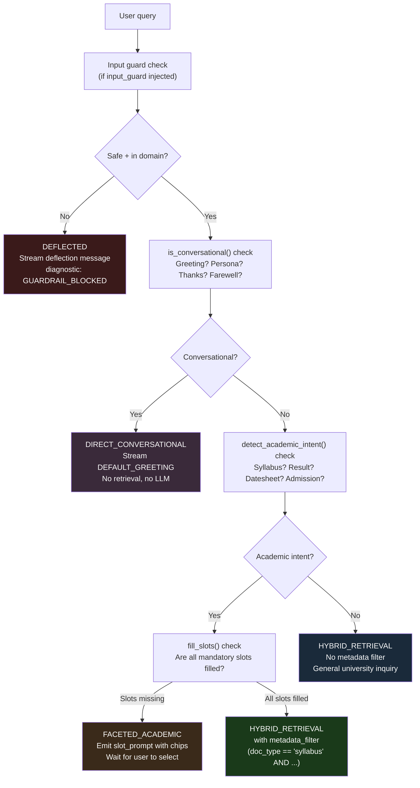
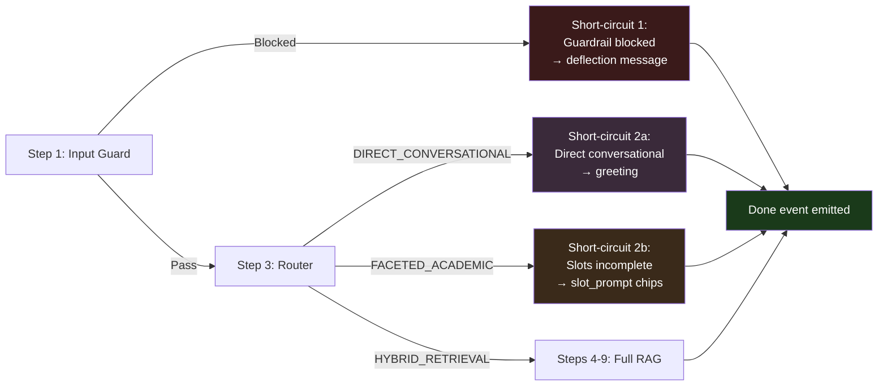
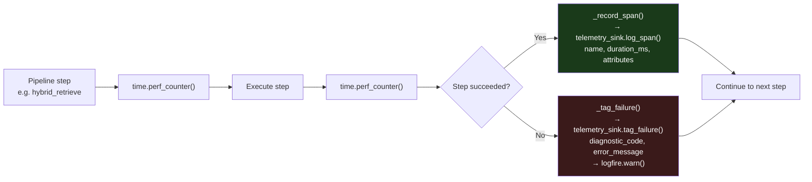
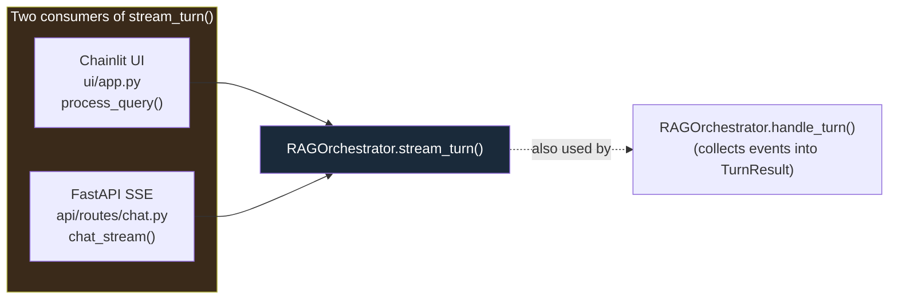

# Request Pipeline Overview

> **The runtime flow that processes a user query from message to streamed response.** The `RAGOrchestrator` is the hub.
>
> Related: [Guardrails](./guardrails.md) · [Routing + Slots](./routing-slots.md) · [Retrieval](./retrieval-rerank.md) · [LLM Failover](./llm-failover.md) · [Session](./session.md)

---

## 1. Purpose

When a user sends a message (via Chainlit UI or FastAPI endpoint), the `RAGOrchestrator.stream_turn()` method executes a 9-step pipeline. Each step is wrapped in telemetry spans and failure attribution. The pipeline can short-circuit at any step (guardrail rejection, missing slots, retrieval empty) and still return a valid response.

---

## 2. The 9-Step Lifecycle

```mermaid
flowchart TD
    ENTRY["User message arrives<br/>via UI or API"]
    STEP1["Step 1: Input Guardrail<br/>InputGuard.validate()<br/>Domain check + safety scan"]
    S1_RESULT{"Safe + in domain?"}
    DEFLECT["Short-circuit:<br/>Stream deflection message<br/>Emit done event"]

    STEP2["Step 2: Session Memory<br/>get_or_create_session()<br/>get_recent_turns (4 turns)<br/>Persist user message"]
    STEP3["Step 3: Intent Routing + Slot Fill<br/>AdaptiveRouter.route()<br/>→ 4 possible destinations"]
    S3_RESULT{"Route destination?"}
    S3_CONV["DIRECT_CONVERSATIONAL<br/>Stream greeting<br/>Persist + emit done"]
    S3_FACETED["FACETED_ACADEMIC<br/>Slots incomplete?<br/>Emit slot_prompt + chips"]
    S3_FILTER["HYBRID_RETRIEVAL<br/>All slots filled<br/>metadata_filter ready"]

    STEP4["Step 4: Hybrid Retrieval<br/>HybridRetrievalCoordinator.retrieve()<br/>LanceDB vector + BM25 + RRF"]
    S4_RESULT{"Chunks found?"}
    S4_EMPTY["Tag: RETRIEVAL_EMPTY<br/>Continue with empty context<br/>LLM gets fallback prompt"]

    STEP5["Step 5: LLM Generation<br/>LLMProviderPool.generate_answer()<br/>Gemini primary → Groq failover"]
    S5_RESULT{"Generation succeeded?"}
    S5_FAIL["Tag: LLM_EXTRACTION_FAILURE<br/>Fallback text generated<br/>Continue with fallback"]

    STEP6["Step 6: Citation Verification<br/>VerbatimCitationVerifier.verify()<br/>Check snippets exist in chunks"]
    S6_RESULT{"Citations grounded?"}
    S6_REDACT["Tag: LLM_HALLUCINATION<br/>Redact unverified claims<br/>Replace with [UNVERIFIED CLAIM REDACTED]"]

    STEP7["Step 7: Output Guardrail<br/>StudentPIIScrubber.scrub()<br/>+ safety rail scan"]
    S7_RESULT{"Output safe?"}
    S7_UNSAFE["Tag: OUTPUT_SAFETY_VIOLATION<br/>Replace with redaction message"]

    STEP8["Step 8: Build Citation Cards<br/>_build_citation_cards()<br/>From retrieved chunks"]
    STEP9["Step 9: Stream + Persist<br/>Stream tokens to client<br/>Emit citation_card events<br/>Emit done event<br/>Persist assistant message to SQLite"]

    ENTRY --> STEP1 --> S1_RESULT
    S1_RESULT -->|"No"| DEFLECT
    S1_RESULT -->|"Yes"| STEP2 --> STEP3 --> S3_RESULT
    S3_RESULT -->|"DEFLECTED"| DEFLECT
    S3_RESULT -->|"DIRECT_CONVERSATIONAL"| S3_CONV
    S3_RESULT -->|"FACETED_ACADEMIC<br/>(slots incomplete)"| S3_FACETED
    S3_RESULT -->|"HYBRID_RETRIEVAL<br/>(slots complete or general)"| S3_FILTER
    S3_FILTER --> STEP4
    STEP4 --> S4_RESULT
    S4_RESULT -->|"Yes"| STEP5
    S4_RESULT -->|"No"| S4_EMPTY --> STEP5
    STEP5 --> S5_RESULT
    S5_RESULT -->|"Yes"| STEP6
    S5_RESULT -->|"No"| S5_FAIL --> STEP6
    STEP6 --> S6_RESULT
    S6_RESULT -->|"Yes"| STEP7
    S6_RESULT -->|"No"| S6_REDACT --> STEP7
    STEP7 --> S7_RESULT
    S7_RESULT -->|"Yes"| STEP8
    S7_RESULT -->|"No"| S7_UNSAFE --> STEP8
    STEP8 --> STEP9

    style DEFLECT fill:#3a1a1a,color:#fff
    style S3_CONV fill:#3a2a3a,color:#fff
    style S3_FACETED fill:#3a2a1a,color:#fff
    style S4_EMPTY fill:#3a1a1a,color:#fff
    style S5_FAIL fill:#3a1a1a,color:#fff
    style S6_REDACT fill:#3a1a1a,color:#fff
    style S7_UNSAFE fill:#3a1a1a,color:#fff
    style STEP9 fill:#1a3a1a,color:#fff
```



---

## 3. Event Types

The orchestrator emits events as an async iterator. Each event is a dict with a `type` key:

| Event type | Fields | When emitted | Consumer action |
|-----------|--------|--------------|-----------------|
| `token` | `token`, `text` | During generation streaming | Append token to UI message |
| `slot_prompt` | `target_slot`, `prompt`, `options`, `is_multi_select` | When slots are missing | Display interactive chips |
| `citation_card` | `citation_id`, `doc_id`, `title`, `source_url`, `page_number`, `quoted_snippet`, `is_table`, `table_markdown` | After generation | Display side-panel card |
| `done` | `citations`, `trace_id`, `session_id`, `diagnostic_code` (optional) | End of turn | Finalize message, attach feedback buttons |
| `error` | `message`, `trace_id` | On pipeline failure | Display error message |

### Event sequence example

```
User: "What is the syllabus of DBMS?"

Events:
  slot_prompt    {target_slot: "batch_year", prompt: "Which batch?", options: [...]}
  token          "Which batch?"
  token          " "
  done           {citations: [], trace_id: "...", session_id: "..."}

User clicks "2024" chip:

Events:
  slot_prompt    {target_slot: "semester", prompt: "Which semester?", options: [...]}
  token          "Which semester?"
  done           {citations: [], trace_id: "...", session_id: "..."}

User clicks "Semester 4":

Events:
  token          "The syllabus for Database Management Systems..."
  token          "in Semester 4 of B.Tech CSE includes..."
  token          "..."
  citation_card  {doc_id: "...", title: "B.Tech CSE Syllabus 2022", source_url: "...", page_number: 5, ...}
  citation_card  {doc_id: "...", title: "Course Outlines", source_url: "...", page_number: 12, ...}
  done           {citations: [...], trace_id: "...", session_id: "..."}
```

---

## 4. Routing Destinations

The `AdaptiveRouter.route()` method classifies every query into one of four destinations:



| Destination | What happens | Retrieval? | LLM? | Citations? |
|-------------|-------------|-----------|------|-----------|
| `DEFLECTED` | Stream deflection message | No | No | No |
| `DIRECT_CONVERSATIONAL` | Stream greeting | No | No | No |
| `FACETED_ACADEMIC` | Emit slot_prompt chips | No | No | No |
| `HYBRID_RETRIEVAL` | Full pipeline (steps 4-9) | Yes | Yes | Yes |

---

## 5. Short-Circuit Points

The pipeline can exit early at three points without executing downstream steps:



Each short-circuit still:
- Emits a `done` event with `trace_id` and `session_id`
- Persists the assistant message to SQLite (if session_store is available)
- Tags any failure with a `FailureDiagnosticCode`

---

## 6. Telemetry and Failure Attribution

Every step is wrapped in `_record_span()` (timing) and `_tag_failure()` (diagnostic codes):



### Diagnostic codes used by the orchestrator

| Code | Step | Condition |
|------|------|-----------|
| `GUARDRAIL_BLOCKED` | Step 1 or Step 3 | Query rejected by input guard or router deflection |
| `RETRIEVAL_EMPTY` | Step 4 | Zero chunks returned after hybrid search |
| `LLM_EXTRACTION_FAILURE` | Step 5 | LLM generation raised an exception |
| `LLM_HALLUCINATION` | Step 6 | Citation verifier found ungrounded snippets |
| `OUTPUT_SAFETY_VIOLATION` | Step 7 | Output safety rail triggered |

---

## 7. Context Window for LLM

The orchestrator builds the LLM context from two sources:

1. **Retrieved chunks** — From Step 4. Each `ScoredChunk` is converted to a dict with `chunk_id`, `doc_id`, `text_content`, `heading_path`, and `metadata`.

2. **Chat history** — From Step 2. `SessionStore.get_recent_turns(session_id, limit_turns=4)` returns the last 4 turns (up to 8 messages). Only `user` and `assistant` roles are included.

```python
chat_history = [
    {"role": "user", "content": "What is the syllabus of DBMS?"},
    {"role": "assistant", "content": "Which batch year?"},
    {"role": "user", "content": "2024"},
    {"role": "assistant", "content": "Which semester?"},
]
```

---

## 8. Entry Points



Both the Chainlit UI and the FastAPI SSE endpoint call `stream_turn()` and consume the async iterator. `handle_turn()` is a convenience wrapper that collects all events into a structured `TurnResult` (used by non-streaming REST endpoints).

---

## 9. Key Files

| File | Responsibility |
|------|---------------|
| `pipeline/orchestrator.py` | `RAGOrchestrator` — the 9-step pipeline hub |
| `core/factory.py` | `create_rag_orchestrator()` — wires all components |
| `agent/router.py` | `AdaptiveRouter` — intent routing + slot dispatch |
| `agent/slot_filler.py` | `FacetedSlotFiller` — slot extraction + chip generation |
| `guardrails/subsystems/input_guard.py` | `InputGuard` — domain + safety check |
| `guardrails/subsystems/output_guard.py` | `OutputGuard` — PII scrub + safety |
| `guardrails/subsystems/citation_verifier.py` | `VerbatimCitationVerifier` — grounding check |
| `retrieval/subsystems/coordinator.py` | `HybridRetrievalCoordinator` — hybrid search |
| `retrieval/subsystems/flashrank_reranker.py` | `FlashRankReranker` — cross-encoder reranking |
| `llm/pool.py` | `LLMProviderPool` — circuit breaker failover |
| `agent/session_store.py` | `SQLiteSessionStore` — conversation memory |
| `core/protocols/telemetry.py` | `TelemetrySinkProtocol` — spans + failures |
