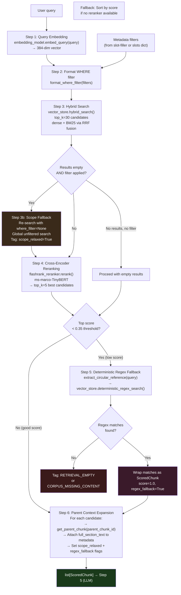
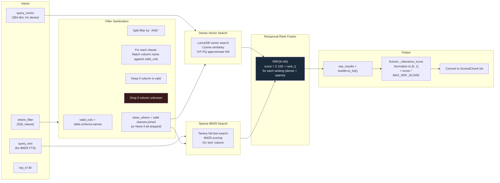
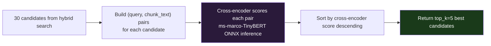
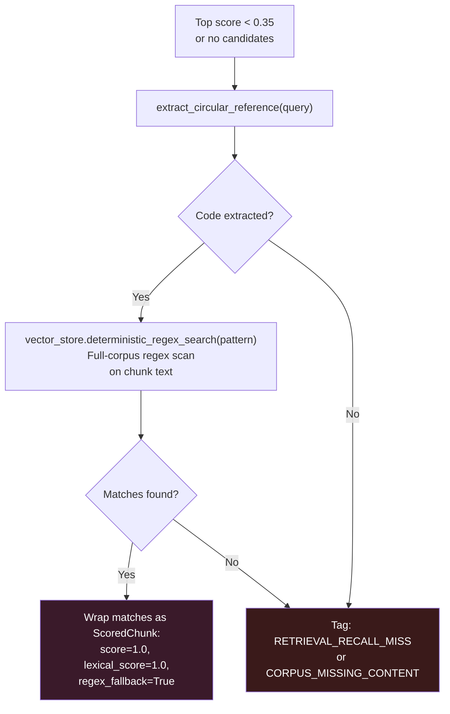
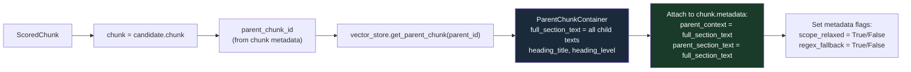

# Retrieval + Reranking

> **Hybrid vector + BM25 search with cross-encoder reranking, scope fallback, and deterministic regex recovery.**
>
> Related: [Pipeline Overview](./overview.md) · [Chunk + Index](../ingestion/chunk-index.md)

---

## 1. Purpose

The `HybridRetrievalCoordinator.retrieve()` method is Step 4 of the request pipeline. It embeds the query, searches LanceDB with hybrid dense + sparse (BM25) fusion, reranks with a cross-encoder, and falls back gracefully when results are sparse or missing.

---

## 2. Retrieval Lifecycle



---

## 3. Hybrid Search (LanceDB)

The `LanceDBStore.hybrid_search()` method fuses dense vector similarity and sparse BM25 lexical search using Reciprocal Rank Fusion (RRF):



### Where filter sanitization

The sanitizer checks each clause's column name against the actual LanceDB table schema. Clauses referencing unknown columns are silently dropped. This is the mechanism that causes the [metadata filter column mismatch](./routing-slots.md#91-metadata-filter-column-mismatch-critical) — `program`, `batch_year`, `semester` are not top-level columns, so their clauses are stripped.

### RRF scoring

RRF (Reciprocal Rank Fusion) combines dense and sparse rankings:

```
RRF_score = Σ 1 / (K + rank_i)

where K = 60 (constant)
      rank_i = position in ranking i (1-indexed)
```

With 2 rankings (dense + sparse), max theoretical score = `2 / (60 + 1) ≈ 0.0328`. This is normalized to `[0, 1]` by dividing by `MAX_RRF_SCORE`.

### Fallback paths

| Condition | Fallback |
|-----------|----------|
| Hybrid search raises exception | Dense vector-only search (no BM25) |
| Dense-only search also fails | Empty results |
| FTS-only (no vector available) | Text search with where filter |

---

## 4. Cross-Encoder Reranking

The `FlashRankReranker` uses ms-marco-TinyBERT-L-2-v2 (ONNX, ~3ms per query) to rescore candidates:



If no reranker is configured, candidates are sorted by their RRF score and truncated to `top_k`.

---

## 5. Deterministic Regex Fallback

When the top candidate score is below the relevance threshold (0.35), the coordinator extracts a reference code from the query and performs a full-corpus regex scan:



### Reference extraction patterns

The `extract_circular_reference()` function checks in order:

1. **Circular/notice keyword** — `circular no. CUK/Acad/2023/123`, `notification # 102`
2. **Multi-segment alphanumeric** — `CUK/Acad/2023/102`, `CUKmr/Acad/2023/45` (must have letters + digits, or ≥2 slashes/dashes)
3. **Course code** — `BT-101`, `CS204` (2-4 letters + 3-4 digits)

Dates (e.g. `15-11-2024`) are excluded.

---

## 6. Parent Context Expansion

For each retrieved candidate, the coordinator expands its parent section for richer LLM context:



This gives the LLM the full section text (all paragraphs under the heading) in addition to the specific chunk that was retrieved.

---

## 7. ScoredChunk Model

```python
class ScoredChunk(BaseModel):
    chunk: ChunkRecord | dict       # The actual chunk (with enriched metadata)
    score: float                    # Normalized relevance score [0, 1]
    dense_score: float              # Dense vector similarity score
    lexical_score: float            # BM25 lexical score
    rrf_rank: int                   # Rank in RRF fusion
    scope_relaxed: bool             # True if filter was dropped
    regex_fallback: bool            # True if regex scan was used
    chunk_id: str                   # Convenience accessor
    text_content: str               # Convenience accessor
    metadata: dict                  # Convenience accessor
```

---

## 8. Key Files

| File | Responsibility |
|------|---------------|
| `retrieval/subsystems/coordinator.py` | `HybridRetrievalCoordinator` — search lifecycle |
| `retrieval/subsystems/lancedb_store.py` | `LanceDBStore` — Arrow columnar store + hybrid search |
| `retrieval/subsystems/flashrank_reranker.py` | `FlashRankReranker` — cross-encoder reranking |
| `core/protocols/storage.py` | `VectorStoreProtocol`, `EmbeddingModelProtocol` |
| `core/protocols/reranker.py` | `RerankerProtocol` |
| `schemas/retrieval.py` | `ScoredChunk` |
