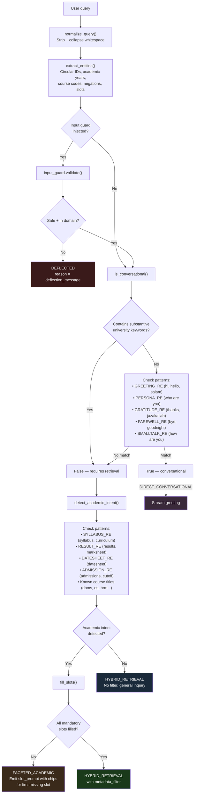
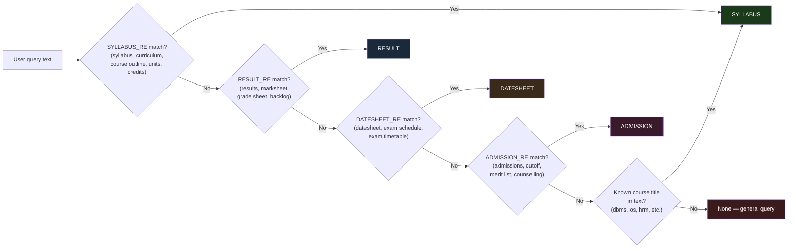
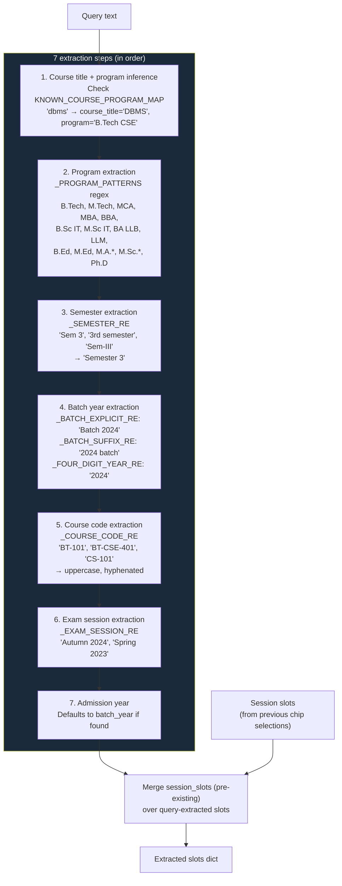
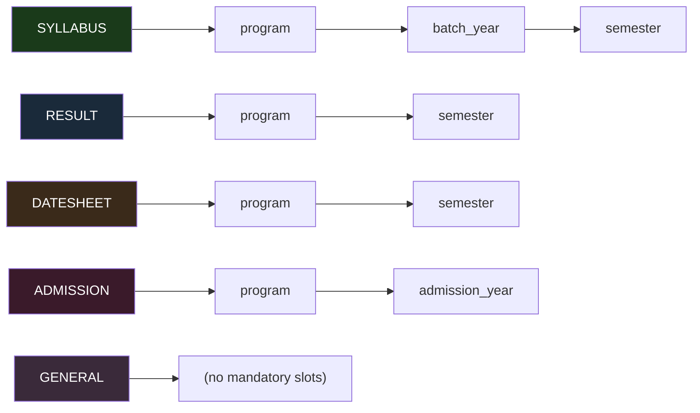
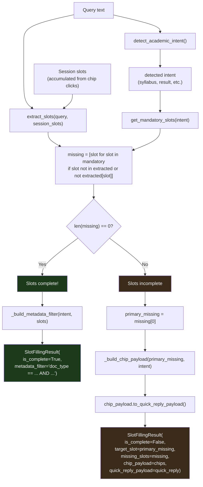
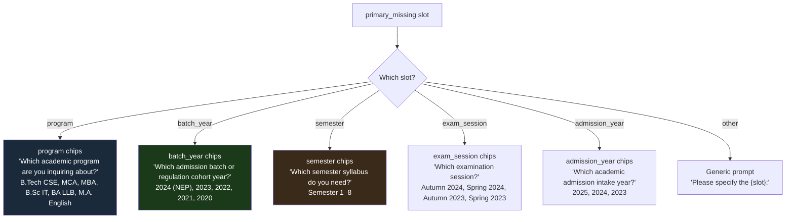
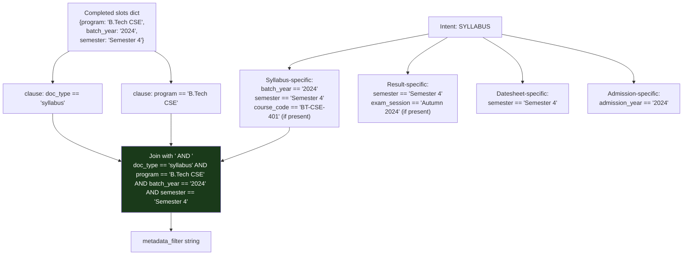
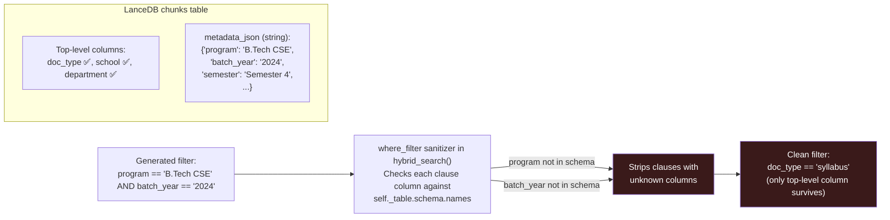

# Routing + Slot Filling

> **Intent detection, entity extraction, and faceted disambiguation.** The `AdaptiveRouter` classifies queries and the `FacetedSlotFiller` extracts mandatory slots, generating interactive chips when slots are missing.
>
> Related: [Pipeline Overview](./overview.md) · [Guardrails](./guardrails.md) · [UI Interaction](../api-ui/ui.md)

---

## 1. Purpose

When a user asks "What is the syllabus of DBMS?", the router needs to:
1. Detect this is a syllabus intent
2. Infer DBMS → B.Tech CSE (program), but batch_year and semester are missing
3. Ask the user to select batch_year via chips, then semester via chips
4. Once all slots are filled, build a metadata filter for LanceDB retrieval

---

## 2. Routing Decision Tree



---

## 3. Intent Detection

The `detect_academic_intent()` method uses regex patterns to classify queries:



> **Note:** If a known course title (like "dbms") is found even without the word "syllabus", the intent defaults to `SYLLABUS`. This handles queries like "What is DBMS?" by inferring syllabus intent.

---

## 4. Slot Extraction

The `extract_slots()` method extracts academic slots from query text and merges with session slots:



### Course-to-program knowledge base

The `KNOWN_COURSE_PROGRAM_MAP` maps well-known course abbreviations to canonical titles and programs:

| Query contains | course_title | program |
|----------------|-------------|---------|
| `dbms`, `database management systems` | Database Management Systems | B.Tech CSE |
| `dsa`, `data structures` | Data Structures & Algorithms | B.Tech CSE |
| `os`, `operating systems` | Operating Systems | B.Tech CSE |
| `coa`, `computer organization` | Computer Organization & Architecture | B.Tech CSE |
| `toc`, `theory of computation` | Theory of Computation | B.Tech CSE |
| `corporate law`, `constitutional law` | (respective) | BA LLB |
| `financial accounting`, `marketing management` | (respective) | MBA |
| `hrm`, `human resource management` | Human Resource Management | MBA |
| `quantum mechanics`, `classical mechanics` | (respective) | M.Sc Physics |
| `organic chemistry` | Organic Chemistry | M.Sc Chemistry |

---

## 5. Mandatory Slots per Intent



| Intent | Mandatory slots | Optional slots |
|--------|----------------|----------------|
| SYLLABUS | `program`, `batch_year`, `semester` | `course_code`, `course_title`, `credits` |
| RESULT | `program`, `semester` | `exam_session` |
| DATESHEET | `program`, `semester` | — |
| ADMISSION | `program`, `admission_year` | `stage`, `intake_capacity` |
| GENERAL | (none) | — |

---

## 6. Slot Filling Flow



---

## 7. Chip Payload Generation

When slots are missing, the slot-filler builds interactive chips for the **first** missing slot:



### Chip payload format

```json
{
  "type": "slot_prompt",
  "target_slot": "batch_year",
  "prompt": "Which admission batch or regulation cohort year?",
  "options": [
    {"label": "2024 (NEP)", "value": "2024", "description": null},
    {"label": "2023", "value": "2023", "description": null},
    {"label": "2022", "value": "2022", "description": null},
    {"label": "2021", "value": "2021", "description": null},
    {"label": "2020", "value": "2020", "description": null}
  ],
  "is_multi_select": false
}
```

---

## 8. Metadata Filter Construction

When all mandatory slots are filled, `_build_metadata_filter()` generates a LanceDB SQL WHERE clause:



### Filter examples by intent

| Intent | Filter clause |
|--------|-------------|
| Syllabus | `doc_type == 'syllabus' AND program == 'B.Tech CSE' AND batch_year == '2024' AND semester == 'Semester 4'` |
| Result | `doc_type == 'result' AND program == 'B.Tech CSE' AND semester == 'Semester 4'` |
| Datesheet | `doc_type == 'datesheet' AND program == 'B.Tech CSE' AND semester == 'Semester 4'` |
| Admission | `doc_type == 'admission' AND program == 'B.Tech CSE' AND admission_year == '2024'` |

---

## 9. Known Issues

### 9.1 Metadata filter column mismatch (CRITICAL)

The slot-filler builds filters against `program`, `batch_year`, `semester`, `course_code`, `exam_session`, `admission_year` as if they were top-level LanceDB columns. They are **not** — these fields live inside `metadata_json` (a JSON string column).



**Impact:** Filters silently fail. The retrieval returns all chunks matching `doc_type == 'syllabus'` regardless of program/batch/semester. The user gets results from wrong batches and programs.

**Fix:** Add `program`, `batch_year`, `semester`, `course_code`, `exam_session`, `admission_year` as nullable top-level columns in `CHUNKS_ARROW_SCHEMA`, and extract them from metadata during `_chunk_record_to_row()`. This requires re-indexing.

### 9.2 Slot selection does nothing (UI bug)

When a user clicks a chip (e.g. "2024" for batch_year), the Chainlit `on_slot_selected` callback updates `active_slots` and calls `process_query()` again. However, the orchestrator's `route()` method re-evaluates from scratch — it checks the input guard, runs conversational detection, and then calls `fill_slots()` with the accumulated session slots.

The flow works correctly if session slots are properly passed through. The bug is in the UI layer where `last_query` may not be preserved correctly between chip clicks. See [ui.md](../api-ui/ui.md) for details.

### 9.3 Obvious slots still asked (missing feature)

The system asks for `program` even when the course title implies it. For example:
- "What is the syllabus of DBMS?" → DBMS is a B.Tech CSE course (known from `KNOWN_COURSE_PROGRAM_MAP`), so `program` is inferred as "B.Tech CSE". But `batch_year` and `semester` are still asked.
- However, the department is also obvious (CSE → Department of Computer Science & Engineering). The system has no logic to skip department selection since department is not a mandatory slot (it's inferred from program).

The current design correctly infers program from course title, but does not infer:
- `department` from `program` (e.g. B.Tech CSE → Department of CSE)
- `semester` from `course_code` (e.g. BT-CSE-401 → Semester 4, based on the "4" in the code)
- `batch_year` from `academic_year` in document metadata

These inferences would reduce the number of chip prompts the user sees.

---

## 10. Complete Turn Example

```
User: "What is the syllabus of DBMS?"

Step 1: detect_academic_intent("What is the syllabus of DBMS?")
  → "syllabus" keyword matches SYLLABUS_RE
  → intent = SYLLABUS

Step 2: extract_slots("What is the syllabus of DBMS?", session_slots={})
  → "dbms" found in KNOWN_COURSE_PROGRAM_MAP
  → course_title = "Database Management Systems", program = "B.Tech CSE"
  → No semester, batch_year, or course_code found

Step 3: get_mandatory_slots(SYLLABUS)
  → ["program", "batch_year", "semester"]

Step 4: missing = ["batch_year", "semester"]
  (program was inferred from course title)

Step 5: primary_missing = "batch_year"
  → Build chip payload with batch year options

Step 6: Router returns FACETED_ACADEMIC with slot_prompt event
  → UI displays chips: [2024 (NEP), 2023, 2022, 2021, 2020]

--- User clicks "2024" ---

Step 7: extract_slots("What is the syllabus of DBMS?", session_slots={batch_year: "2024"})
  → program = "B.Tech CSE" (from course map)
  → batch_year = "2024" (from session slots)
  → No semester found

Step 8: missing = ["semester"]
  → primary_missing = "semester"
  → Build chip payload with semester options

Step 9: Router returns FACETED_ACADEMIC with slot_prompt event
  → UI displays chips: [Semester 1-8]

--- User clicks "Semester 4" ---

Step 10: extract_slots("What is the syllabus of DBMS?",
           session_slots={batch_year: "2024", semester: "Semester 4"})
  → program = "B.Tech CSE"
  → batch_year = "2024"
  → semester = "Semester 4"

Step 11: missing = []
  → All slots complete!

Step 12: _build_metadata_filter(SYLLABUS, slots)
  → "doc_type == 'syllabus' AND program == 'B.Tech CSE' AND batch_year == '2024' AND semester == 'Semester 4'"

Step 13: Router returns HYBRID_RETRIEVAL with metadata_filter
  → Proceed to Step 4 (retrieval)
  → ⚠️ Filter will be silently stripped (see issue 9.1)
```

---

## 11. Key Files

| File | Responsibility |
|------|---------------|
| `agent/router.py` | `AdaptiveRouter` — routing decision engine |
| `agent/slot_filler.py` | `FacetedSlotFiller` — slot extraction + chip generation |
| `schemas/chunks.py` | `ChunkRecord` — chunk data model |
| `retrieval/subsystems/lancedb_store.py` | `LanceDBStore.hybrid_search` — where filter sanitizer |
