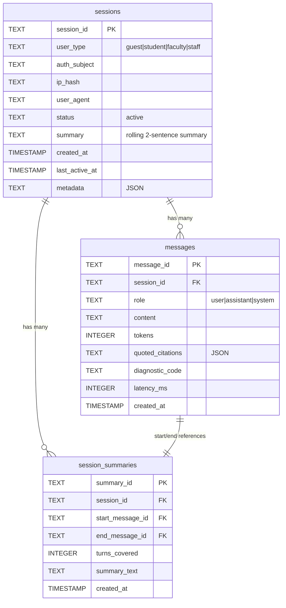
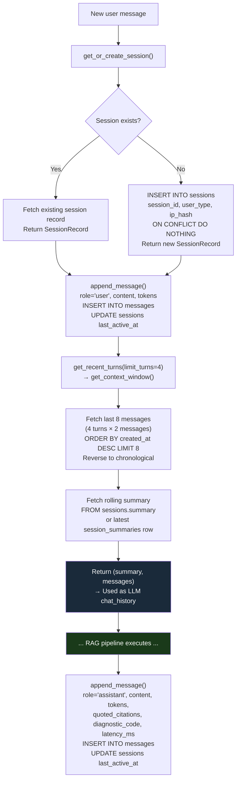
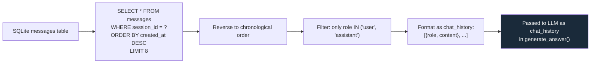
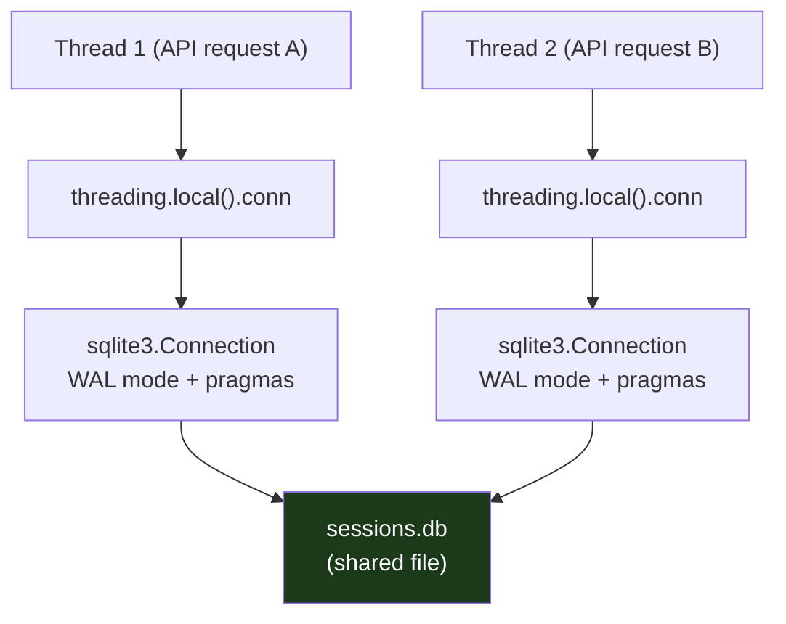
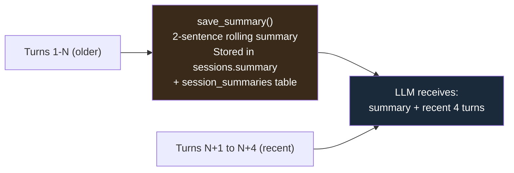

# Session Memory

> **SQLite WAL conversation store with rolling context window and summary management.**
>
> Related: [Pipeline Overview](./overview.md)

---

## 1. Purpose

The `SQLiteSessionStore` persists every user and assistant message, maintains a rolling context window for LLM prompts, and supports conversation summaries for long-running sessions. It runs in WAL (Write-Ahead Logging) mode for high concurrency.

---

## 2. Database Schema



### SQLite pragmas

| Pragma | Value | Purpose |
|--------|-------|---------|
| `journal_mode` | `WAL` | Write-Ahead Logging for concurrent reads + writes |
| `busy_timeout` | `5000ms` | Wait up to 5s on lock contention |
| `synchronous` | `NORMAL` | Balance durability and speed (safe with WAL) |
| `foreign_keys` | `ON` | Enforce cascade delete on session removal |

### Indexes

| Index | Table | Columns | Purpose |
|-------|-------|---------|---------|
| `idx_sessions_last_active` | sessions | `last_active_at DESC` | Recent session lookup |
| `idx_sessions_ip_hash` | sessions | `ip_hash, created_at DESC` | IP-based rate limit queries |
| `idx_messages_session_time` | messages | `session_id, created_at ASC` | Chronological message retrieval |
| `idx_summaries_session_recent` | session_summaries | `session_id, created_at DESC` | Latest summary lookup |

---

## 3. Session Lifecycle



---

## 4. Context Window

The orchestrator calls `get_recent_turns(session_id, limit_turns=4)` to build the LLM's chat history:



### Example chat history

```python
# After user selects batch_year chip:
[
    {"role": "user", "content": "What is the syllabus of DBMS?"},
    {"role": "assistant", "content": "Which admission batch or regulation cohort year?"},
    {"role": "user", "content": "2024"},
    {"role": "assistant", "content": "Which semester syllabus do you need?"},
]
```

The LLM receives this context along with the retrieved chunks, allowing it to understand multi-turn conversations where slots are filled incrementally.

---

## 5. Thread-Local Connections

Each thread gets its own SQLite connection (via `threading.local`):



This avoids SQLite's threading limitations while allowing concurrent reads (WAL mode) and serialized writes.

---

## 6. Summary Management

Long conversations use a rolling summary to compress older turns:



The `get_context_window()` method returns a tuple of `(summary_string, list[MessageRecord])`. The summary compresses turns outside the 4-turn window, while recent turns are passed verbatim.

---

## 7. MessageRecord Fields

```python
class MessageRecord(BaseModel):
    message_id: str                    # Unique message ID (msg_XXXXXXXX)
    session_id: str                     # Session this message belongs to
    role: str                           # "user" | "assistant" | "system"
    content: str                        # Message text
    tokens: int                          # Token count (word count approximation)
    quoted_citations: list[dict]         # Citation cards (assistant only)
    diagnostic_code: str | None         # Failure diagnostic (if any)
    latency_ms: int | None              # Total turn latency (assistant only)
    created_at: datetime                # UTC timestamp
```

### What gets persisted per turn

| Role | Persisted fields |
|------|-----------------|
| user | `message_id`, `session_id`, `role="user"`, `content`, `tokens` |
| assistant | All fields including `quoted_citations`, `diagnostic_code`, `latency_ms` |

---

## 8. Key Files

| File | Responsibility |
|------|---------------|
| `agent/session_store.py` | `SQLiteSessionStore` — WAL mode, thread-local connections |
| `core/protocols/session.py` | `SessionStoreProtocol`, `MessageRecord`, `SessionRecord` |
| `core/factory.py` | `create_session_store()` — instantiates with env config |
